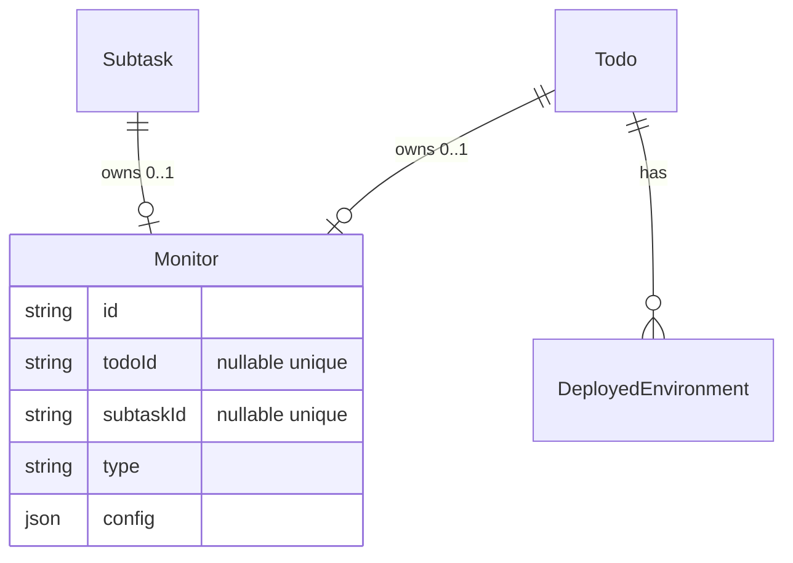
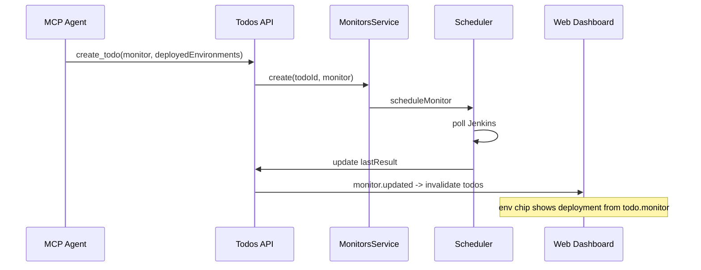

# Todo-Level Deployment Monitor - Plan

## Goal Capsule

- **Objective:** Allow a deployment monitor to be attached directly to a todo (alongside `deployedEnvironments`), without requiring a deploy subtask.
- **Authority:** This plan; extends the Jenkins deployment monitor work in `docs/plans/2026-07-20-001-feat-jenkins-deploy-monitor-plan.md`.
- **Stop conditions:** Block only if schema migration cannot enforce exactly-one owner (todo XOR subtask) per monitor.
- **Execution profile:** Schema and shared types first, then backend services, MCP, enrichment, tests.
- **Tail ownership:** Implementer runs verification contract before marking done.

---

## Product Contract

### Summary

Extend the monitor model so a todo can own one monitor (same types as subtasks, primary use case: Jenkins `deployment`). API, MCP, scheduler, and environment-chip enrichment treat todo monitors as first-class peers of subtask monitors.

### Problem Frame

Todos already support `deployedEnvironments` and show live deployment status on chips when subtask monitors exist. Operators must create a synthetic deploy subtask only to attach a monitor. That mismatch adds friction for MCP agents and humans when deployment is a todo-level concern.

### Requirements

#### Data model

- R1. A `Monitor` is owned by exactly one entity: a todo **or** a subtask, never both, never neither.
- R2. At most one monitor per todo (mirrors the one-monitor-per-subtask rule).
- R3. Existing subtask monitors remain unchanged in behavior.

#### API and services

- R4. `TodoDto` exposes optional `monitor?: MonitorDto | null`.
- R5. `CreateTodoDto` and `UpdateTodoDto` accept optional `monitor` (same shape as subtask monitor DTOs).
- R6. `POST /todos/:todoId/monitors` and reuse of `PATCH /monitors/:id` support todo-owned monitors (mirror subtask monitor endpoints).
- R7. Creating or updating a todo with `monitor` in the body delegates to the same monitor validation and scheduling path as subtasks.
- R8. `MonitorDto` carries `todoId` and `subtaskId` as nullable fields; exactly one is set.

#### Scheduler and real-time

- R9. Scheduler executes todo-owned monitors on the same cron/BullMQ path as subtask monitors.
- R10. On monitor result, todo-owned deployment monitors enrich `deployedEnvironments[].deployment` on the todo; they do **not** auto-mutate `TodoStatus` (no `FAILED` status exists on todos).
- R11. `monitor.created` / `monitor.updated` / `monitor.deleted` WebSocket events include enough context for clients to refetch todos (existing invalidate-on-monitor pattern continues to work).

#### Enrichment

- R12. Todo-level `deployedEnvironments` enrichment considers the todo's own monitor plus all subtask monitors; when multiple monitors target the same env, the monitor with the latest `lastRunAt` wins.

#### MCP

- R13. `create_todo` and `update_todo` accept optional `monitor` with deployment config documented (same Jenkins shape as subtasks).
- R14. Agent can set up deployment monitoring on a todo in one MCP call without creating a subtask.

#### Scope

- R15. Primary product path is `type: deployment`; all monitor types remain attachable to todos for registry extensibility (same as subtasks).

### Acceptance Examples

- AE1. **Create todo with deployment monitor**
  - **Given:** Jenkins build URL and env `dev`.
  - **When:** MCP `create_todo` with `deployedEnvironments: ["dev"]` and a `deployment` monitor.
  - **Then:** Response includes `todo.monitor` and `deployedEnvironments[0].deployment` after the first poll.

- AE2. **Update existing todo to add monitor**
  - **Given:** A todo with `deployedEnvironments: ["uat"]` and no monitor.
  - **When:** `update_todo` adds a `deployment` monitor for `uat`.
  - **Then:** Monitor is scheduled; subsequent `list_todos` shows monitor on the todo.

- AE3. **Todo and subtask monitors on same env**
  - **Given:** Todo monitor and subtask monitor both target `dev`, subtask monitor ran more recently.
  - **When:** `GET /todos/:id`.
  - **Then:** Todo-level `dev` chip shows deployment info from the subtask monitor (latest `lastRunAt`).

### Scope Boundaries

**In scope:** Prisma migration, shared types, `MonitorsService`, `TodosService`, scheduler, enrichment, MCP schemas, integration tests.

**Deferred to Follow-Up Work:**

- Todo-level UI panel showing raw monitor config (chips already show deployment status).
- Auto-updating `TodoStatus` from monitor results.
- Multiple monitors per todo (one per env) — would need a new cardinality model.

**Out of scope:** Changing Jenkins provider behavior; subtask monitor removal.

---

## Planning Contract

### Key Technical Decisions

| ID | Decision | Rationale |
|---|---|---|
| KTD-1 | Add optional `todoId` on `Monitor`; make `subtaskId` optional | Minimal schema change; reuses existing monitor table and scheduler. |
| KTD-2 | DB check: XOR owner (`(todoId IS NULL) != (subtaskId IS NULL)`) | Enforces R1 at persistence layer. |
| KTD-3 | Unique `todoId` on `Monitor` (when not null) | Enforces one monitor per todo (R2). |
| KTD-4 | No `TodoStatus` sync from monitor results | `TodoStatus` has no `FAILED`; deployment monitoring is informational on env chips. Subtask status sync unchanged. |
| KTD-5 | `MonitorsService.createForTodo` / `updateForTodo` mirror subtask methods | Same validation, cron, and scheduler wiring as `subtasks.service.ts`. |
| KTD-6 | Enrichment merges todo monitor + subtask monitors with `lastRunAt` tie-break | R12; extends `enrichTodoDeployedEnvironments` in `deployment-enrichment.ts`. |
| KTD-7 | `MonitorDto.subtaskId` and `todoId` both nullable in API | Clients distinguish owner; MCP agents attach to todo without fake subtask. |

### High-Level Technical Design

### Assumptions

- One deployment monitor per todo is sufficient for v1 (one env per monitor config; multiple envs still use multiple todos or subtasks).
- Todo monitor uses the same `DeploymentMonitorConfig` as subtask monitors.
- `JENKINS_AUTH` remains server-wide on the backend container.

### Sequencing

1. Schema + shared types (U1)
2. MonitorsService todo ownership (U2)
3. Todos API + DTO wiring (U3)
4. Scheduler + enrichment (U4)
5. MCP + tests (U5)

---

## Implementation Units

### U1. Schema and shared types for todo-owned monitors

**Goal:** Persist todo-owned monitors and expose them in shared DTOs.

**Requirements:** R1, R2, R4, R8

**Dependencies:** None

**Files:**
- `apps/backend/prisma/schema.prisma`
- `apps/backend/prisma/migrations/<timestamp>_todo_monitor/migration.sql` (generated)
- `packages/shared-types/src/index.ts`

**Approach:**
- Add `todoId String? @unique` to `Monitor`; change `subtaskId` to `String? @unique`.
- Add `todo Todo? @relation(...)` on `Monitor`; add `monitor Monitor?` on `Todo`.
- Add raw SQL check constraint or Prisma-level validation ensuring XOR ownership.
- Update `MonitorDto`: `todoId: string | null`, `subtaskId: string | null`.
- Add `monitor?: CreateMonitorDto` to `CreateTodoDto` / `UpdateTodoDto`.
- Add `monitor?: MonitorDto | null` to `TodoDto`.

**Test scenarios:**
- Test expectation: none — migration + types; covered in U2/U5.

**Verification:** `npm run prisma:generate --workspace=@todo-platform/backend` and `npm run build --workspace=@todo-platform/shared-types` succeed.

---

### U2. MonitorsService todo ownership

**Goal:** Create, update, and delete monitors attached to todos.

**Requirements:** R1, R2, R6, R7

**Dependencies:** U1

**Files:**
- `apps/backend/src/monitors/monitors.service.ts`
- `apps/backend/src/monitors/monitors.controller.ts`
- `apps/backend/src/common/dto.ts`
- `apps/backend/src/common/mappers.ts`

**Approach:**
- Add `createForTodo(todoId, dto)` and ensure todo exists; conflict if todo already has a monitor.
- Add `POST /todos/:todoId/monitors` route (mirror `POST /subtasks/:subtaskId/monitors`).
- Update `toMonitorDto` to map nullable `todoId` / `subtaskId`.
- `remove` and `update` work unchanged (keyed by monitor id).

**Patterns to follow:** `MonitorsService.create(subtaskId, ...)` and `monitors.controller.ts` subtask route.

**Test scenarios:**
- Create monitor for todo -> returns `todoId` set, `subtaskId` null.
- Second create on same todo -> 409 Conflict.
- Create with both todoId and subtaskId in DB rejected by service/DB.

**Verification:** Unit or integration test for `POST /todos/:id/monitors` with deployment config.

---

### U3. TodosService composite monitor on create/update

**Goal:** Attach or update a todo monitor via `POST /todos` and `PATCH /todos/:id`, matching subtask ergonomics.

**Requirements:** R5, R7

**Dependencies:** U2

**Files:**
- `apps/backend/src/todos/todos.service.ts`
- `apps/backend/src/todos/todos.module.ts`
- `apps/backend/src/common/dto.ts` (CreateTodoBody / UpdateTodoBody monitor fields)
- `apps/backend/test/todos.integration-spec.ts`

**Approach:**
- Import `MonitorsModule` into `TodosModule`.
- In `create` / `update`, destructure `monitor` from DTO; after todo persisted, call `monitorsService.createForTodo` or `update` on existing todo monitor (mirror `subtasks.service.ts` monitor branch).
- Include `monitor: true` in `todoInclude` Prisma shape.
- Map via `toTodoDto` with todo's monitor.

**Patterns to follow:** `apps/backend/src/subtasks/subtasks.service.ts` monitor handling.

**Test scenarios:**
- `POST /todos` with `deployment` monitor -> response `monitor.type === 'deployment'`.
- `PATCH /todos/:id` adds monitor when none exists.
- `PATCH /todos/:id` updates existing todo monitor cron/config.

**Verification:** Integration tests pass.

---

### U4. Scheduler and deployment enrichment for todo monitors

**Goal:** Execute todo-owned monitors and enrich todo env chips from the todo's own monitor.

**Requirements:** R9, R10, R11, R12

**Dependencies:** U1, U3

**Files:**
- `apps/backend/src/scheduler/scheduler.service.ts`
- `apps/backend/src/common/deployment-enrichment.ts`
- `apps/backend/src/common/mappers.ts`
- `apps/backend/src/common/deployment-enrichment.spec.ts`

**Approach:**
- In `executeMonitor`, load `todo` relation when `todoId` is set.
- After result persisted: if `subtaskId`, call existing `syncSubtaskStatus`; if `todoId`, broadcast `todo.updated` with full todo DTO (no status mutation per KTD-4).
- Update `enrichTodoDeployedEnvironments` to pass `[todo.monitor, ...subtask monitors]` into `enrichDeployedEnvironments`.
- Ensure `toTodoDto` includes enriched `deployedEnvironments` using merged monitor list.

**Test scenarios:**
- Todo with own deployment monitor -> `deployedEnvironments[0].deployment` populated after lastResult.
- Todo monitor + subtask monitor same env -> newer `lastRunAt` wins.
- Todo-owned monitor run -> `todo.updated` WS event emitted (scheduler broadcast).

**Verification:** `deployment-enrichment.spec.ts` extended; backend unit tests pass.

---

### U5. MCP tools and documentation

**Goal:** Agents can attach deployment monitors on create/update todo.

**Requirements:** R13, R14

**Dependencies:** U3

**Files:**
- `apps/mcp-server/src/index.ts`
- `README.md`

**Approach:**
- Add `monitor` object to `create_todo` and `update_todo` input schemas (same shape as subtask monitor; reuse `deploymentMonitorConfigDescription`).
- Wire handlers to pass `monitor` through `CreateTodoDto` / `UpdateTodoDto`.
- Document todo-level deployment monitor in README MCP section with example prompt.

**Test scenarios:**
- Test expectation: none — schema passthrough; manual MCP smoke.

**Verification:** `npm run build --workspace=@todo-platform/mcp-server`; README example is accurate.

---

## Verification Contract

| Gate | Command | Applies to |
|---|---|---|
| Prisma migrate | `npm run prisma:migrate:dev --workspace=@todo-platform/backend` (dev) / auto on Docker startup | U1 |
| Shared types build | `npm run build --workspace=@todo-platform/shared-types` | U1 |
| Backend unit tests | `npm test --workspace=@todo-platform/backend` | U2, U4 |
| Backend integration tests | `DATABASE_URL=... REDIS_URL=... npm run test:integration --workspace=@todo-platform/backend` | U3 |
| MCP build | `npm run build --workspace=@todo-platform/mcp-server` | U5 |
| Docker smoke | `docker compose up --build -d`; MCP `create_todo` with deployment monitor | U5 |

---

## Definition of Done

- [ ] Todo can own exactly one monitor (DB + API enforced).
- [ ] `create_todo` / `update_todo` (MCP) and REST accept `monitor` on todos.
- [ ] Todo `deployedEnvironments` chips reflect the todo's own deployment monitor.
- [ ] Subtask monitor behavior unchanged.
- [ ] Integration test covers todo with deployment monitor.
- [ ] README documents todo-level deployment monitor for MCP users.

---

## System-Wide Impact

| Surface | Impact |
|---|---|
| PostgreSQL | Migration adds `todoId` to `monitors`; `subtaskId` becomes nullable |
| API clients | `MonitorDto` shape change (`subtaskId` nullable, `todoId` added) |
| MCP agents | Can skip deploy subtask for simple deployments |
| Web UI | Env chips work via existing enrichment + WS invalidate; no new UI required for v1 |
| Scheduler | Must broadcast `todo.updated` for todo-owned monitors |

---

## Risks & Dependencies

| Risk | Mitigation |
|---|---|
| Breaking change to `MonitorDto.subtaskId` (required -> nullable) | Document in README; clients should check `todoId` or `subtaskId` |
| Migration on existing monitors | All existing rows have `subtaskId`; set `todoId` null; no data backfill needed |
| XOR constraint bypass in application code | Enforce in `MonitorsService.create` / `createForTodo` and DB check |

---

## Sources & Research

- Prior plan: `docs/plans/2026-07-20-001-feat-jenkins-deploy-monitor-plan.md`
- Current schema: `apps/backend/prisma/schema.prisma` (`Monitor.subtaskId` required today)
- Subtask monitor pattern: `apps/backend/src/subtasks/subtasks.service.ts`
- Enrichment: `apps/backend/src/common/deployment-enrichment.ts`
