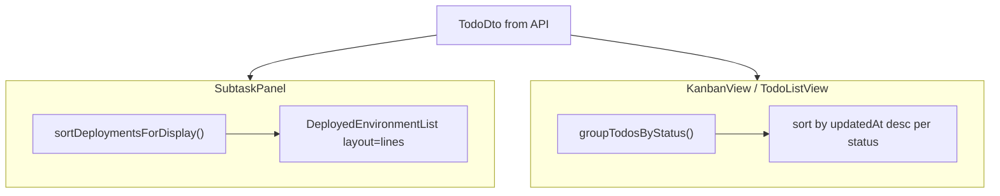

# Deployment Display and Kanban Sort - Plan

## Goal Capsule

- **Objective:** Improve todo UX by showing deployment history as a time-sorted line list in the detail popup, and ordering todos by most recently updated within each status column in kanban and list views.
- **Authority:** This plan; user confirmed list-view sort parity during scoping.
- **Stop conditions:** Block only if `DeploymentInfo.timestamp` is absent on all deployment records and no reliable fallback timestamp exists (research shows `updatedAt` on `DeployedEnvironmentDto` is available as fallback).
- **Execution profile:** Frontend-only changes in `apps/web`; no API or schema work.
- **Tail ownership:** Implementer runs verification contract before marking done.

---

## Product Contract

### Summary

Rename the popup's environment section to **Deployments**, render each deployed environment on its own line sorted newest-first by deployment time, and pin env-only rows (deployed but no Jenkins history) to the bottom. Sort todos within each status group by `updatedAt` descending in both Kanban and list views. Compact env chips on kanban cards stay unchanged.

### Problem Frame

The detail popup labels the section "Environments" and renders horizontal chips sorted by a fixed env-name order. Operators care about recent deployment activity, not env tier order. Kanban and list views also preserve API insertion order within a status, so recently touched todos are hard to spot.

### Requirements

#### Popup deployments

- R1. The todo detail popup (`SubtaskPanel`) section label reads **Deployments**, not Environments.
- R2. Each deployed environment renders on its own line (vertical list, not wrapped chips).
- R3. Rows with deployment history sort by deployment time descending (newest first).
- R4. Rows with a deployed env but no `deployment` object appear after all rows with history.
- R5. Within the no-history group, preserve stable ordering by `DEPLOYED_ENVIRONMENT_ORDER`.
- R6. Each line retains existing deployment metadata where available (env name, build number, status indicator, duration, link to Jenkins when `buildUrl` exists).
- R7. Subtask rows inside the popup keep compact chip layout (out of scope for line layout).

#### Todo ordering

- R8. Within each todo status group, items sort by `updatedAt` descending (ISO string compare).
- R9. Kanban and list views both use the same sort (via shared grouping helper).
- R10. Status column order (`TODO_STATUS_ORDER`) is unchanged.

#### Scope

- R11. Compact env chips on kanban cards and list cards are unchanged.
- R12. No backend, MCP, or shared-types changes unless a sort-key helper is intentionally shared (default: web-local utils only).

### Acceptance Examples

- AE1. **Popup with mixed deployment history**
  - **Given:** A todo with `dev` deployed yesterday (with Jenkins metadata) and `uat` deployed today (with Jenkins metadata).
  - **When:** The popup opens.
  - **Then:** Section title is Deployments; `uat` line appears above `dev`.

- AE2. **Popup with env-only row**
  - **Given:** A todo with `staging` having `deployment` metadata and `dev` listed as deployed with no `deployment`.
  - **When:** The popup opens.
  - **Then:** `staging` (with history) appears above `dev` (env-only at bottom).

- AE3. **Kanban sort by updated**
  - **Given:** Two `IN_PROGRESS` todos where todo B was updated more recently than todo A.
  - **When:** Kanban view renders.
  - **Then:** Todo B appears above todo A in the In Progress column.

- AE4. **List view sort parity**
  - **Given:** Same todos as AE3.
  - **When:** List view renders.
  - **Then:** Todo B appears above todo A in the In Progress section.

### Scope Boundaries

**In scope:** Popup deployment line list, shared todo sort in kanban and list views.

**Deferred to Follow-Up Work:** Vitest setup for `apps/web`; extending line layout to subtask rows or compact card chips.

**Outside this product's identity:** Backend sort parameters, deployment history pagination, multi-build history per env.

---

## Planning Contract

### Key Technical Decisions

- KTD1. **Sort key for deployment rows:** Use `deployment.timestamp` (Jenkins build time, ms epoch) when present; fall back to `Date.parse(deployedEnvironment.updatedAt)` when `deployment` exists but `timestamp` is missing; env-only rows get sort key `null` and sink to the bottom group.
- KTD2. **Component shape:** Extend `DeployedEnvironmentList` with a `layout` prop (`chips` default, `lines` for popup) rather than a separate component — chip rendering and link/tooltip helpers stay in one module.
- KTD3. **Todo sort location:** Sort inside `groupTodosByStatus` in `statusUtils.ts` so Kanban and list views stay consistent without duplicating sort logic.
- KTD4. **Testing posture:** Extract pure sort helpers to `apps/web/src/utils/deploymentSort.ts`; no web test runner exists today — verify via manual UI smoke and TypeScript build.

### High-Level Technical Design

### Assumptions

- User confirmed kanban **and** list view sort; compact card chips remain chip layout.
- `deployment.timestamp` is populated for Jenkins-polled deployments (see `apps/backend/src/monitors/providers/monitor-providers.ts`).

---

## Implementation Units

### U1. Deployment sort helper

**Goal:** Centralize deployment row ordering for the popup line list.

**Requirements:** R3, R4, R5

**Dependencies:** None

**Files:**
- `apps/web/src/utils/deploymentSort.ts` (create)

**Approach:** Export `getDeploymentSortKey(env: DeployedEnvironmentDto): number | null` and `sortDeploymentsForDisplay(envs: DeployedEnvironmentDto[]): DeployedEnvironmentDto[]`. Partition into with-history vs env-only; sort the first group by key descending; append the second group sorted by `DEPLOYED_ENVIRONMENT_ORDER`.

**Patterns to follow:** Pure utility style in `apps/web/src/utils/statusUtils.ts`.

**Test scenarios:**
- Env A timestamp 1000, env B timestamp 2000 → B before A.
- Env with `deployment` but no `timestamp` uses `updatedAt` fallback and sorts among history rows.
- Env with no `deployment` always after all history rows.
- Two env-only rows order by `DEPLOYED_ENVIRONMENT_ORDER`.

**Verification:** Unit logic reviewable by inspection; no automated test file until vitest is added.

---

### U2. Line layout in DeployedEnvironmentList

**Goal:** Render deployments as one line each in popup mode while preserving chip layout elsewhere.

**Requirements:** R2, R6, R11

**Dependencies:** U1

**Files:**
- `apps/web/src/components/DeployedEnvironmentList.tsx` (modify)
- `apps/web/src/index.css` (modify)

**Approach:** Add optional `layout?: 'chips' | 'lines'` (default `chips`). In `lines` mode, call `sortDeploymentsForDisplay`, render a vertical `.deployment-lines` list. Each row reuses env color classes and existing chip meta content (build #, duration, spinner) adapted to a row flex layout. Keep `EnvChip` link behavior for rows with `buildUrl`.

**Execution note:** Prefer install/runtime smoke verification over unit coverage for layout/CSS.

**Patterns to follow:** Existing chip classes (`env-chip-*`), panel field spacing in `.subtask-panel-field`.

**Test scenarios:**
- `layout="lines"` renders one row per env with no flex-wrap chip row.
- `layout` omitted or `chips` on `TodoCard` unchanged (horizontal chips).
- Row with `buildUrl` remains a link; row without remains static text.
- In-progress deployment still shows spinner/marquee treatment.

**Verification:** Popup shows vertical list; kanban card chips unchanged.

---

### U3. SubtaskPanel Deployments section

**Goal:** Wire popup to the new line layout and label.

**Requirements:** R1, R7

**Dependencies:** U2

**Files:**
- `apps/web/src/components/SubtaskPanel.tsx` (modify)

**Approach:** Change section label from Environments to Deployments. Pass `layout="lines"` to the todo-level `DeployedEnvironmentList`. Leave subtask `DeployedEnvironmentList` instances on default chip layout. Keep empty state copy as "Not deployed yet".

**Test scenarios:**
- Popup section heading reads Deployments.
- Todo-level list uses line layout.
- Subtask env display still uses compact chips.
- Empty todo shows empty-state message without line list.

**Verification:** Open popup from kanban card; confirm label and line layout.

---

### U4. Sort todos by updatedAt in status groups

**Goal:** Most recently updated todos appear first within each status in kanban and list views.

**Requirements:** R8, R9, R10

**Dependencies:** None

**Files:**
- `apps/web/src/utils/statusUtils.ts` (modify)

**Approach:** After grouping todos by status, sort each group's array by `updatedAt` descending (`localeCompare` or `Date.parse` difference). Export behavior through existing `groupTodosByStatus` — both `KanbanView` and `TodoListView` pick it up automatically.

**Patterns to follow:** Existing `TODO_STATUS_ORDER` grouping; immutable sort (`[...list].sort(...)`).

**Test scenarios:**
- Two todos same status, different `updatedAt` → newer first.
- Equal `updatedAt` → stable relative order acceptable.
- Todos in different statuses unaffected (each column/section sorted independently).
- `KanbanView` and `TodoListView` both reflect new order without component changes.

**Verification:** Manually update a todo (or mock data) and confirm it moves to top of its status group in both views.

---

## Verification Contract

| Gate | Command / action | Applies to |
|------|------------------|------------|
| Typecheck + build | `npm run build --workspace=@todo-platform/web` | All units |
| Lint | `npm run lint --workspace=@todo-platform/web` | All units |
| Manual popup | Open kanban popup; verify Deployments lines, sort, env-only at bottom | U1–U3 |
| Manual sort | Confirm updated todo rises to top in kanban and list view | U4 |

---

## Definition of Done

- [ ] Popup section labeled Deployments with vertical, time-sorted deployment lines; env-only rows at bottom.
- [ ] Kanban and list views sort todos by `updatedAt` descending within each status.
- [ ] Compact card chips unchanged.
- [ ] `npm run build` and `npm run lint` pass for web workspace.
- [ ] No unrelated refactors or dead experimental code left in the diff.

---

## Sources & Research

- `apps/web/src/components/SubtaskPanel.tsx` — popup section to rename and rewire.
- `apps/web/src/components/DeployedEnvironmentList.tsx` — current chip sort by `DEPLOYED_ENVIRONMENT_ORDER`.
- `apps/web/src/utils/statusUtils.ts` — shared status grouping for kanban and list.
- `packages/shared-types/src/index.ts` — `DeploymentInfo.timestamp`, `DeployedEnvironmentDto.updatedAt`.
- Prior deployment enrichment: `docs/plans/2026-07-20-002-feat-todo-deployment-monitor-plan.md`.
