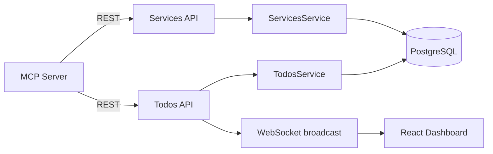
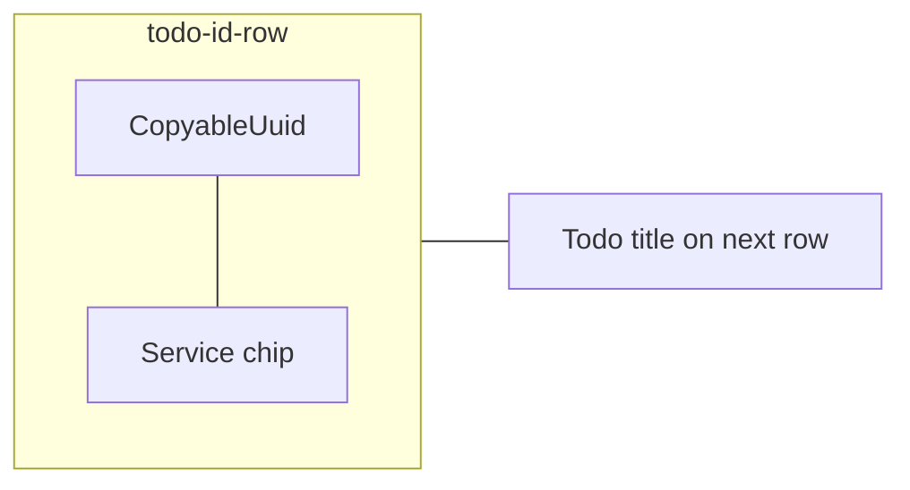

# Todo Service Lookup - Plan

## Goal Capsule

- **Objective:** Add a CRUD-managed services catalog and an optional single service association per todo, validated against that catalog, exposed through REST and MCP, and displayed read-only on kanban cards and in the todo popup.
- **Authority:** Product Contract defines behavior; user-confirmed call-outs (SET NULL delete, dual assignment fields, read-only UI) override defaults in Planning Contract.
- **Stop conditions:** Block only on schema/API contract conflicts or failing verification gates — not on cosmetic UI polish.
- **Execution profile:** Standard layered change across Prisma, shared types, backend, MCP, web display, and integration tests.

---

## Product Contract

### Summary

Introduce a `services` lookup table with unique `key_name` and optional `display_name` (defaulting to `key_name` at read time). Todos may optionally reference one service; assignment accepts `serviceId` or `serviceKeyName`, validated against the catalog. MCP exposes full service CRUD plus todo assignment via extended create/update tools. The web dashboard shows the resolved label read-only — kanban card to the right of the UUID, popup as the top body section before Tickets.

### Problem Frame

Todo items lack a structured way to tag which product or platform service they belong to. Service names vary by team and change over time; hard-coded enums or free-text fields would drift and fail validation. A centrally managed catalog with MCP administration keeps agent assignments consistent while the dashboard surfaces the tag at a glance.

### Requirements

#### Services catalog

- R1. Services are stored in a dedicated table with `key_name` (unique, required) and `display_name` (optional string).
- R2. API read responses expose `displayName` as `display_name ?? key_name` — no DB default for `display_name`.
- R3. `key_name` is immutable after create (updates may change `display_name` only).
- R4. `POST /services`, `GET /services`, `GET /services/:id`, `PATCH /services/:id`, and `DELETE /services/:id` provide full CRUD.
- R5. Deleting a service clears the association on referencing todos (`ON DELETE SET NULL` on the todo FK).

#### Todo association

- R6. Each todo may have zero or one associated service (todo-scoped only; subtasks do not carry service).
- R7. `POST /todos` and `PATCH /todos/:id` accept optional `serviceId` (UUID) and/or `serviceKeyName` (string); when both are provided they must resolve to the same service or the request is rejected with 400.
- R8. Passing `serviceId: null` or `serviceKeyName: null` (explicit null) clears the association and ignores the other field if present; omitting both fields leaves the association unchanged.
- R9. Assigning a non-existent `serviceId` or `serviceKeyName` returns 400 with a clear error message.
- R10. `GET /todos` and `GET /todos/:id` return nested `service: ServiceDto | null` on each todo.

#### MCP agent surface

- R11. MCP tools `list_services`, `get_service`, `create_service`, `update_service`, and `delete_service` mirror REST CRUD.
- R12. `create_todo` and `update_todo` accept optional `serviceId` and/or `serviceKeyName` with the same semantics as REST (R7–R9).
- R13. README MCP tools table documents all new tools and todo fields.

#### UI

- R14. Kanban todo cards display the service label to the right of the UUID when a service is set.
- R15. The todo popup (`SubtaskPanel`) shows a Service section as the first body section, before Tickets.
- R16. UI is read-only — assignment and clearing happen via REST/MCP only (no service picker in v1).

### Scope Boundaries

**In scope:** Prisma migration, shared types, backend services module, todo service resolution, MCP tools, web display components/styles, backend integration tests, README updates.

**Out of scope:** Subtask-level service, multiple services per todo, service grouping/hierarchy, web UI editing, filtering/sorting kanban by service.

#### Deferred to Follow-Up Work

- Service picker or inline edit in the todo popup.
- Kanban column filter or sort by service.
- Bulk reassign todos when renaming `key_name` (blocked by R3 immutability unless a migration tool is added later).

### Success Criteria

- Service CRUD round-trips via REST and MCP.
- Todo create/update assigns, replaces, and clears service with validation errors for unknown keys/ids and conflicting dual input.
- Deleting a referenced service succeeds and leaves todos with `service: null`.
- Kanban cards and popup show the resolved display label when set.
- Backend unit and integration test suites pass.

---

## Planning Contract

### Key Technical Decisions

- KTD1. **`Service` model + nullable FK on `Todo`** — `services` table with `keyName`/`displayName` mapped to snake_case columns; `todos.serviceId` nullable FK with `onDelete: SetNull`. Rationale: first dynamic lookup catalog in the repo; Monitor's optional 0..1 FK pattern fits cardinality; unlike tickets (many) this is a single optional reference.
- KTD2. **Dual assignment input with conflict guard** — accept both `serviceId` and `serviceKeyName` on create/update; resolve to one FK after lookup; reject when both are provided and point to different rows. Rationale: REST clients often hold UUIDs; MCP agents prefer stable `key_name` strings.
- KTD3. **Display name at mapper layer** — `ServiceDto.displayName = row.displayName ?? row.keyName`; do not write `key_name` into `display_name` on create. Rationale: keeps optional column truly optional; single resolution point for UI and API consumers.
- KTD4. **Immutable `key_name`** — PATCH on services allows `displayName` only; create validates `key_name` format (non-empty, slug-safe pattern). Rationale: `key_name` is the agent-stable identifier referenced in MCP prompts and historical assignments.
- KTD5. **Dedicated Nest `ServicesModule`** — CRUD controller/service following `MonitorsModule` layout; todo assignment logic lives in `TodosService` via a shared resolver helper. Rationale: first standalone lookup CRUD; keeps todo service thin.
- KTD6. **Read-only UI v1** — compact chip/badge beside UUID on cards; full label in popup section. Rationale: matches associated-tickets v1 posture; user confirmed no picker.

### High-Level Technical Design

**Todo service assignment resolution:**

| Input | Result |
|---|---|
| Both omitted | No change (update) / null FK (create) |
| `serviceId` only | Lookup by id; 400 if not found |
| `serviceKeyName` only | Lookup by key; 400 if not found |
| Both provided, same service | Set FK |
| Both provided, different services | 400 conflict |
| One or both explicitly `null` | Clear FK (`service: null`); ignore any non-null sibling field |

**UI layout (kanban card header row):**

### Assumptions

- `key_name` uses lowercase slug characters (`a-z`, `0-9`, `_`, `-`); validation enforced at create.
- Service CRUD does not require WebSocket events in v1 — todos already broadcast on assignment change.
- Existing `todoInclude` pattern extends with `service: true`.

### Sequencing

Prisma migration and shared types first, then backend services module and todo resolver, then MCP, then web UI, then tests and README.

---

## Implementation Units

### U1. Schema and shared types

**Goal:** Define the `Service` model, todo FK, and TypeScript contracts consumed by backend, MCP, and web.

**Requirements:** R1, R6, R10

**Dependencies:** None

**Files:**
- `apps/backend/prisma/schema.prisma`
- `apps/backend/prisma/migrations/<timestamp>_services_table/migration.sql` (created via migrate)
- `packages/shared-types/src/index.ts`

**Approach:** Add `Service` model (`id`, `keyName` unique, `displayName` optional, timestamps). Add nullable `serviceId` on `Todo` with relation and index. Extend `ServiceDto`, `CreateServiceDto`, `UpdateServiceDto`; add `service?: ServiceDto | null` to `TodoDto`; add optional `serviceId` / `serviceKeyName` to `CreateTodoDto` and `UpdateTodoDto` (nullable union for explicit clear).

**Patterns to follow:** nullable optional FK on `Todo` (cardinality per KTD1 / `Monitor` precedent); DTO nesting in `packages/shared-types/src/index.ts` (see nested `monitor` on `TodoDto`).

**Test scenarios:**
- Test expectation: none — schema/types only; verified by build and downstream integration tests.

**Verification:** `npm run build --workspace=@todo-platform/shared-types` succeeds; `prisma migrate dev` applies cleanly.

---

### U2. Backend services module

**Goal:** Expose REST CRUD for the services catalog with validation and display-name resolution.

**Requirements:** R1–R5

**Dependencies:** U1

**Files:**
- `apps/backend/src/services/services.module.ts` (new)
- `apps/backend/src/services/services.controller.ts` (new)
- `apps/backend/src/services/services.service.ts` (new)
- `apps/backend/src/common/service.dto.ts` (new)
- `apps/backend/src/common/mappers.ts`
- `apps/backend/src/app.module.ts`
- `apps/backend/test/services.integration-spec.ts` (new)

**Approach:** Nest module with `GET/POST /services`, `GET/PATCH/DELETE /services/:id`. Create validates unique `keyName` and slug pattern; update allows `displayName` only and rejects PATCH bodies that include `keyName`; delete relies on DB `SET NULL`. Mapper exports `toServiceDto()` with display fallback. Register module in `AppModule`.

**Execution note:** Add integration coverage for CRUD happy paths before wiring todo assignment in U3.

**Test scenarios:**
- Happy path: POST service with `keyName` only → 201; response `displayName` equals `keyName`.
- Happy path: POST with `keyName` and `displayName` → response preserves both; GET list includes entry.
- Edge case: duplicate `keyName` on create → 400/409.
- Edge case: invalid `keyName` characters → 400.
- Happy path: PATCH updates `displayName`; `keyName` unchanged in DB.
- Edge case: PATCH with `keyName` in body → 400; DB `keyName` unchanged (R3).
- Happy path: DELETE service that a todo references → 204; todo's `serviceId` becomes null (covered in U3 integration test, assert here that delete succeeds).
- Error path: GET/PATCH/DELETE unknown id → 404.

**Verification:** `services.integration-spec.ts` passes; Swagger shows services routes.

---

### U3. Todo service assignment

**Goal:** Resolve and persist optional service on todo create/update; include nested `service` in reads and WebSocket payloads.

**Requirements:** R5–R10

**Dependencies:** U1, U2

**Files:**
- `apps/backend/src/common/resolve-todo-service.ts` (new)
- `apps/backend/src/common/dto.ts`
- `apps/backend/src/todos/todos.service.ts`
- `apps/backend/src/common/mappers.ts`
- `apps/backend/test/todos.integration-spec.ts`

**Approach:** Extend `CreateTodoBody` / `UpdateTodoBody` in `dto.ts` with optional nullable `serviceId` (UUID) and `serviceKeyName` (string) validators so REST rejects malformed input before resolver runs (R7–R9). Extract `resolveTodoServiceInput(prisma, { serviceId?, serviceKeyName? })` returning `{ connect: { id } }`, `{ disconnect: true }`, or `undefined` (no change). On create, destructure service fields from DTO before `prisma.todo.create`; pass resolved connect/disconnect in data or follow-up update. Extend `todoInclude` with `service: true`; map in `toTodoDto`. Broadcast unchanged — payload picks up nested service automatically.

**Patterns to follow:** Monitor optional FK inclusion in `todos.service.ts`; `undefined` vs explicit null semantics for PATCH omit vs clear.

**Test scenarios:**
- Happy path: create todo with `serviceKeyName` → 201; `service.displayName` correct.
- Happy path: create todo with `serviceId` → same result.
- Happy path: PATCH assign service via `serviceKeyName`; omit on second PATCH → unchanged.
- Happy path: PATCH `serviceKeyName: null` → `service: null`.
- Edge case: unknown `serviceKeyName` → 400.
- Edge case: unknown `serviceId` → 400.
- Edge case: both fields reference different services → 400.
- Edge case: PATCH `serviceId: null` with `serviceKeyName` set → `service: null` (R8 precedence).
- Integration: delete service (U2) then GET todo → `service: null`.
- Integration: WebSocket `todo.updated` payload includes `service` object when set.

**Verification:** Extended `todos.integration-spec.ts` passes.

---

### U4. Shared API client and MCP tools

**Goal:** Wire REST client methods and MCP tools for services CRUD and todo assignment fields.

**Requirements:** R11–R13

**Dependencies:** U2, U3

**Files:**
- `packages/shared-api/src/index.ts`
- `apps/mcp-server/src/services.ts` (new)
- `apps/mcp-server/src/index.ts`
- `README.md`

**Approach:** Add `listServices`, `getService`, `createService`, `updateService`, `deleteService` to shared API client. New MCP module exports JSON schemas; register five tools plus extend `create_todo`/`update_todo` input schemas and handlers with `serviceId`/`serviceKeyName`. Update README MCP tools table.

**Patterns to follow:** `apps/mcp-server/src/associated-ticket.ts` for schema exports; monitors CRUD tool naming in `index.ts`.

**Test scenarios:**
- Test expectation: none — no MCP test harness; verified by build and manual smoke (`list_services` after seed).

**Verification:** `npm run build --workspace=@todo-platform/mcp-server` succeeds; README lists new tools.

---

### U5. Web UI display

**Goal:** Show service label read-only on kanban cards (right of UUID) and as the first popup section before Tickets.

**Requirements:** R14–R16

**Dependencies:** U3 (API returns `service` on `TodoDto`)

**Files:**
- `apps/web/src/components/ServiceBadge.tsx` (new)
- `apps/web/src/components/TodoCard.tsx`
- `apps/web/src/components/SubtaskPanel.tsx`
- `apps/web/src/index.css`

**Approach:** `ServiceBadge` renders `service.displayName` with compact variant for cards. Wrap `CopyableUuid` and badge in a flex row (`.todo-id-row`); badge uses `stopPropagation` on click so card remains clickable. Insert a read-only Service section (label `Service`) at top of `subtask-panel-body`, before the Tickets section; show empty-state copy when `todo.service` is null.

**Patterns to follow:** `AssociatedTicketList` compact chip styling; `SubtaskPanel` section structure for Tickets.

**Test scenarios:**
- Test expectation: none — no frontend test runner; manual smoke only.

**Verification:** `npm run build --workspace=@todo-platform/web` succeeds; kanban card shows chip beside UUID when service set; popup shows Service section above Tickets.

---

## Verification Contract

| Gate | Command | Applies |
|---|---|---|
| Shared types build | `npm run build --workspace=@todo-platform/shared-types` | U1+ |
| Backend unit tests | `npm test --workspace=@todo-platform/backend` | U2–U3 |
| Backend integration tests | `DATABASE_URL=… REDIS_URL=… npm run test:integration --workspace=@todo-platform/backend` | U2–U3 |
| MCP build | `npm run build --workspace=@todo-platform/mcp-server` | U4 |
| Web build | `npm run build --workspace=@todo-platform/web` | U5 |
| Lint (if touched) | `npm run lint --workspaces --if-present` | All |

---

## Definition of Done

- All requirements R1–R16 satisfied.
- Units U1–U5 complete per verification gates.
- No abandoned experimental code from implementation attempts.
- README MCP section documents service tools and todo assignment fields.
- Manual smoke: create service via MCP, assign to todo, confirm kanban chip and popup section, delete service and confirm todo shows no service.

---

## System-Wide Impact

- **Agent parity:** MCP gains first lookup-table CRUD — agents can manage the catalog without direct DB access.
- **Shared types:** `TodoDto` shape change is backward-compatible (new optional field).
- **WebSocket:** Todo update events carry nested `service`; clients ignore unknown fields safely.
- **Migration:** One additive migration; no data backfill required.

---

## Risks & Dependencies

| Risk | Mitigation |
|---|---|
| Agents use inconsistent `key_name` casing | Slug validation + document convention in MCP tool descriptions |
| Dual input confusion (`serviceId` + `serviceKeyName`) | Explicit 400 on conflict; MCP description recommends `serviceKeyName` for agents |
| Deleting service silently clears tags | Document SET NULL behavior in `delete_service` tool description |

---

## Sources & Research

- Existing optional FK pattern: `Monitor.todoId` in `apps/backend/prisma/schema.prisma`
- CRUD module template: `apps/backend/src/monitors/monitors.controller.ts`
- Layered rollout precedent: `docs/plans/2026-07-20-003-feat-external-ticket-link-plan.md`
- UI placement anchors: `apps/web/src/components/TodoCard.tsx`, `apps/web/src/components/SubtaskPanel.tsx`
