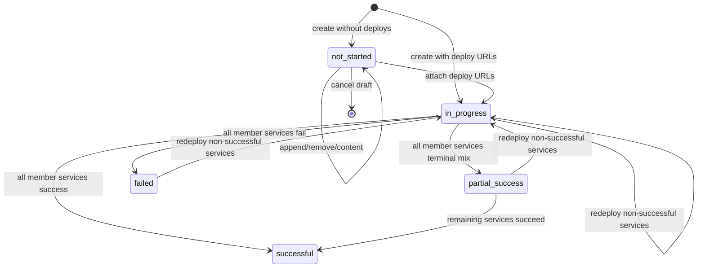
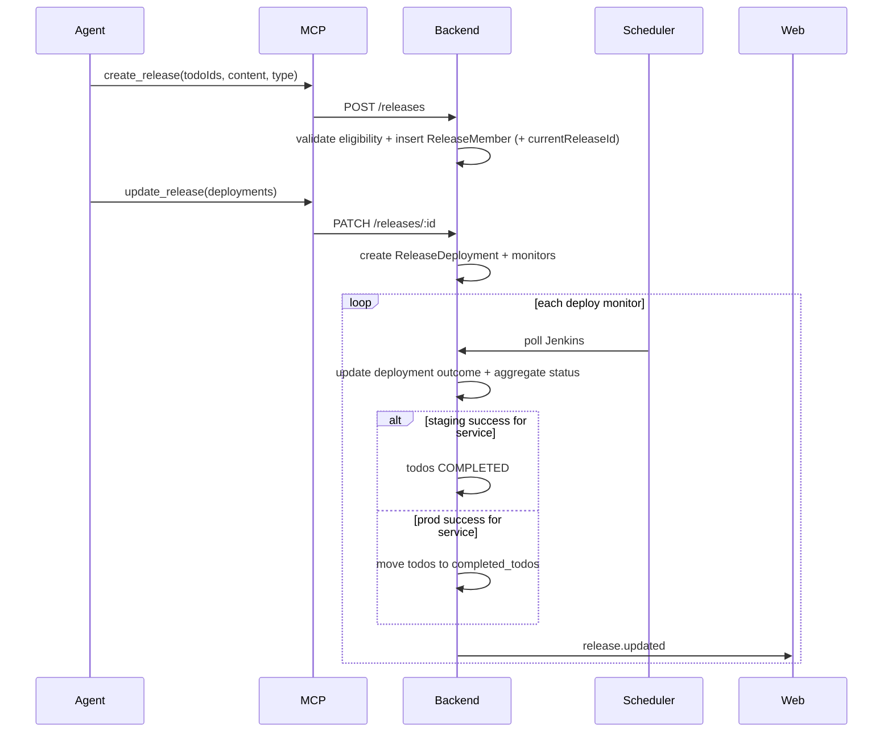

# feat: Release generation from todos

## Goal Capsule

- **Objective:** Let coding agents create staging and production releases from selected todos via MCP (durable `ReleaseMember` membership), monitor per-service Jenkins deployments, aggregate release status across all member services, advance or archive todos on success, and let users inspect releases (including archived members) on a dedicated web view.
- **Authority:** Product Contract (user-confirmed scope) overrides Planning Contract defaults; existing todo deployment-monitor behavior is the pattern to extend, not replace.
- **Stop conditions:** Block on schema/API contract conflicts, broken monitor XOR ownership, or failing Verification Contract gates — not on changelog formatting polish.
- **Execution profile:** Deep cross-cutting change across Prisma, shared types/API, Nest releases + monitor/scheduler hooks, MCP tools, and web view mode.

---

## Product Contract

### Summary

Agents author release content and pass an explicit todo ID list into MCP to create a staging or prod release. The backend stores `releaseId` on each member todo, optionally starts Jenkins deployment monitors per service, aggregates release status from those monitors, updates or archives todos only for successfully deployed services, and exposes the same durable release records on a web Releases screen.

### Problem Frame

Release notes and deploy tracking today live outside todoX. Agents can already list todos and watch Jenkins builds per todo, but there is no first-class release aggregate that groups service work, tracks multi-service deploy outcomes, or archives prod-shipped todos off the active board.

### Requirements

#### Release model

- R1. A release stores `releaseDate` (`yyyy-mm-dd`), `content` (agent-authored string), `type` (`staging` | `prod`), `status` (wire: `not_started` | `in_progress` | `successful` | `partial_success` | `failed`; UI may show spaced labels), and a list of per-service deployments (URLs / Jenkins build identity + live status).
- R2. Creating a release requires `type`, `releaseDate`, `content`, and a non-empty `todoIds` list. Optional deployment entries may be supplied at create time or later.
- R3. Membership truth is a `ReleaseMember` join (`releaseId`, `todoId`, unique together). Create/append inserts join rows. Optional denormalized `Todo.currentReleaseId` points only at the todo's non-terminal release for exclusivity checks and may be cleared/overwritten when that release becomes terminal or the todo joins a new release — historical membership always remains on the join (and on `completed_todos.releaseId` after prod archive).
- R4. Staging releases may only include todos with status `WAIT_FOR_STAGING` that have a resolvable service. Intended services = distinct services of **current** members (append may introduce new services).
- R5. Prod releases may only include todos with status `COMPLETED` (active board) that have a resolvable service and are not already archived.
- R6. A todo with an active membership on a **non-terminal** release cannot be added to a different release. Terminal statuses are `successful`, `partial_success`, and `failed`.
- R7. While status is `not_started`, the release may be updated to **append** eligible todos, optionally refresh `content`, **remove** member todos (delete join + clear `currentReleaseId` if it pointed here), or **cancel** the whole draft (delete release + clear members). Membership changes other than deploy/redeploy are locked once status is `in_progress` or terminal.
- R8. Attaching or updating deployment build URLs for one or more member services starts/restarts Jenkins deployment monitoring for those services and sets release status to `in_progress` when any monitor is active. Create-with-deploys may enter `in_progress` directly.
- R9. Aggregation is over **all distinct member services**, not only rows that already have URLs: missing/unattached service ⇒ non-terminal. All member services successful → `successful`; all failed → `failed`; mix of terminal success+fail (and every member service terminal) → `partial_success`; any missing, running, or otherwise non-terminal → stay `in_progress` (or `not_started` if no monitors yet).
- R10. Re-deploy / replace URLs is allowed on any non-`successful` release (including `in_progress`) for services whose current deployment outcome is **not** `successful` (failed, pending/missing URL, or still running). Replacing an in-flight URL recreates that service's monitor. Already-successful services are immutable (400).
- R11. Staging: when a service's deployment first succeeds, set that service's member todos to `COMPLETED`. Staging `ReleaseMember` rows remain for history.
- R12. Prod: when a service's deployment first succeeds, **move** that service's member todos into `completed_todos` (core todo fields + `serviceId` + associated tickets at minimum; PRs copied when practical; subtasks intentionally dropped unless cheap to copy) and remove them from the active `todos` table. Release DTO member summaries union active todos and `completed_todos` by membership (id, title, service, archived flag).
- R13. Failed services' todos are unchanged by the success path (staging stays `WAIT_FOR_STAGING` until success; prod stays `COMPLETED` on the board until success).

#### Agent / MCP / API surface

- R14. MCP exposes primitive tools: create, list, get, update release (draft append/remove/content + deploy URL attach / redeploy), and cancel `not_started` releases. REST mirrors the same operations.
- R15. Agents can discover eligible todos via filtered todo listing (`status`, `serviceKeyName` / `serviceId`, and whether the todo is free of a non-terminal release) — enforced again on create/update.
- R16. No MCP tool performs raw archive/move or mass-complete outside the release success side effects.

#### Web

- R17. The web app has a dedicated Releases view (peer to list/kanban) showing releases and per-service deployment status for the same records agents mutate.

### Actors

- A1. Coding agent (Cursor / Claude Code / etc.) — primary author of releases via MCP.
- A2. Human operator — views releases and deployment progress on the web app.

### Key Flows

- F1. Staging release: agent filters `WAIT_FOR_STAGING` todos → drafts content → `create_release` (type staging) → optional deploy URLs → monitors run → status aggregates → successful services’ todos → `COMPLETED`.
- F2. Prod release: agent filters `COMPLETED` todos → drafts content → `create_release` (type prod) → deploy URLs → on success, archive those services’ todos to `completed_todos`.
- F3. Draft amendment: `not_started` release → `update_release` appends/removes todos (and optional content) or cancel → still `not_started` until deployments are attached.
- F4. Partial failure recovery: release `partial_success` or `failed` (or `in_progress` with a bad URL) → agent redeploys non-successful services → aggregation and todo side effects re-evaluate for those services.

### Acceptance Examples

- AE1. Agent creates staging release for services A,B with three todos and no deploy URLs → status `not_started`; `ReleaseMember` rows exist; web shows the release.
- AE2. Agent appends a fourth eligible todo (possibly a new service) to that `not_started` release → succeeds; attempting append after deploy URLs are attached → rejected; remove/cancel while `not_started` → succeeds.
- AE3. Agent attaches staging Jenkins URLs for A and B → status `in_progress`; A succeeds and B fails → status `partial_success`; only A's todos become `COMPLETED`.
- AE4. Agent redeploys B with a new build URL → B's monitor restarts; A remains successful; on B success → status `successful` and B's todos become `COMPLETED`.
- AE5. Agent creates prod release from completed todos; on all-success → todos leave the board and appear in `completed_todos` with core fields + tickets; `get_release` / web still list archived members.
- AE6. Second create that reuses a todo still on an `in_progress` release → conflict/rejection.
- AE7. Members for A+B but URL attached only for A; A succeeds → release stays `in_progress` (B undeployed), not `successful`.

### Scope Boundaries

**In scope:** Prisma models/migrations, shared types + shared-api, Nest releases module, monitor ownership extension for release deployments, scheduler aggregation + staging/prod side effects, MCP tools + todo list filters, web Releases view, backend unit/integration tests, README MCP table.

**Out of scope:** Server-side changelog assembly from tickets; CI-created releases; notifications; web UI to create/edit releases; cancel/delete after `in_progress`; force-complete / force-archive tools; subtask-level release membership; restore/unarchive API.

#### Deferred to Follow-Up Work

- Content edits after the release leaves `not_started`.
- Web-authored release create/edit.
- Dedicated listing/search UI for `completed_todos` (release member summaries still include archived members).
- Soft-restore of archived todos.

### Success Criteria

- Staging and prod releases round-trip via REST and MCP with membership, exclusivity, and draft-append rules enforced.
- Deployment monitoring reuses the Jenkins provider; release status and per-service outcomes match monitor results.
- Staging success completes only successful services’ todos; prod success archives only those todos.
- Web Releases view reflects the same release and deployment state agents see via `get_release`.
- Backend unit and integration suites covering release rules and aggregation pass.

### Sources

- User request + confirmed scoping (content authored by agent; todo ID list on create; `releaseId` on todos; prod archive; draft append only while `not-started`; redeploy failed services only).
- Example content shape: `docs/requirements/release-generation/staging_release_format.md` (agent template; not server-rendered).
- Prior patterns: `docs/plans/2026-07-20-001-feat-jenkins-deploy-monitor-plan.md`, `docs/plans/2026-07-20-002-feat-todo-deployment-monitor-plan.md`, `docs/plans/2026-07-20-005-feat-todo-service-lookup-plan.md`.

---

## Planning Contract

### Assumptions

- Draft membership supports append, remove, and cancel while `not_started` (R7).
- Exclusivity is **todo-level** against non-terminal releases only (not "one open release per service").
- Prod archive needs no extra approval beyond attaching deploy URLs (same trust posture as existing unauthenticated MCP); blast radius is larger than single `delete_todo` and is accepted as residual risk with no restore in this plan.
- Todos without a resolvable `serviceId` cannot be included in a release.
- Intended services for a release are the distinct services of its member todos after each membership change; deployment entries must reference those services.
- Wire status tokens use underscores (`not_started`, `partial_success`, …).
- Archive payload is locked: core todo columns + `serviceId` + associated tickets (+ PRs when practical); subtasks and todo-owned monitors are not required for v1 parity.
- `ReleaseDeployment` rows are created/upserted only when deploy URLs are attached (not eagerly for every member service).

### Key Technical Decisions

- KTD1. **Release + ReleaseMember + ReleaseDeployment.** `Release` holds date/content/type/status. `ReleaseMember` is membership truth (`releaseId`, `todoId`). Optional `Todo.currentReleaseId` is a denormalized pointer to the non-terminal release only. `ReleaseDeployment` is upserted **only when deploy URLs are attached** (unique `[releaseId, serviceId]`), with `ReleaseDeploymentStatus` (`pending` | `in_progress` | `successful` | `failed`). Aggregation always walks distinct member services; missing deployment row ⇒ non-terminal.
- KTD2. **One monitor per ReleaseDeployment, not per Release.** Extend ownership to a three-way XOR: `todoId` XOR `subtaskId` XOR `releaseDeploymentId` (unique FK + CHECK). Preserves the Jenkins provider without multi-job config.
- KTD3. **Release monitor env is release-scoped, not a board chip.** Prefer storing `staging`|`prod` on `ReleaseDeployment` / monitor config without adding `prod` to todo `DeployedEnvironmentName` chip vocabulary. If a shared enum value is unavoidable for typing, reject `prod` on todo/subtask `deployedEnvironments` write paths and never show it on board chips.
- KTD4. **Primitive MCP tools, thin proxy.** `create_release`, `list_releases`, `get_release`, `update_release` (append/remove/content when `not_started`; attach or replace deploy URLs), `cancel_release` (only `not_started`). Prefer constrained params over a mega-workflow tool.
- KTD5. **Filtered `list_todos` / `GET /todos`.** Filters for `status`, `serviceId` / `serviceKeyName`, and `availableForRelease` (free of non-terminal membership). Server re-validates on create/update.
- KTD6. **Success side effects live in the scheduler path**, keyed off release-deployment monitors — not agent `update_todo`. `executeMonitor` must early-branch on `releaseDeploymentId` so UAT/uat-main todo sync never runs for release monitors. Pure helpers compute aggregation and which todos to complete/archive. Single server mapper enriches deployments for REST; MCP and web consume that DTO only.
- KTD7. **Web: third `ViewMode` (`releases`)** in `App.tsx` rather than introducing a router. View toggle must remain reachable when the todo board is empty (do not gate on `todos.length > 0`).
- KTD8. **WebSocket:** extend `WebSocketEventType` with `release.created` / `release.updated`; broadcast on membership/status/deployment changes; web invalidates `['releases']` (and todos when board membership changes).

### High-Level Technical Design

#### Release status machine



#### Create → monitor → side effects



#### Multi-service monitor ownership

```text
Release 1──* ReleaseMember *──1 Todo
Release 1──* ReleaseDeployment 1──1 Monitor (deployment)
                └── serviceId → Service
Todo.currentReleaseId ──? Release   (denormalized; non-terminal only)
```

### Implementation Constraints

- Follow Nest module pattern from `apps/backend/src/services/` for registration; orchestration complexity may resemble `todos` more than catalog CRUD.
- MCP remains HTTP client only (`apps/mcp-server` → `TodoApiClient`); no business logic in MCP.
- Do not use agent `update_todo` status/archive as a substitute for release success hooks.
- Preserve existing todo/subtask monitor behavior and UAT / uat-main status sync.

### Sequencing

1. Schema + shared types  
2. Releases CRUD / membership / filters  
3. Monitors + aggregation + side effects  
4. MCP  
5. Web Releases view  
6. README + verification polish  

### Product Contract preservation

Product Contract updated during confidence/doc-review: `ReleaseMember` membership truth (fixes staging→prod history), aggregation over all member services, draft remove/cancel while `not_started`, locked archive child set, release-scoped prod env (not board chips).

---

## Implementation Units

### U1. Prisma schema for releases, deployments, archive, and monitor XOR

**Goal:** Persist releases, per-service deployments, todo membership, completed archive, and extended monitor ownership.

**Requirements:** R1–R3, R12, KTD1–KTD3

**Dependencies:** None

**Files:**
- `apps/backend/prisma/schema.prisma`
- `apps/backend/prisma/migrations/<timestamp>_release_generation/migration.sql` (created by migrate)

**Approach:**
- Add enums: `ReleaseType` (`staging` | `prod`), `ReleaseStatus` (`not_started` | `in_progress` | `successful` | `partial_success` | `failed`), `ReleaseDeploymentStatus` (`pending` | `in_progress` | `successful` | `failed`).
- Models: `Release`, `ReleaseMember` (`releaseId`, `todoId`, `@@unique([releaseId, todoId])`), `ReleaseDeployment` (unique `[releaseId, serviceId]`, optional Jenkins fields, outcome status), `CompletedTodo` (core todo fields + `originalTodoId`, `releaseId`, `archivedAt`, `serviceId` + ticket copies as JSON or child table).
- Optional `Todo.currentReleaseId` FK + index (SET NULL); membership history never depends on this column alone.
- `Monitor.releaseDeploymentId` optional `@unique`; replace `monitors_owner_xor` CHECK with three-way XOR.
- Do not add `prod` to todo board `DeployedEnvironmentName` unless KTD3 fallback is forced — prefer release-scoped env on deployment/monitor config.

**Patterns to follow:** `Service` / `Todo.serviceId` optional FK; existing `monitors_owner_xor` migration.

**Test scenarios:**
- Test expectation: none for migration-only — covered by U2/U3 service tests once client generates. Spot-check migrate applies cleanly in integration setup.

**Verification:** `prisma migrate` applies on empty and existing DBs; Prisma client includes new models.

---

### U2. Shared types and shared-api client

**Goal:** Export release DTOs/enums and REST client methods used by MCP and web.

**Requirements:** R1, R14–R15, KTD4–KTD5

**Dependencies:** U1

**Files:**
- `packages/shared-types/src/index.ts`
- `packages/shared-api/src/index.ts`
- `apps/backend/src/common/mappers.ts` (env / DTO mappers as needed)

**Approach:**
- Add `ReleaseType`, `ReleaseStatus`, `ReleaseDto`, `ReleaseDeploymentDto`, create/update DTOs (todoIds, content, releaseDate, deployments: `{ serviceId|serviceKeyName, jobUrl, buildNumber }[]`).
- Extend `TodoDto` with `currentReleaseId: string | null`.
- Extend `MonitorDto` with `releaseDeploymentId`.
- `ReleaseDto.members` summaries include archived flag for prod-archived todos.
- Extend `WebSocketEventType` with `release.created` | `release.updated`.
- `TodoApiClient`: `createRelease`, `listReleases`, `getRelease`, `updateRelease`, `cancelRelease`; extend `listTodos(params?)`.
- Keep todo `DeployedEnvironmentName` chip enum unchanged unless KTD3 fallback requires otherwise.

**Test scenarios:**
- Test expectation: none -- type package; behavior covered in backend/MCP tests.

**Verification:** Workspace typechecks; client method signatures match planned REST paths.

---

### U3. Releases Nest module — create, list, get, draft update, exclusivity

**Goal:** Implement release CRUD/membership rules without deployment monitors yet (or stub deploy attach until U4).

**Requirements:** R2–R7, R14–R15, AE1, AE2, AE6, KTD1, KTD5

**Dependencies:** U1, U2

**Files:**
- `apps/backend/src/releases/releases.module.ts`
- `apps/backend/src/releases/releases.controller.ts`
- `apps/backend/src/releases/releases.service.ts`
- `apps/backend/src/releases/releases.service.spec.ts`
- `apps/backend/src/common/release.dto.ts` (or extend `common/dto.ts`)
- `apps/backend/src/app.module.ts`
- `apps/backend/src/todos/todos.service.ts` / `todos.controller.ts` (list filters + `releaseId` on todo DTO mapping)
- `apps/backend/test/` integration specs as appropriate

**Approach:**
- `POST /releases`: validate todo existence, status by type, service present, no non-terminal membership; insert `ReleaseMember` + set `currentReleaseId` in a transaction; status `not_started` unless deployments provided (accept field shape; wire monitors in U4).
- `GET /releases`, `GET /releases/:id` with nested deployments + member summaries (active todos union `completed_todos` for that release).
- `PATCH /releases/:id`: if `not_started`, allow append/remove `todoIds` + optional `content`; reject membership changes otherwise.
- `DELETE /releases/:id` (or `POST .../cancel`): only `not_started`; clears members and `currentReleaseId`.
- On create/append into a new release after a **terminal** prior release: insert new `ReleaseMember`; update `currentReleaseId` to the new release (prior join rows remain).
- `GET /todos` query: `status`, `serviceId`, `serviceKeyName`, `availableForRelease=true`.
- Broadcast `release.created` / `release.updated` and `todo.updated` for members.

**Patterns to follow:** `services` module registration; `ConflictException` / `BadRequestException` style from todos/monitors.

**Test scenarios:**
- Happy path: create staging with two eligible todos → `not_started`, `ReleaseMember` rows + `currentReleaseId` set.
- Happy path: append third eligible todo (new service allowed) while `not_started` → membership grows.
- Happy path: remove a member / cancel draft while `not_started` → join cleared; todos free for another release.
- Happy path: todo on a **terminal** staging release can join a new prod create; `currentReleaseId` updates; staging join retained.
- Edge: empty `todoIds` → 400.
- Edge: todo missing service → 400.
- Error: todo `IN_PROGRESS` in staging create → 400.
- Error: todo already on `in_progress` release → 409/400.
- Error: append after status `in_progress` → 409/400.
- Integration: `availableForRelease` filter excludes members of non-terminal releases and includes free `WAIT_FOR_STAGING` todos.

**Verification:** Unit + integration tests green; Swagger shows release routes.

---

### U4. Release deployment monitors, aggregation, staging complete, prod archive

**Goal:** Attach Jenkins monitors per `ReleaseDeployment`, aggregate release status, and apply todo side effects on first success per service.

**Requirements:** R8–R13, F1–F4, AE3–AE5, KTD2, KTD3, KTD6, KTD8

**Dependencies:** U3

**Files:**
- `apps/backend/src/monitors/monitors.service.ts`
- `apps/backend/src/monitors/monitors.controller.ts` (optional `POST /release-deployments/:id/monitors` or internal-only create)
- `apps/backend/src/scheduler/scheduler.service.ts`
- `apps/backend/src/common/release-deployment-status-sync.ts` (new pure helpers)
- `apps/backend/src/common/release-deployment-status-sync.spec.ts`
- `apps/backend/src/releases/releases.service.ts` (deploy attach / redeploy)
- `apps/backend/src/common/mappers.ts` / `deployment-enrichment.ts` (enrich release deployments from monitor `lastResult` as needed)

**Approach:**
- On deploy attach: upsert `ReleaseDeployment` rows only for supplied services (must be member services); `createForReleaseDeployment` monitor with `type: deployment`, env from release type (`staging`|`prod`), default cron matching todo deploys.
- Setting any active monitors moves release to `in_progress`.
- Scheduler: **early-branch** when monitor has `releaseDeploymentId` → update deployment outcome; recompute release status over **all member services** (missing URL = non-terminal); on first success for that service, staging complete or prod archive for that `serviceId` only. Never call `resolveTodoStatusOnDeploySuccess` for release monitors.
- Redeploy: services whose outcome is not `successful`; replace jobUrl/buildNumber; recreate monitor; set release `in_progress`.
- Prod archive: transaction copy core+tickets(+PRs) → `completed_todos` → delete todo; broadcast `todo.updated`/invalidate board so archived todos disappear; release member summaries still show archived entries.
- Broadcast `release.updated` after aggregation. Single enrichment mapper for deployment status shared by REST/MCP/web.

**Execution note:** Implement aggregation and side-effect helpers test-first (pure unit tests) before wiring the scheduler.

**Patterns to follow:** `todo-deployment-status-sync.ts`, `MonitorsService.createForTodo`, `scheduler.service.ts` `executeMonitor`.

**Test scenarios:**
- Happy path: two services both SUCCESS → release `successful`; staging todos `COMPLETED`.
- Happy path: one SUCCESS one FAILED → `partial_success`; only success service's todos completed (staging).
- Happy path: all FAILED → release `failed`; todos unchanged (R13).
- Happy path: prod all SUCCESS → todos removed from `todos`, present in `completed_todos` with tickets; `get_release` still lists members as archived.
- Edge: members A+B, URL only for A, A SUCCESS → stay `in_progress` (B undeployed), not `successful`.
- Edge: first-success gate — repeat SUCCESS polls do not double-archive.
- Edge: redeploy while monitor still running → allowed; monitor recreated; prior success side effects not re-run.
- Edge: redeploy failed service only — successful service monitor untouched.
- Error: redeploy already-successful service → 400.
- Error: attach URL for non-member service → 400.
- Regression: releaseDeployment monitor SUCCESS does not change unrelated todo statuses via UAT helpers.
- Integration: monitor poll updates release DTO enrichment via the shared mapper.

**Verification:** Helper specs + service/scheduler tests pass; manual Jenkins poll path updates release status.

---

### U5. MCP release tools and filtered list_todos

**Goal:** Expose agent-native primitives with clear eligibility docs in tool descriptions.

**Requirements:** R14–R16, KTD4–KTD5, agent-native parity

**Dependencies:** U3, U4

**Files:**
- `apps/mcp-server/src/index.ts`
- `apps/mcp-server/src/releases.ts` (schemas/helpers)
- `README.md` (MCP tools table)

**Approach:**
- Tools: `create_release`, `list_releases`, `get_release`, `update_release`, `cancel_release` with schemas documenting draft append/remove vs deploy/redeploy fields.
- Extend `list_todos` input with filter properties matching REST.
- Error payloads remain `{ isError: true }` with server message (eligibility / lock).

**Patterns to follow:** `services.ts` + tools array / switch in `index.ts`.

**Test scenarios:**
- Test expectation: none dedicated in mcp-server package — verify via shared-api against running backend in manual/agent smoke, and backend tests for the underlying API.
- Agent-native verification (manual or future eval): Covers AE1–AE6 via tool calls.

**Verification:** Tools listed in MCP; README updated; create/list/get/update succeed against local backend.

---

### U6. Web Releases view

**Goal:** Dedicated screen to view releases and per-service deployment status.

**Requirements:** R17, KTD7–KTD8, AE1

**Dependencies:** U2, U3, U4

**Files:**
- `apps/web/src/App.tsx`
- `apps/web/src/components/ReleasesView.tsx` (new)
- `apps/web/src/components/ReleaseCard.tsx` or inline list (new)
- `apps/web/src/hooks/useWebSocket.ts`
- `apps/web/src/index.css` (minimal layout consistent with existing views)

**Approach:**
- Add `ViewMode = 'list' | 'kanban' | 'releases'`.
- Keep the view toggle reachable when `todos.length === 0` (empty board after prod archive must still open Releases). Empty releases and empty board each get their own empty state.
- Query `['releases']` via shared-api; on `release.updated` / related events invalidate that query (and todos when membership/status side effects matter).
- List order: `releaseDate` desc then `createdAt`. Show date, type, status (distinct chrome for `partial_success`), truncated content (expand/pre-wrap), member summaries (including archived), and per-service deployment chips.
- Read-only — no create/edit forms in v1.

**Patterns to follow:** `App.tsx` view toggle; `DeployedEnvironmentList` status presentation; React Query + websocket invalidation.

**Test scenarios:**
- Test expectation: none -- web package has no test runner; verify manually that Releases view lists releases and updates after websocket events.

**Verification:** Toggle to Releases shows API data; status chips update when a monitor completes in local smoke.

---

## Verification Contract

- Backend unit tests: `apps/backend` Jest — especially `releases.service.spec.ts`, `release-deployment-status-sync.spec.ts`, and any scheduler/monitor extensions.
- Backend integration tests under `apps/backend/test` for create/append/exclusivity/filters and at least one success-path archive/complete flow when DB is available.
- Typecheck / build workspaces that change (`shared-types`, `shared-api`, `backend`, `mcp-server`, `web`).
- Manual MCP smoke: filtered `list_todos` → `create_release` → `update_release` deployments → observe `get_release` status.
- Manual web smoke: Releases view reflects the same release.

## Definition of Done

- All Implementation Units U1–U6 complete with their verification outcomes.
- Product requirements R1–R17 satisfied or explicitly deferred in Scope Boundaries.
- No agent-callable raw archive tool; success side effects are server-owned.
- Abandoned experiment code removed from the diff.
- README MCP tools table documents release tools (`cancel_release` included) and `list_todos` filters.

---

## System-Wide Impact

- **Monitor ownership CHECK** must stay valid for existing todo/subtask monitors after the three-way XOR migration.
- **Todo list consumers** gain optional filters; default unfiltered list behavior remains for the web board.
- **Active board size** shrinks after prod success (archive); staging success increases `COMPLETED` count available for later prod releases. Broadcast/invalidate so the board drops archived todos; staging success emits `todo.updated`.
- **Release membership history** survives staging→prod because `ReleaseMember` is immutable per (release, todo) while `currentReleaseId` moves.
- **Agent/tool parity:** Releases are MCP-primary; web is read parity for the same durable objects (including archived member summaries).

## Risks & Dependencies

- **Risk:** Multi-service monitor XOR migration breaks existing monitors if CHECK is wrong. *Mitigation:* migration SQL with explicit three-way constraint; integration boot test.
- **Risk:** Subset deploy attach marked successful while other member services never deployed. *Mitigation:* aggregate over distinct member services; missing outcomes block terminal success (AE7 / U4 tests).
- **Risk:** Web and MCP diverge on per-service status if enrichment paths differ. *Mitigation:* single server DTO mapper for deployments.
- **Risk:** Prod archive incompleteness (missing child rows). *Mitigation:* locked archive payload (core + tickets; PRs when practical); subtasks deferred.
- **Risk:** Unauthenticated `update_release` deploy attach can archive many todos per successful service (larger blast radius than `delete_todo`); no restore in this plan. *Mitigation:* accept under existing MCP trust; no raw archive tool (R16); cancel only while `not_started`.
- **Risk:** Agents bypass filters and pass wrong todo IDs. *Mitigation:* server-side eligibility on every create/append/remove.
- **Dependency:** Jenkins auth/`DeploymentMonitorProvider` already required for todo deploys; SUCCESS on agent-supplied `jobUrl` triggers side effects with the same host-trust assumptions as todo monitors.

## Alternative Approaches Considered

- **Single monitor per Release with multi-job config** — rejected; fights existing 1:1 monitor + provider shape.
- **Workflow MCP tool `ship_release`** — rejected; completion/archive must be atomic with monitor success in the backend.
- **Separate `list_release_candidates` tool only** — deferred in favor of filtered `list_todos` unless filters prove too opaque during implementation (then add a thin helper tool without removing filters).
