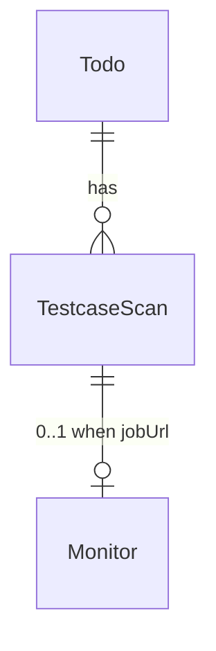
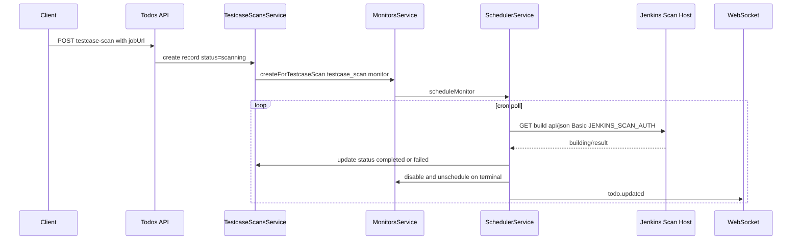

# Testcase Scan History - Plan

## Goal Capsule

- **Objective:** Add a per-todo testcase scan history with optional Jenkins job monitoring on a separate host/credentials, and surface in-progress scan status on Kanban cards and the todo detail popup.
- **Authority:** This plan; extends patterns from `docs/plans/2026-07-20-001-feat-jenkins-deploy-monitor-plan.md` and `docs/plans/2026-07-20-002-feat-todo-deployment-monitor-plan.md`.
- **Stop conditions:** Block only if Monitor XOR ownership cannot be extended to scan records without breaking existing monitors.
- **Execution profile:** Schema and shared types first, scan monitor provider, scheduler sync, API/MCP, then web UI.
- **Tail ownership:** Implementer runs verification contract before marking done.

---

## Product Contract

### Summary

Todos gain a `testcaseScanHistory` collection. Each record has a name, status, and optional Jenkins job URL. When a URL is present, the backend attaches a dedicated Jenkins poll monitor (scan credentials/host, not deployment credentials), updates the record when the job finishes, and the UI shows active scan status on the card and popup.

### Problem Frame

Operators run testcase scans on Jenkins jobs that live on a different host and use different credentials than deployment monitors. Today todos have no way to record scan attempts, track whether a scan is still running, or see scan activity alongside deployment status on the dashboard.

### Requirements

#### Data model

- R1. A todo may have zero or many testcase scan history records (append-only history, not a single slot).
- R2. Each record stores: `name` (required string), `status` (`scanning` | `completed` | `failed`), optional `jobUrl` (Jenkins job/build URL).
- R3. Records are owned by a todo only (not subtasks) in this iteration.
- R4. When `jobUrl` is omitted, no Jenkins monitor is created; status is set by the API caller and not auto-updated by polling.
- R5. When `jobUrl` is present on create, initial status is `scanning` and a monitor is scheduled automatically.
- R6. Multiple scans may be in `scanning` concurrently on the same todo (each with its own monitor when URL provided).

#### Jenkins monitoring

- R7. Add monitor type `testcase_scan` that polls Jenkins build JSON API (`building`, `result`, `duration`, `timestamp`, `url`) using the same field mapping philosophy as deployment monitors.
- R8. Scan Jenkins auth uses server-wide `JENKINS_SCAN_AUTH` (base64 `user:password` Basic token), separate from deployment `JENKINS_AUTH`.
- R9. Jenkins host/path comes from each record's `jobUrl` (no global scan host env var).
- R10. On terminal Jenkins outcome, update the scan record: `SUCCESS` → `completed`; `FAILURE` / `ABORTED` / `UNSTABLE` → `failed`; then disable and unschedule the scan's monitor.
- R11. While Jenkins reports `building: true` (or no final `result`), keep status `scanning`.
- R12. Monitor poll cron defaults to `*/5 * * * *` (same cadence as deployment monitors unless overridden in monitor config).

#### API and MCP

- R13. `TodoDto` exposes `testcaseScanHistory?: TestcaseScanDto[]` ordered by `createdAt` descending (newest first).
- R14. `CreateTodoDto` and `UpdateTodoDto` accept optional `testcaseScanHistory` inputs for bulk create/replace (same sync pattern as associated tickets).
- R15. `POST /todos/:todoId/testcase-scans` appends one record; when `jobUrl` is provided, monitor setup runs in the same transaction path.
- R16. `DELETE /todos/:todoId/testcase-scans/:scanId` removes a record and its monitor if present.
- R17. MCP `create_todo`, `update_todo`, and a new `add_testcase_scan` tool expose the same shapes and behavior as REST.

#### Web UI

- R18. When any scan on a todo has status `scanning`, show a compact scan-in-progress indicator on the Kanban `TodoCard`.
- R19. The todo detail popup (`SubtaskPanel`) shows the same in-progress indicator plus a short list of active scans (name + optional link).
- R20. Completed and failed scans do not show on the card compact indicator; full history remains available in API/MCP responses for future UI.
- R21. UI updates live via existing `todo.updated` and `monitor.updated` WebSocket events (extend todo fetch includes to carry scan history).

#### Scope

- R22. Do not auto-mutate `TodoStatus` from scan outcomes (informational only, like todo-level deployment monitors).

### Acceptance Examples

- AE1. **Append scan with Jenkins URL**
  - **Given:** Valid `JENKINS_SCAN_AUTH` and a Jenkins build URL for an in-progress job.
  - **When:** `POST /todos/:id/testcase-scans` with `name: "regression"` and `jobUrl`.
  - **Then:** Response includes a record with `status: scanning`, a linked monitor is scheduled, and subsequent polls keep status `scanning` until Jenkins finishes.

- AE2. **Scan completes successfully**
  - **Given:** A scanning record with an active monitor and Jenkins returns `building: false`, `result: SUCCESS`.
  - **When:** The scheduler runs the monitor.
  - **Then:** Record status becomes `completed`, monitor is disabled/unscheduled, and `todo.updated` is broadcast.

- AE3. **Scan fails on Jenkins**
  - **Given:** Jenkins returns `result: FAILURE`.
  - **When:** The scheduler runs the monitor.
  - **Then:** Record status becomes `failed` (not `completed`), monitor is disabled.

- AE4. **Manual scan without URL**
  - **Given:** A todo exists.
  - **When:** Client posts a scan with `name` only and `status: completed`.
  - **Then:** Record is stored with no monitor; status stays as provided.

- AE5. **UI in-progress indicator**
  - **Given:** A todo has one scan in `scanning`.
  - **When:** Kanban renders the card and the user opens the popup.
  - **Then:** Both surfaces show scan-in-progress UI; when the scan transitions to `completed` or `failed`, the indicator disappears from the card.

### Scope Boundaries

**In scope:** Prisma model, shared types, `testcase_scan` monitor provider, scheduler side effects, REST, MCP, web card/popup indicators, unit and integration tests.

**Deferred to Follow-Up Work:**

- Subtask-level scan history.
- Full scan history panel in the web UI (edit/delete from UI, failed/completed history lines).
- Parsing Allure or test-case-level results from Jenkins artifacts.
- Auto-adding scans from external CI webhooks.
- Per-scan custom cron in the public API (use default cron internally).

**Out of scope:** Changing deployment monitor behavior or credentials; storing Jenkins poll payloads beyond monitor `lastResult`.

---

## Planning Contract

### Assumptions

User confirmed overall scope without selecting individual call-out options. Defaults applied:

- Terminal Jenkins failure maps to status `failed`, not `completed` (third status added beyond the two named in the prompt — required for honest UX).
- One monitor per scan record via extended Monitor ownership (parallel to release deployments), not a bespoke poller outside the registry.
- Append via dedicated `POST` plus optional nested sync on todo create/update (replace-all on update only when `testcaseScanHistory` is explicitly provided).

### Key Technical Decisions

| ID | Decision | Rationale |
|---|---|---|
| KTD-1 | New `TestcaseScan` Prisma model with optional 1:1 `Monitor` | History requires many records per todo; `monitor.lastResult` alone is insufficient (see deploy plan out-of-scope note). |
| KTD-2 | Add `testcaseScanId` as fourth Monitor owner; XOR with todo/subtask/releaseDeployment | Reuses BullMQ scheduler, provider registry, and WebSocket pipeline (`apps/backend/prisma/schema.prisma`, release deployment precedent). |
| KTD-3 | New `MonitorType.TESTCASE_SCAN` + `TestcaseScanMonitorProvider` | Keeps scan Jenkins logic separate from deployment provider and `JENKINS_AUTH`. |
| KTD-4 | `JENKINS_SCAN_AUTH` env var | User requirement: different credentials from deployment; mirrors `JENKINS_AUTH` pattern in `apps/backend/src/config/env.validation.ts`. |
| KTD-5 | Parse `jobUrl` into `jobUrl` + `buildNumber` for monitor config | Reuse `parseJobNameFromUrl` and build API URL shape from `DeploymentMonitorProvider.check()` in `monitor-providers.ts`. |
| KTD-6 | Scheduler branch `syncTestcaseScanMonitor()` | Mirror `syncReleaseDeploymentMonitor()` — update scan status, disable monitor on terminal, broadcast `todo.updated`. |
| KTD-7 | No todo status sync from scan monitors | `TodoStatus` has no failed state; scans are informational (KTD-4 in todo deployment monitor plan). |
| KTD-8 | UI shows in-progress only on card/popup | User scoped UI to active scans; history remains API-visible. |
| KTD-9 | `testcaseScanHistory` replace sync on explicit update field | Follows `syncAssociatedTickets()` delete-and-recreate pattern; document that replacing history removes monitors for deleted rows. |

### High-Level Technical Design

### System-Wide Impact

- **Monitor XOR migration** must be updated in SQL check constraint (existing pattern in `apps/backend/prisma/migrations/`).
- **`broadcastTodoUpdated` include graph** must load `testcaseScans` (+ nested monitors) wherever todos are mapped to DTOs.
- **MCP agents** gain scan append without fake subtasks or deployment env chips.
- **Ops:** Deploy environments need `JENKINS_SCAN_AUTH` wherever scan monitoring is used; missing auth fails monitor checks with a clear message (same as deployment).

### Risks and Dependencies

| Risk | Mitigation |
|---|---|
| Replace-all sync deletes in-flight scans | Document in API; integration test asserts monitor cleanup on delete |
| Full Jenkins URL formats vary | Accept job URL + build number or full build URL; unit-test URL parser |
| Concurrent scanning load | Default 5-min cron; reuse worker concurrency 5 |
| Missing `JENKINS_SCAN_AUTH` | Fail monitor with explicit message; record stays `scanning` until fixed or deleted |

---

## Implementation Units

### U1. Schema, enums, and shared types

**Goal:** Persist testcase scan history and expose wire types across backend, MCP, and web.

**Requirements:** R1–R6, R13, R14

**Dependencies:** None

**Files:**
- `apps/backend/prisma/schema.prisma`
- `apps/backend/prisma/migrations/<timestamp>_testcase_scan_history/migration.sql`
- `packages/shared-types/src/index.ts`
- `.env.example`

**Approach:** Add `TestcaseScanStatus` enum (`scanning`, `completed`, `failed`). Add `TestcaseScan` model (`id`, `todoId`, `name`, `status`, `jobUrl?`, timestamps). Extend `Monitor` with optional `testcaseScanId @unique` and relation. Update DB XOR check to exactly-one-of-four owners. Add `TestcaseScanDto`, input types, extend `TodoDto` / create/update DTOs. Add `MonitorType.TESTCASE_SCAN` and `TestcaseScanMonitorConfig` interface. Document `JENKINS_SCAN_AUTH` in `.env.example`.

**Patterns to follow:** `AssociatedTicket` child model; `ReleaseDeployment` ↔ `Monitor` 1:1 in `schema.prisma`.

**Test scenarios:**
- Schema generates without Prisma errors after migration.
- Shared types export scan status enum aligned with Prisma.

**Verification:** `npm run prisma:generate --workspace=@todo-platform/backend` succeeds.

---

### U2. Testcase scan Jenkins monitor provider

**Goal:** Poll scan Jenkins jobs with separate credentials.

**Requirements:** R7–R9, R11

**Dependencies:** U1

**Files:**
- `apps/backend/src/monitors/providers/monitor-providers.ts`
- `apps/backend/src/monitors/providers/monitor-providers.spec.ts`
- `apps/backend/src/monitors/providers/monitor-provider.registry.ts`
- `apps/backend/src/monitors/monitors.module.ts`
- `apps/backend/src/config/env.validation.ts`

**Approach:** Extract shared Jenkins HTTP helper or duplicate minimal fetch logic with `JENKINS_SCAN_AUTH`. Implement `TestcaseScanMonitorProvider` with `type = MonitorType.TESTCASE_SCAN`. Reuse `mapJenkinsBuildToDeployment`-style mapping but emit `metadata.scan` (or reuse a slim `ScanJobInfo` type) without `env`. Add `parseJenkinsJobUrl()` accepting full build URLs or job URL + build number. Register provider in `MonitorProviderRegistry`.

**Patterns to follow:** `DeploymentMonitorProvider` in `monitor-providers.ts`.

**Test scenarios:**
- `building: true` → monitor result `running`.
- `result: SUCCESS` → monitor result `success`.
- `result: FAILURE` → monitor result `failed`.
- Missing `JENKINS_SCAN_AUTH` → failed result with explicit message.
- Malformed config → failed result with validation message.

**Verification:** `npm run test --workspace=@todo-platform/backend -- monitor-providers.spec.ts` passes.

---

### U3. Monitor ownership, scheduler sync, and mappers

**Goal:** Attach monitors to scan records and drive status transitions from poll results.

**Requirements:** R5, R10–R12, R21, R22

**Dependencies:** U1, U2

**Files:**
- `apps/backend/src/monitors/monitors.service.ts`
- `apps/backend/src/scheduler/scheduler.service.ts`
- `apps/backend/src/common/testcase-scan-status-sync.ts`
- `apps/backend/src/common/testcase-scan-status-sync.spec.ts`
- `apps/backend/src/common/mappers.ts`
- `apps/backend/src/common/parse-jenkins-job-url.ts`
- `apps/backend/src/common/parse-jenkins-job-url.spec.ts`

**Approach:** Add `createForTestcaseScan(testcaseScanId, dto)` and extend `createMonitor` owner union. In `executeMonitor`, when `monitor.testcaseScanId` is set, call `syncTestcaseScanMonitor()` instead of subtask/todo deploy paths. Sync function maps monitor result → `TestcaseScanStatus`, updates row, disables monitor on terminal, calls `broadcastTodoUpdated` with scans included. Extend `toTodoDto` / Prisma includes for `testcaseScans: { include: { monitor: true } }`.

**Patterns to follow:** `syncReleaseDeploymentMonitor()` and `createForReleaseDeployment()` in `scheduler.service.ts` / `monitors.service.ts`.

**Test scenarios:**
- Running monitor result leaves scan status `scanning`.
- Success result sets `completed` and disables monitor.
- Failure result sets `failed` and disables monitor.
- `broadcastTodoUpdated` include loads scan history for DTO mapping.
- URL parser extracts job base path and build number from sample Jenkins URLs.

**Verification:** Unit tests for sync and URL parser pass.

---

### U4. Testcase scans service and REST API

**Goal:** CRUD paths for scan history on todos.

**Requirements:** R13–R16, R14

**Dependencies:** U3

**Files:**
- `apps/backend/src/testcase-scans/testcase-scans.service.ts`
- `apps/backend/src/testcase-scans/testcase-scans.controller.ts`
- `apps/backend/src/testcase-scans/testcase-scans.module.ts`
- `apps/backend/src/common/sync-testcase-scans.ts`
- `apps/backend/src/common/dto.ts`
- `apps/backend/src/todos/todos.service.ts`
- `apps/backend/src/todos/todos.module.ts`
- `apps/backend/src/app.module.ts`
- `apps/backend/test/todos.integration-spec.ts`

**Approach:** `TestcaseScansService.create()` sets status to `scanning` when `jobUrl` present else honors input status. On URL, parse job, create `testcase_scan` monitor with default cron. `syncTestcaseScans()` for nested todo updates (delete removed scans and their monitors, recreate rows — mirror tickets). Wire controller routes under todos. Extend todo create/update to call sync when field provided. Validation: name required; jobUrl optional URL string.

**Patterns to follow:** `syncAssociatedTickets()`; todo nested deploy env sync in `todos.service.ts`.

**Test scenarios:**
- Integration: POST scan with jobUrl creates DB row + monitor row linked by `testcaseScanId`.
- Integration: POST scan without jobUrl creates row, no monitor.
- Integration: DELETE scan removes monitor and BullMQ job.
- Integration: GET todo returns `testcaseScanHistory` newest-first.
- Integration: update todo with replacement scan array removes deleted scans' monitors.

**Verification:** Integration test file passes with scheduler overridden (existing `todos.integration-spec.ts` pattern).

---

### U5. MCP tools and shared API client

**Goal:** Agent-accessible scan append and todo payloads including history.

**Requirements:** R17

**Dependencies:** U4

**Files:**
- `packages/shared-api/src/index.ts`
- `apps/mcp-server/src/index.ts`

**Approach:** Add `TodoApiClient.addTestcaseScan()` and extend create/update client methods. MCP tool `add_testcase_scan` with `todoId`, `name`, optional `jobUrl`, optional `status`. Document scan history field on existing todo tools.

**Patterns to follow:** Existing MCP todo tool definitions and `TodoApiClient` methods.

**Test scenarios:**
- MCP schema includes `add_testcase_scan` with documented parameters.
- Client method hits `POST /todos/:id/testcase-scans`.

**Verification:** MCP server builds; manual smoke via existing MCP test patterns if present, else typecheck `npm run build --workspace=@todo-platform/mcp-server`.

---

### U6. Web UI scan-in-progress indicators

**Goal:** Show active scan status on Kanban card and todo popup.

**Requirements:** R18–R21

**Dependencies:** U4

**Files:**
- `apps/web/src/components/TestcaseScanIndicator.tsx`
- `apps/web/src/components/TodoCard.tsx`
- `apps/web/src/components/SubtaskPanel.tsx`
- `apps/web/src/index.css`
- `apps/web/src/hooks/useWebSocket.ts` (only if todo patch omitting scans)

**Approach:** New component renders when `todo.testcaseScanHistory?.some(s => s.status === 'scanning')`. Compact mode for card: icon/spinner + count or first scan name. Popup mode: list scanning entries with name and external link when `jobUrl` set. Reuse deployment spinner/marquee CSS patterns from `DeployedEnvironmentList.tsx`. Ensure WebSocket todo patches include `testcaseScanHistory` or invalidate todos query on `monitor.updated`.

**Patterns to follow:** `DeployedEnvironmentList` in-progress styling; `SubtaskPanel` section layout.

**Test scenarios:**
- Component renders nothing when no scanning records.
- Component renders indicator for one scanning record.
- Component renders multiple scanning names in popup layout.
- Link opens `jobUrl` in new tab when present.

**Verification:** Manual smoke: run web + backend, append scanning record, confirm card and popup update on `todo.updated`.

---

## Verification Contract

| Gate | Command | Applies to |
|---|---|---|
| Unit tests | `npm run test --workspace=@todo-platform/backend` | U2, U3 |
| Integration tests | `DATABASE_URL=... REDIS_URL=redis://localhost:6379 npm run test:integration --workspace=@todo-platform/backend` | U4 |
| Lint | `npm run lint --workspace=@todo-platform/backend` | All backend units |
| Build | `npm run build` | U5, U6 |
| Manual UI | Kanban card + popup with live scan | U6 |

---

## Definition of Done

- All requirements R1–R22 satisfied with traced U-IDs.
- Migration applies cleanly with updated Monitor XOR constraint.
- Scan with Jenkins URL transitions `scanning` → `completed` or `failed` via scheduler without manual intervention.
- `JENKINS_SCAN_AUTH` used for scan monitors; deployment monitors unchanged.
- Kanban card and todo popup show in-progress scan UI and clear it on terminal status.
- MCP can append a scan in one tool call.
- No abandoned experimental code from implementation attempts remains in the diff.

---

## Open Questions

None blocking. If product later rejects the `failed` status, collapse Jenkins failure into `completed` in U3 sync only (UI unchanged for terminal states).
