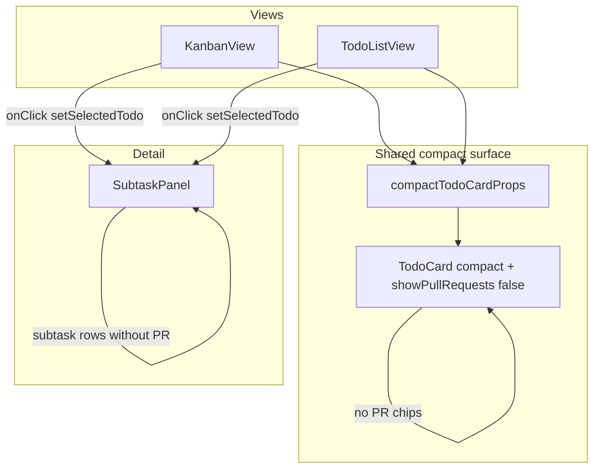

# Compact Todo Views - Plan

## Goal Capsule

- **Objective:** Unify compact todo cards across Kanban and List views, remove PR chips from cards, and route full todo detail (including PRs) through the shared detail popup. List view opens the same popup on click instead of expanding subtasks inline.
- **Authority:** This plan; user confirmed during scoping that subtask-level PR chips are also removed from the popup subtask list (todo-level PR section remains).
- **Stop conditions:** Block only if extracting shared card props breaks existing Kanban behavior in manual verification.
- **Execution profile:** Frontend-only in `apps/web`; no API, schema, or backend changes.
- **Tail ownership:** Implementer runs verification contract before marking done.

---

## Product Contract

### Summary

Kanban and List todo cards show the same compact fields: uuid, title, service, deployed environments, and active testcase-scan progress. Pull request chips disappear from cards everywhere. Clicking a card in either view opens `SubtaskPanel`, which keeps the todo-level PR section but no longer shows PR chips on individual subtask rows.

### Problem Frame

Kanban cards still render PR chips even though PR detail lives in the popup. List view cards are heavier than Kanban: they show inline subtasks, description, status badge, associated tickets, and PRs. Operators want both views to scan the same signal density on cards and use one popup for depth.

### Requirements

#### Compact card surface

- R1. Todo cards in Kanban and List display only: uuid, title, service badge, deployed environment chips, and active testcase-scan indicator (same `getActiveTestcaseScans` + compact scan list used on Kanban today).
- R2. Todo cards in Kanban and List do not render todo-level PR chips.
- R3. Todo cards in Kanban and List do not render associated ticket chips, description, or per-card status badge (status remains on the group/column header).
- R4. List view cards may show subtask count when subtasks exist, matching Kanban (`showSubtaskCount`).
- R5. List view cards use compact uuid styling (`compactUuid`), matching Kanban.

#### Popup behavior

- R6. Clicking a todo card in List view opens the same `SubtaskPanel` used by Kanban (overlay, Escape to close, click-outside to close).
- R7. The popup todo-level PR section is unchanged.
- R8. Subtask rows inside the popup show name, deployment chips, and status badge only — no PR chips on subtask rows.

#### Parity and scope

- R9. Kanban card click behavior and popup content are unchanged aside from R2.
- R10. Status-group ordering and within-group `updatedAt` sort remain unchanged.
- R11. No backend, MCP, shared-types, or Releases sidebar changes.

### Acceptance Examples

- AE1. **Kanban card without PR**
  - **Given:** A todo with linked PRs and deployed environments.
  - **When:** Kanban view renders the card.
  - **Then:** PR chips are absent; env chips and scan indicator remain; clicking opens the popup with PR section populated.

- AE2. **List card matches Kanban density**
  - **Given:** The same todo in List view.
  - **When:** List view renders.
  - **Then:** Card shows the same compact fields as Kanban; no inline subtasks, description, tickets, status badge, or PR chips.

- AE3. **List opens shared popup**
  - **Given:** List view with a todo that has subtasks and description.
  - **When:** User clicks the card.
  - **Then:** `SubtaskPanel` opens with full detail; subtask rows have no PR chips.

- AE4. **Popup subtask rows**
  - **Given:** A subtask with linked PRs and deployments.
  - **When:** Popup subtask list renders.
  - **Then:** Deployments and status appear; PR chips do not.

### Scope Boundaries

**In scope:** `TodoCard` visibility props, shared compact card configuration, `TodoListView` popup wiring, `SubtaskPanel` subtask row cleanup, minor CSS if list compact cards need spacing tweaks.

**Deferred to Follow-Up Work:** Adding a frontend test harness (Vitest + Testing Library) for view components; lifting `SubtaskPanel` state to `App` to deduplicate between views.

**Outside this product's identity:** Changing popup section order, removing todo-level PR section, or altering Releases sidebar.

---

## Planning Contract

### Key Technical Decisions

- KTD1. **Gate PR rendering with a `showPullRequests` prop on `TodoCard`.** Default `true` preserves any future non-compact card usage; Kanban and List pass `false`. `(session-settled: user-directed — chosen over deleting PullRequestList from TodoCard entirely: keeps one component usable for richer layouts later.)`
- KTD2. **Extract shared compact card props into a small module** (e.g., `apps/web/src/components/compactTodoCardProps.ts`) consumed by `KanbanView` and `TodoListView` so the two views cannot drift. `(session-settled: user-directed — chosen over duplicating prop lists in each view: user asked for list/kanban parity.)`
- KTD3. **Keep popup selection state local to each view**, mirroring existing `KanbanView` pattern (`useState<TodoDto | null>` + conditional `SubtaskPanel`) rather than lifting to `App`. Lower churn; duplication is two identical state blocks.
- KTD4. **Remove subtask PR rendering only in popup subtask rows**, not the todo-level PR section. `(session-settled: user-directed — chosen over removing all PR UI from popup: user selected hiding subtask PRs specifically.)`

### High-Level Technical Design

### Assumptions

- No caller outside Kanban/List uses `TodoCard` with `showSubtasks` on cards after List is updated; if one exists, it inherits `showPullRequests` default until explicitly set.
- Manual browser verification is acceptable because `apps/web` has no component test runner today.

---

## Implementation Units

### U1. Add PR visibility control to TodoCard

**Goal:** Stop rendering PR chips on cards when views opt out.

**Requirements:** R2, R8 (card-side subtask PR rows when `showSubtasks` is ever true)

**Dependencies:** None

**Files:**
- `apps/web/src/components/TodoCard.tsx` (modify)

**Approach:** Add optional `showPullRequests?: boolean` (default `true`). Wrap the todo-level `PullRequestList` and subtask-row `PullRequestList` renders in that guard.

**Patterns to follow:** Existing boolean visibility props (`showDescription`, `showAssociatedTickets`, `showSubtasks`).

**Test scenarios:**
- Happy path: `showPullRequests={false}` with PRs on todo — card DOM has no `.pr-list` / PR chip elements.
- Edge case: `showPullRequests={true}` (default) — PR chips still render (backward compatibility).
- Edge case: todo with empty PR array — no PR section regardless of prop.

**Verification:** Typecheck passes; Kanban manual spot-check shows no PR on card, popup still has PR section.

---

### U2. Shared compact card props module

**Goal:** Single source of truth for compact card configuration used by both views.

**Requirements:** R1, R4, R5

**Dependencies:** U1

**Files:**
- `apps/web/src/components/compactTodoCardProps.ts` (create)
- `apps/web/src/components/KanbanView.tsx` (modify)

**Approach:** Export a constant or factory, e.g. `COMPACT_TODO_CARD_PROPS`, matching current Kanban settings: `compact`, `compactUuid`, `showSubtasks: false`, `showSubtaskCount: true`, `showStatus: false`, `showDescription: false`, `showAssociatedTickets: false`, `showPullRequests: false`. Spread into `TodoCard` in `KanbanView`.

**Patterns to follow:** KanbanView's existing prop block in `KanbanView.tsx`.

**Test scenarios:**
- Happy path: exported object includes all flags required by R1 and R4–R5.
- Integration scenario: Kanban regression — card still shows uuid, title, service, env, scan indicator, subtask count; no PR.

**Verification:** Kanban behavior unchanged after refactor.

---

### U3. Compact List view with shared popup

**Goal:** List view cards match Kanban compact surface and open `SubtaskPanel` on click.

**Requirements:** R1–R7, R9–R10

**Dependencies:** U2

**Files:**
- `apps/web/src/components/TodoListView.tsx` (modify)

**Approach:** Add `useState<TodoDto | null>` for `selectedTodo`. Map todos with `TodoCard` spreading `COMPACT_TODO_CARD_PROPS` and `onClick={() => setSelectedTodo(todo)}`. Remove `showSubtasks` from list cards. Render `{selectedTodo && <SubtaskPanel todo={selectedTodo} onClose={() => setSelectedTodo(null)} />}` after the list, same structure as `KanbanView`.

**Patterns to follow:** `KanbanView.tsx` selection + panel pattern.

**Test scenarios:**
- Happy path: list card click opens panel with todo title and description.
- Happy path: list card shows no inline subtask list.
- Edge case: Escape closes panel in List view.
- Edge case: click overlay closes panel.
- Integration scenario: switch List → Kanban → List; panel state does not leak (each view owns its own state; closing on view switch is acceptable — document as expected).

**Verification:** List and Kanban cards visually match for the same todo; popup opens from List.

---

### U4. Remove subtask PR chips from SubtaskPanel

**Goal:** Popup subtask rows no longer show PR links.

**Requirements:** R8, AE4

**Dependencies:** None (can parallelize with U1–U3)

**Files:**
- `apps/web/src/components/SubtaskPanel.tsx` (modify)

**Approach:** Delete `PullRequestList` from subtask `<li>` content inside the Subtasks section. Keep todo-level PR section intact. Remove unused import if `PullRequestList` is only used at todo level (still needed).

**Patterns to follow:** Subtask row layout after removal: name + `DeployedEnvironmentList` + status badge.

**Test scenarios:**
- Happy path: subtask with PRs — row shows name and deployments, no PR chip.
- Happy path: todo-level PR section still lists PRs when present.
- Edge case: subtask with no deployments — name and status only.

**Verification:** Manual popup check with subtasks that have PRs.

---

### U5. List view CSS touch-up (conditional)

**Goal:** Ensure compact interactive list cards have correct spacing/hover affordance.

**Requirements:** R6 (usable click target)

**Dependencies:** U3

**Files:**
- `apps/web/src/index.css` (modify only if needed)

**Approach:** Reuse `.todo-card-interactive` from Kanban (applied via `onClick` on `TodoCard`). If list-specific selectors (`.status-group-items .todo-card`) need tighter gap after removing subtasks block, adjust minimally.

**Test scenarios:**
- Test expectation: none — visual smoke only unless layout regression is found during implementation.

**Verification:** List cards have pointer cursor and hover border consistent with Kanban.

---

## Verification Contract

| Gate | Command / action | Applies to |
|------|------------------|------------|
| Typecheck + build | `npm run build --workspace=@todo-platform/web` | All units |
| Lint | `npm run lint --workspace=@todo-platform/web` | All units |
| Manual — Kanban | Card shows no PR; click opens popup with PR section | U1, U2 |
| Manual — List | Card matches Kanban fields; click opens same popup | U3 |
| Manual — Popup subtasks | Subtask rows lack PR chips; todo PR section present | U4 |

---

## Definition of Done

- Kanban and List todo cards show only uuid, title, service, deployed envs, active scan indicator, and optional subtask count — no PR, tickets, description, or status badge on the card.
- List view opens `SubtaskPanel` on card click with the same behavior as Kanban.
- Popup subtask rows do not render PR chips; todo-level PR section remains.
- `npm run build` and `npm run lint` pass for `@todo-platform/web`.
- No unrelated refactors or dead code left from removed inline list subtasks.

---

## Appendix

### Sources & Research

- Current Kanban compact props: `apps/web/src/components/KanbanView.tsx`
- Current List (pre-change) inline subtasks: `apps/web/src/components/TodoListView.tsx`
- Card composition: `apps/web/src/components/TodoCard.tsx`
- Popup layout: `apps/web/src/components/SubtaskPanel.tsx`
- Prior related plans: `docs/plans/2026-07-20-004-feat-deployment-display-kanban-sort-plan.md`, `docs/plans/2026-07-21-001-feat-testcase-scan-history-plan.md`
