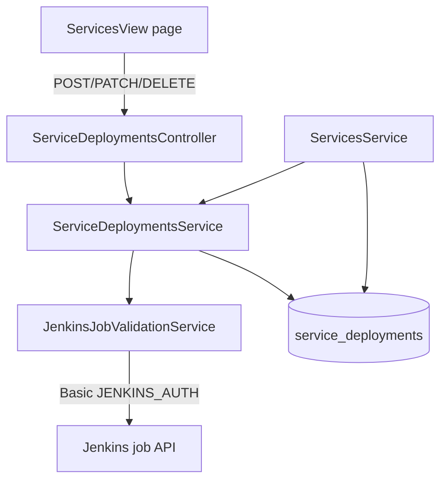
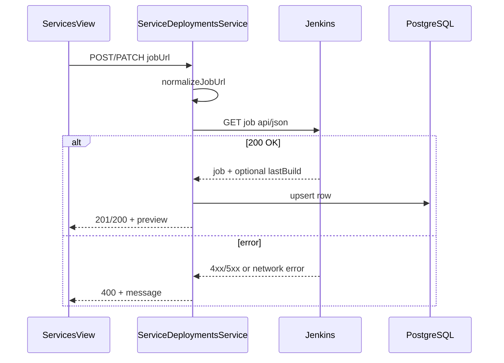

# feat: Service deployment configuration

## Goal Capsule

- **Objective:** Extend the services catalog so each service stores Jenkins deployment targets per environment (env + job URL), editable incrementally from a new web Services page, with the API validating each save by calling Jenkins using existing `JENKINS_AUTH` credentials.
- **Authority:** Product Contract defines behavior; user-confirmed incremental save semantics override a full-replace default.
- **Stop conditions:** Block on schema/API contract conflicts, Jenkins validation wiring failures, or failing verification gates — not on styling polish.
- **Execution profile:** Standard layered change across Prisma, shared types, backend validation service, REST API, web page, and integration tests.

---

## Product Contract

### Summary

The platform already stores services as `keyName` + `displayName` and polls Jenkins for todo/release deployment monitors. This feature adds a **catalog-level** deployment map on each service: one Jenkins job URL per environment. Operators configure these mappings on a dedicated Services page; each row save hits the API, which normalizes the URL, verifies the Jenkins job is reachable, optionally returns last-build snapshot metadata, and persists only on success.

### Problem Frame

Release and todo deployment monitors require operators to supply Jenkins job URLs at deploy time, but there is no durable place to record which Jenkins job belongs to which service and environment. Service identity (`billing-api`, `auth`, etc.) is already centralized; deployment job URLs should live alongside it so humans can maintain the catalog once and downstream features can reuse it later.

### Requirements

#### Data model

- R1. Each service may have zero or more deployment configurations, each pairing an **environment** with a **Jenkins job URL** (job-level URL, not a specific build).
- R2. Environment values use the existing deployment vocabulary: `dev`, `uat`, `uat-main`, `staging`, `prod` (same set as `DeploymentMonitorConfig.env`).
- R3. At most one deployment configuration per `(service, environment)` pair.
- R4. Deleting a service cascades deletion of its deployment configurations.

#### API

- R5. `GET /services/:id` and `GET /services` include nested deployment configurations for each service.
- R6. Incremental write endpoints (not full replace):
  - `POST /services/:id/deployments` — create a new env + job URL for the service.
  - `PATCH /services/:serviceId/deployments/:deploymentId` — update the job URL for an existing row (environment immutable after create).
  - `DELETE /services/:serviceId/deployments/:deploymentId` — remove one configuration.
- R7. On `POST` and `PATCH`, the API validates the submitted job URL **before** persisting:
  - Normalize input (trim, strip trailing slashes, strip accidental trailing `/buildNumber` if pasted).
  - Call Jenkins job JSON API with server-wide `JENKINS_AUTH` (`Authorization: Basic …`).
  - **Valid** when Jenkins returns HTTP 200 for the job — even if the job has no builds yet.
  - **Invalid** when Jenkins returns non-2xx, auth is missing, URL is malformed, or the host is unreachable — return 400 with a clear error message; do not persist.
- R8. Successful validation responses include a preview of fetched deployment info when available (job name, optional last-build number/status/url/timestamp) so the UI can confirm what Jenkins returned.
- R9. Duplicate environment on `POST` for the same service returns 409.
- R10. Unknown service or deployment id returns 404.

#### Web UI

- R11. Add a dedicated **Services** page reachable from the main app navigation (peer to List/Kanban).
- R12. The page lists services from `GET /services` and lets the user select one to edit.
- R13. For the selected service, show deployment rows with environment selector, Jenkins job URL input, per-row **Save** (create/update), and **Delete**.
- R14. **Add environment** adds a new unsaved row; saving calls `POST`; editing an existing row calls `PATCH`.
- R15. Display validation errors from the API inline; on success show the validation preview fields returned by the API (e.g., job name, last build #/status when present).
- R16. Service `keyName` / `displayName` remain read-only on this page (catalog CRUD stays REST/MCP-only, consistent with the service lookup v1 posture).

#### Out of scope (v1)

- Auto-filling release or todo monitor configs from the service catalog.
- MCP write tools for deployment configuration (read-only inclusion in `GET /services` responses is sufficient for agent visibility).
- Per-environment Jenkins credential selection (always `JENKINS_AUTH`, matching deployment monitors).
- Requiring a last build to exist for validation to pass.

### Actors

- A1. Human operator — maintains service deployment mappings via the web Services page.
- A2. Coding agent — may read deployment configs via existing service list/get endpoints (nested field only).

### Key Flows

- F1. Operator opens Services page → selects `billing-api` → adds `dev` + Jenkins job URL → Save → API validates against Jenkins → row persisted → preview shown.
- F2. Operator updates `uat` job URL → Save → API re-validates → row updated.
- F3. Operator deletes a stale `staging` row → `DELETE` succeeds → row removed.
- F4. Operator pastes a full build URL ending in `/123` → API normalizes to job URL → validation proceeds against the job.

### Acceptance Examples

- AE1. **Create valid deployment config**
  - **Given:** Service `auth` exists and Jenkins returns 200 for the submitted job URL.
  - **When:** Operator POSTs `{ environment: "dev", jobUrl: "https://jenkins.example.net/job/auth-dev" }`.
  - **Then:** Response 201 includes persisted row plus validation preview; `GET /services/:id` lists the new deployment.

- AE2. **Reject unreachable Jenkins job**
  - **Given:** Jenkins returns 404 for the job URL.
  - **When:** Operator saves a new row.
  - **Then:** Response 400 with error message; no DB row created.

- AE3. **Incremental update**
  - **Given:** Service already has a `dev` deployment row.
  - **When:** Operator PATCHes a new job URL for that row.
  - **Then:** Only that row changes; other environments untouched.

- AE4. **Duplicate environment blocked**
  - **Given:** Service already has `uat` configured.
  - **When:** Operator POSTs another `uat` row.
  - **Then:** Response 409.

### Scope Boundaries

**In scope:** Prisma model + migration, shared types, Jenkins validation helper, REST endpoints, web Services page, backend unit + integration tests, README API section update.

**Deferred to Follow-Up Work:**

- MCP tools to create/update/delete service deployment configs.
- Using catalog job URLs to pre-fill release deployment inputs or todo deployment monitors.
- Web UI for service catalog CRUD (create/rename/delete services).

**Out of scope:** Storing build numbers in the catalog; polling/scheduled refresh of catalog entries; `JENKINS_SCAN_AUTH` jobs (testcase scan uses a separate credential).

### Success Criteria

- Operators can manage per-service, per-environment Jenkins job URLs from the web Services page with incremental save/delete.
- Invalid Jenkins URLs are rejected with actionable errors; valid jobs persist even without build history.
- Service list/detail API responses expose nested deployment configurations.
- Backend unit and integration test suites pass.

---

## Planning Contract

### Key Technical Decisions

| ID | Decision | Rationale |
|---|---|---|
| KTD-1 | New `ServiceDeployment` table (`serviceId`, `environment`, `jobUrl`, timestamps) with `@@unique([serviceId, environment])` and `onDelete: Cascade` from `Service` | Normalized rows fit incremental CRUD; unique constraint enforces R3; cascade keeps orphan configs out when a service is deleted. |
| KTD-2 | Incremental REST (`POST` / `PATCH` / `DELETE` per row) | User-confirmed save semantics; matches per-row Save buttons in the UI. |
| KTD-3 | Validate on write only (no background polling of catalog entries) | Catalog stores intent, not live status; monitors already poll builds at deploy time. |
| KTD-4 | Extract shared Jenkins job fetch helper from `DeploymentMonitorProvider` | Avoid duplicating auth header, timeout, and error mapping; job-level API differs from build-level monitor check. |
| KTD-5 | Job-level validation via `GET {jobUrl}/api/json?tree=name,url,lastBuild[number,result,building,duration,timestamp,url]` | Confirms job exists (R7); last-build subtree is optional preview data (R8). |
| KTD-6 | Normalize pasted build URLs by stripping trailing `/digits` before validation/persist | Reuses pattern from `normalizeDeploymentMonitorConfig` in `apps/backend/src/common/parse-jenkins-job-url.ts`. |
| KTD-7 | Environment enum reuse (`DeployedEnvironmentName` + `'prod'`) | Aligns catalog env names with deployment monitors and release vocabulary. |
| KTD-8 | Services page as third header nav mode in `App.tsx` | Matches existing List/Kanban toggle pattern; no new router dependency in v1. |
| KTD-9 | Incremental REST per row (session-settled: user-directed — chosen over full-list replace on submit: operator saves one environment at a time from the UI) | User confirmed at scope checkpoint. |

### High-Level Technical Design

**Validation gate on write:**

### Assumptions

- `JENKINS_AUTH` is configured in environments where validation is expected; missing auth returns 400 with a clear configuration error (same posture as deployment monitors).
- Job URLs point at the same Jenkins instance(s) already used by deployment monitors.
- Operators paste HTTPS Jenkins job URLs; no folder-job path parsing beyond existing trailing-slash and build-number stripping.

### Sequencing

Schema and shared types → Jenkins validation helper → backend endpoints → web page → tests and README.

---

## Implementation Units

### U1. Schema and shared types

**Goal:** Persist service deployment configurations and expose typed contracts across backend and web.

**Requirements:** R1, R2, R3, R4, R5

**Dependencies:** None

**Files:**
- `apps/backend/prisma/schema.prisma`
- `apps/backend/prisma/migrations/<timestamp>_service_deployments/migration.sql` (via migrate)
- `packages/shared-types/src/index.ts`

**Approach:** Add `ServiceDeployment` model with UUID id, `serviceId` FK, `environment` string column, `jobUrl` string column, timestamps, unique `(serviceId, environment)`, cascade delete from `Service`. Add `ServiceDeploymentDto`, `CreateServiceDeploymentDto`, `UpdateServiceDeploymentDto`, `ServiceDeploymentValidationPreviewDto`, and `ServiceDeploymentWriteResponseDto` (row + preview). Extend `ServiceDto` with `deployments: ServiceDeploymentDto[]` defaulting to `[]` in mappers when empty.

**Patterns to follow:** `ReleaseDeployment` relation pattern in `schema.prisma`; DTO nesting on `ServiceDto` like `TodoDto.service`.

**Test scenarios:**
- Test expectation: none — types-only unit; behavior covered in U2–U3 integration tests.

**Verification:** `npm run build --workspace=@todo-platform/shared-types` succeeds; Prisma migrate applies cleanly.

---

### U2. Jenkins job validation helper

**Goal:** Centralize job URL normalization and Jenkins job API fetch for catalog validation.

**Requirements:** R7, R8, F4

**Dependencies:** U1 (types for preview DTO)

**Files:**
- `apps/backend/src/common/normalize-jenkins-job-url.ts` (new)
- `apps/backend/src/common/normalize-jenkins-job-url.spec.ts` (new)
- `apps/backend/src/jenkins/jenkins-job-validation.service.ts` (new)
- `apps/backend/src/jenkins/jenkins-job-validation.service.spec.ts` (new)
- `apps/backend/src/jenkins/jenkins.module.ts` (new)

**Approach:** Extract `normalizeJenkinsJobUrl(input)` — trim, drop trailing slash, strip trailing `/\d+` segment when present (do not require build number). Implement `JenkinsJobValidationService.validateJobUrl(jobUrl)` reading `JENKINS_AUTH` from `ConfigService`, calling job JSON API with 15s timeout, mapping 200 → `{ valid: true, jobName, lastBuild? }`, non-2xx/network → `{ valid: false, error }`. Reuse `parseJobNameFromUrl` from `apps/backend/src/monitors/providers/monitor-providers.ts` for preview job name when Jenkins `name` field absent.

**Patterns to follow:** Auth header and timeout from `DeploymentMonitorProvider.check()` in `monitor-providers.ts`; URL tests from `parse-jenkins-job-url.spec.ts`.

**Test scenarios:**
- Happy path: normalized job URL → mocked Jenkins 200 with `lastBuild` → valid preview populated.
- Job reachable, no builds: Jenkins 200 with `lastBuild: null` → valid, preview without build fields.
- Trailing build number stripped before fetch (`.../job/foo/42` → `.../job/foo`).
- Jenkins 404 → invalid with message.
- Missing `JENKINS_AUTH` → invalid with configuration message.

**Verification:** `npm test --workspace=@todo-platform/backend -- --testPathPattern='normalize-jenkins-job-url|jenkins-job-validation'` passes.

---

### U3. Service deployment REST API

**Goal:** Incremental CRUD for service deployment rows with validate-then-persist semantics.

**Requirements:** R5, R6, R7, R8, R9, R10, AE1–AE4

**Dependencies:** U1, U2

**Files:**
- `apps/backend/src/services/service-deployments.service.ts` (new)
- `apps/backend/src/services/service-deployments.controller.ts` (new)
- `apps/backend/src/common/service-deployment.dto.ts` (new)
- `apps/backend/src/services/services.module.ts`
- `apps/backend/src/services/services.service.ts`
- `apps/backend/src/common/mappers.ts`
- `apps/backend/test/service-deployments.integration-spec.ts` (new)

**Approach:** Register nested routes under services module: `POST /services/:id/deployments`, `PATCH /services/:serviceId/deployments/:deploymentId`, `DELETE /services/:serviceId/deployments/:deploymentId`. On create/update, call validation service first; abort with 400 if invalid. Persist normalized job URL. Extend `ServicesService.findAll/findOne` to `include: { deployments: { orderBy: { environment: 'asc' } } }` and map to DTOs. Validate environment enum in DTO layer. PATCH allows `jobUrl` only.

**Execution note:** Implement integration tests with mocked `fetch` (same pattern as `monitor-providers.spec.ts`) so CI does not require live Jenkins.

**Patterns to follow:** Controller/service split in `services.controller.ts`; validation pipe on DTOs in `service.dto.ts`; integration spec layout in `services.integration-spec.ts`.

**Test scenarios:**
- POST creates row when Jenkins mock returns 200; response includes preview.
- POST returns 400 when Jenkins mock returns 404; DB unchanged.
- POST duplicate environment returns 409.
- PATCH updates jobUrl after re-validation; environment unchanged.
- DELETE removes row; GET service no longer lists it.
- GET /services includes deployments array on each service.

**Verification:** Integration spec passes; existing `services.integration-spec.ts` still passes.

---

### U4. Web Services configuration page

**Goal:** Operators manage deployment rows incrementally from the dashboard.

**Requirements:** R11, R12, R13, R14, R15, R16, F1–F3

**Dependencies:** U3

**Files:**
- `apps/web/src/components/ServicesView.tsx` (new)
- `apps/web/src/App.tsx`
- `apps/web/src/api.ts`
- `apps/web/src/index.css`

**Approach:** Add `Services` button to header view toggle (alongside List/Kanban). `ServicesView` loads services via React Query, shows service picker (list or select), renders deployment table for selected service. Each row: environment `<select>` (disabled when editing existing row), job URL input, Save and Delete buttons. Save calls POST or PATCH based on row state; show API error text or success preview (job name, last build). Add environment button appends draft row. Use existing badge/chip styling from `ServiceBadge.tsx` and form patterns from `ReleasesView.tsx`.

**Patterns to follow:** Data fetching in `App.tsx` / `ReleasesView.tsx`; API helpers in `api.ts`; compact layout in sidebar-style panels.

**Test scenarios:**
- Test expectation: none — no frontend test runner; manual smoke only.

**Verification:** `npm run build --workspace=@todo-platform/web` succeeds; manual smoke: add dev row, see validation preview, update URL, delete row.

---

### U5. Shared API client and documentation

**Goal:** Keep programmatic clients and docs aligned with new endpoints.

**Requirements:** R5, R6 (agent read path)

**Dependencies:** U3

**Files:**
- `packages/shared-api/src/index.ts`
- `README.md` (API section)

**Approach:** Add client methods: `createServiceDeployment`, `updateServiceDeployment`, `deleteServiceDeployment`. Document nested `deployments` on service responses and the three write endpoints with validation behavior.

**Test scenarios:**
- Test expectation: none — thin client wrappers; behavior covered by backend integration tests.

**Verification:** `npm run build --workspace=@todo-platform/shared-api` succeeds.

---

## Verification Contract

| Gate | Command | Applies |
|---|---|---|
| Shared types build | `npm run build --workspace=@todo-platform/shared-types` | U1+ |
| Backend unit tests | `npm test --workspace=@todo-platform/backend` | U2–U3 |
| Backend integration tests | `DATABASE_URL=… REDIS_URL=… npm run test:integration --workspace=@todo-platform/backend` | U3 |
| Shared API build | `npm run build --workspace=@todo-platform/shared-api` | U5 |
| Web build | `npm run build --workspace=@todo-platform/web` | U4 |
| Lint (if touched) | `npm run lint --workspaces --if-present` | All |

---

## Definition of Done

- Requirements R1–R16 satisfied.
- Units U1–U5 complete per verification gates.
- No live Jenkins dependency in automated tests (mocked fetch).
- README documents service deployment endpoints and validation behavior.
- Manual smoke: configure two environments for one service, confirm invalid URL rejected, valid URL shows preview.

---

## System-Wide Impact

- **API consumers:** `ServiceDto` gains `deployments[]` — backward-compatible optional array for existing clients.
- **Release/todo monitors:** Unchanged in v1; catalog is standalone until follow-up wiring.
- **Credentials:** Reuses `JENKINS_AUTH`; no new secrets surface.
- **Migration:** One additive migration; empty backfill.

---

## Risks & Dependencies

| Risk | Mitigation |
|---|---|
| Jenkins folder jobs need encoded paths | Document expected URL shape; extend normalizer in follow-up if folder jobs appear |
| Operators paste build URLs habitually | Strip trailing build number (KTD-6); show normalized URL in success response |
| Validation latency on save | 15s timeout; disable Save button while pending in UI |
| Service delete blocked by `ReleaseDeployment` Restrict FK | Existing behavior unchanged; deployment cascade only affects catalog rows |

---

## Open Questions

| Question | Status |
|---|---|
| Should MCP gain write tools for deployment configs in v1? | Deferred — read-only nested field sufficient for now |
| Auto-fill release deploy URLs from catalog? | Deferred follow-up |

---

## Sources & Research

- Service catalog baseline: `docs/plans/2026-07-20-005-feat-todo-service-lookup-plan.md`
- Jenkins auth and build polling: `docs/plans/2026-07-20-001-feat-jenkins-deploy-monitor-plan.md`
- Existing `Service` model: `apps/backend/prisma/schema.prisma`
- Jenkins monitor provider: `apps/backend/src/monitors/providers/monitor-providers.ts`
- URL normalization: `apps/backend/src/common/parse-jenkins-job-url.ts`
- Web navigation pattern: `apps/web/src/App.tsx`
