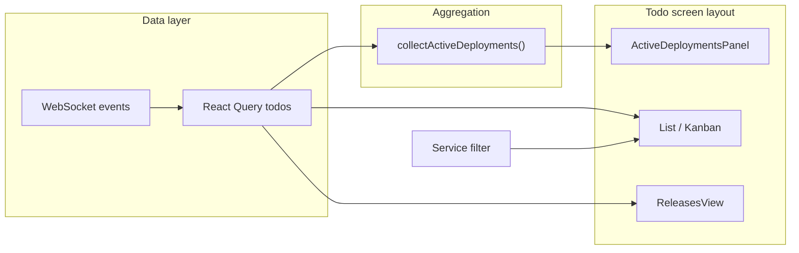

# feat: Todo screen active deployments sidebar

## Goal Capsule

- **Objective:** Add a left-side panel on the todo screen that surfaces all in-progress service deployments in one place, with service name, environment, status, and a click-through to the Jenkins build.
- **Authority:** Product Contract; user confirmed the panel ignores the header service filter and shows deployments across all services.
- **Stop conditions:** Block only if todo deployment enrichment data is unavailable on the client (research shows `TodoDto.deployedEnvironments[].deployment` is already populated via existing monitor polling and WebSocket invalidation).
- **Execution profile:** Frontend-only change in `apps/web`; no API, schema, or MCP work.
- **Tail ownership:** Implementer runs verification contract before marking done.

---

## Product Contract

### Summary

Operators already see deployment chips on individual todo cards (`DeployedEnvironmentList`). This feature adds a dedicated **Active Deployments** sidebar on the todo screen so in-progress deploys are visible without scanning every card. The panel lists service name, deployed environment, and deployment status; clicking a row opens the Jenkins build URL when one exists. Todo-card deployment chips and the right-side Releases panel stay unchanged.

### Problem Frame

When several services deploy at once, status is buried inside todo cards in the main list/kanban area. There is no aggregate view of what is actively deploying. Operators want a persistent left-side section on the todo screen — symmetric to the existing Releases panel on the right — that answers "what is deploying right now?" at a glance.

### Requirements

#### Panel content

- R1. On the todo screen (list and kanban modes), render a left-side panel titled **Active Deployments** (or equivalent concise label).
- R2. Each row shows **service name**, **deployed environment**, and **deployment status**.
- R3. Include only deployments whose `deployment.status` is `in_progress` (`DeploymentStatus.IN_PROGRESS`).
- R4. Aggregate deployments from a todo's own `deployedEnvironments` and from each subtask's `deployedEnvironments` (subtasks inherit the parent todo's service).
- R5. Service name uses `todo.service.displayName` when present; otherwise show **Unassigned**.
- R6. Clicking a row opens `deployment.buildUrl` in a new tab when the URL exists; rows without a build URL remain visible but are not links.
- R7. Rows reuse existing deployment status visual language (spinner / color cues consistent with `DeployedEnvironmentList`).

#### Data scope and live updates

- R8. The panel reads from the full todos query (`['todos']`), **not** the header service filter — operators see all in-progress deployments even when the main view is filtered to one service.
- R9. Panel content updates on the same live-update path as todo cards (React Query cache + existing WebSocket `todo.*`, `subtask.*`, and `monitor.*` invalidation).

#### Layout and scope

- R10. Todo screen layout becomes three columns on wide viewports: active deployments (left), main todo content (center), releases (right).
- R11. On narrow viewports, panels stack with the main todo content first (match existing releases responsive behavior).
- R12. Todo-card deployment chips, popup deployment lines, and the Releases panel are unchanged.

### Acceptance Examples

- AE1. **Single in-progress deployment**
  - **Given:** Todo for service `Billing` has `uat` with `deployment.status = in_progress` and a `buildUrl`.
  - **When:** The todo screen renders.
  - **Then:** Left panel shows one row: Billing · uat · in progress; clicking opens the Jenkins URL.

- AE2. **Subtask deployment inherits service**
  - **Given:** Todo for `Auth` has a subtask with `dev` deploying (`in_progress`).
  - **When:** The todo screen renders.
  - **Then:** Panel row shows Auth · dev · in progress (not the subtask name).

- AE3. **Service filter does not hide panel rows**
  - **Given:** Two todos on different services both have in-progress deployments; header filter is set to one service.
  - **When:** The todo screen renders.
  - **Then:** Main list/kanban shows only filtered todos; left panel still lists both in-progress deployments.

- AE4. **Empty state**
  - **Given:** No todo or subtask has `deployment.status = in_progress`.
  - **When:** The todo screen renders.
  - **Then:** Panel shows a short empty message (no rows).

- AE5. **No build URL**
  - **Given:** A deploying env has `in_progress` status but no `buildUrl`.
  - **When:** The panel renders.
  - **Then:** Row shows service, env, and status; row is not a link.

### Scope Boundaries

**In scope:** Left deployments panel, client-side aggregation utility, layout/CSS, unit tests for aggregation logic.

**Deferred to Follow-Up Work:** Showing recently finished (success/fail) deployments in the panel; clicking a row to open the todo popup; backend aggregate endpoint; Vitest migration for the whole web app.

**Outside this product's identity:** Service-catalog deployment config editing (Services page); release-level deployment tracking (Releases panel).

---

## Planning Contract

### Key Technical Decisions

- KTD1. **Panel data source (session-settled: user-directed — chosen over respecting header filter: user wants cross-service visibility while filtering todos):** Pass the unfiltered `todos` array from `App.tsx` into the panel component, not `filteredTodos`.
- KTD2. **Aggregation location:** Extract a pure helper `collectActiveDeployments(todos: TodoDto[])` in `apps/web/src/utils/` rather than embedding flatten logic in the component — enables focused unit tests (same pattern as `deploymentSort.ts` and `serviceFilter.ts`).
- KTD3. **In-progress filter:** Only `DeploymentStatus.IN_PROGRESS` rows appear. Success and fail deployments remain on todo cards only.
- KTD4. **Row identity:** Deduplicate by `(todoId, source: 'todo' | subtask', sourceId, env.name)` so the same env is not listed twice if enrichment overlaps (defensive; unlikely today but cheap).
- KTD5. **Sort order:** Newest activity first — use `getDeploymentSortKey` from `deploymentSort.ts` when available, else `Date.parse(env.updatedAt)`.
- KTD6. **Component shape:** New `ActiveDeploymentsPanel` mirrors `ReleasesView` structure (title, loading/error passthrough optional, empty state, scrollable list) rather than overloading `DeployedEnvironmentList`, which is optimized for env chips inside cards.
- KTD7. **Layout grid:** Extend `.app-layout` to `grid-template-columns: minmax(140px, 180px) minmax(0, 1fr) minmax(160px, 200px)` on wide screens; keep `.app-layout-full` for the Services section.

### High-Level Technical Design

### Assumptions

- User confirmed panel ignores header service filter (KTD1).
- Unassigned-service deploying todos show **Unassigned** rather than being hidden.
- Panel label **Active Deployments** is acceptable; implementer may shorten to **Deploying** if space is tight in CSS.

---

## Implementation Units

### U1. Active deployment aggregation helper

**Goal:** Pure function that flattens todos and subtasks into panel-ready in-progress deployment rows.

**Requirements:** R3, R4, R5, R8

**Dependencies:** None

**Files:**
- `apps/web/src/utils/activeDeployments.ts` (create)
- `apps/web/src/utils/activeDeployments.test.ts` (create)

**Approach:** Export `ActiveDeploymentRow` type with fields: `todoId`, `serviceLabel`, `environment`, `status`, `buildUrl`, `sortKey`. Walk each todo: emit rows from `todo.deployedEnvironments`, then from each subtask's envs with the parent todo's service. Filter to `DeploymentStatus.IN_PROGRESS`. Map service to `displayName` or `'Unassigned'`. Sort by `sortKey` descending. Extend `apps/web/package.json` `test` script to include the new test file (same `tsx --test` pattern as `serviceFilter.test.ts`).

**Patterns to follow:** `apps/web/src/utils/deploymentSort.ts`, `apps/web/src/utils/serviceFilter.test.ts`.

**Test scenarios:**
- Todo-level `in_progress` deployment produces one row with correct service, env, status, and `buildUrl`.
- Subtask `in_progress` deployment inherits parent service display name.
- Todo without service uses `Unassigned` label.
- `success` and `fail` deployments are excluded.
- Multiple rows sort newest-first when timestamps differ.
- Empty todos array returns empty list.

**Verification:** `npm run test --workspace=@todo-platform/web` passes including new tests.

---

### U2. ActiveDeploymentsPanel component

**Goal:** Render the left sidebar list with click-through links and empty state.

**Requirements:** R1, R2, R6, R7, R9, AE1, AE4, AE5

**Dependencies:** U1

**Files:**
- `apps/web/src/components/ActiveDeploymentsPanel.tsx` (create)

**Approach:** Accept `todos: TodoDto[]`. Call `collectActiveDeployments(todos)` inside `useMemo`. Render panel shell matching `releases-panel` typography. Each row: service name (primary), env chip styling via existing `env-chip-*` classes, status text or badge, spinner when in progress. Wrap row in `<a>` when `buildUrl` exists (`target="_blank"`, `rel="noopener noreferrer"`); otherwise render a static `
`. Empty state: short muted copy ("No deployments in progress").

**Patterns to follow:** `apps/web/src/components/ReleasesView.tsx`, link/stopPropagation pattern in `DeployedEnvironmentList.tsx`.

**Test scenarios:**
- Test expectation: none — component behavior covered by utility tests plus manual smoke; no component test runner today.

**Verification:** Manual smoke — panel lists rows and link opens Jenkins in new tab.

---

### U3. Todo screen layout wiring

**Goal:** Mount the panel on the todo screen and pass unfiltered todos.

**Requirements:** R8, R10, R11, R12, AE3

**Dependencies:** U2

**Files:**
- `apps/web/src/App.tsx` (modify)

**Approach:** Import `ActiveDeploymentsPanel`. Inside `section === 'todos'`, wrap layout as: left `<aside className="app-deployments">` with panel (pass `todos ?? []` from query, not `filteredTodos`), center `.app-main` unchanged, right `.app-releases` unchanged. Do not gate panel on `filteredTodos.length` — show even when filter yields zero main rows.

**Patterns to follow:** Existing `app-releases` aside in `App.tsx`.

**Test scenarios:**
- With service filter active, panel still receives full todos array (assert via code review / manual AE3).
- Services section layout unchanged (`app-layout-full`).

**Verification:** Filter todos in header; confirm panel still shows all in-progress deployments.

---

### U4. Layout and panel styling

**Goal:** Three-column grid on desktop; stacked panels on mobile.

**Requirements:** R10, R11, R7

**Dependencies:** U3

**Files:**
- `apps/web/src/index.css` (modify)

**Approach:** Update `.app-layout` grid to three columns. Add `.app-deployments` with same sticky/scroll constraints as `.app-releases`. Style `.deployments-panel`, `.deployment-active-row`, hover/focus states mirroring `.release-summary`. Reuse env color classes from existing chips. At `@media (max-width: 960px)`, stack columns: main first, then deployments, then releases (or deployments before releases — pick order that keeps main content highest; prefer deployments then releases below main).

**Execution note:** Prefer runtime smoke verification over unit coverage for CSS.

**Patterns to follow:** `.releases-panel` and `.release-summary` blocks in `index.css`.

**Test scenarios:**
- Test expectation: none — visual/responsive smoke only.

**Verification:** Resize viewport below 960px; panels stack without horizontal overflow.

---

## Verification Contract

| Gate | Command / action | Applies to |
|------|------------------|------------|
| Unit tests | `npm run test --workspace=@todo-platform/web` | U1 |
| Typecheck + build | `npm run build --workspace=@todo-platform/web` | All units |
| Lint | `npm run lint --workspace=@todo-platform/web` | All units |
| Manual — panel content | Todo with in-progress deploy shows service, env, status in left panel | U2, U4 |
| Manual — link | Click row with `buildUrl` opens Jenkins in new tab | U2 |
| Manual — filter independence | Header service filter active; panel still shows other services' deploys | U3, AE3 |
| Manual — empty | No in-progress deploys shows empty state | U2 |
| Manual — regression | Todo card chips and Releases panel unchanged | U3 |

---

## Definition of Done

- Todo screen shows a left **Active Deployments** panel on wide viewports with service name, environment, and in-progress status per row.
- Clicking a row with a build URL opens the Jenkins deployment link in a new tab.
- Panel lists all in-progress deployments from the full todos dataset, ignoring the header service filter.
- Subtask deployments appear under the parent todo's service name.
- Empty state renders when nothing is in progress.
- `npm run test`, `npm run build`, and `npm run lint` pass for `@todo-platform/web`.
- No backend, shared-types, or MCP changes.

---

## Appendix

### Sources & Research

- Todo screen layout: `apps/web/src/App.tsx` (main + right releases; service filter on main only)
- Deployment chip rendering and link behavior: `apps/web/src/components/DeployedEnvironmentList.tsx`
- Right panel pattern: `apps/web/src/components/ReleasesView.tsx`
- Deployment sort helper: `apps/web/src/utils/deploymentSort.ts`
- Live updates: `apps/web/src/hooks/useWebSocket.ts`
- Responsive layout breakpoint: `apps/web/src/index.css` (`@media (max-width: 960px)`)
- Related plans: `docs/plans/2026-07-20-004-feat-deployment-display-kanban-sort-plan.md`, `docs/plans/2026-07-20-002-feat-todo-deployment-monitor-plan.md`
- User scoping confirmation: panel shows all services (ignore header filter); in-progress only; unassigned label default
