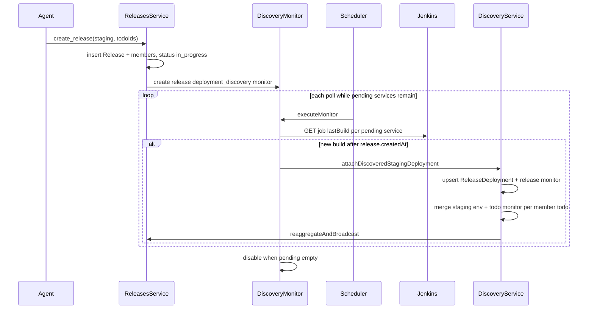

# feat: Automatic staging deployment discovery for releases

## Goal Capsule

- **Objective:** When a staging release enters `in_progress` without deploy URLs for every member service, the backend automatically watches each service's catalog staging Jenkins job for a new build, then attaches release deployment monitors and todo-level staging env chips plus deployment monitors for that service's member todos — matching the MCP/todox-deploy attach flow. The discovery monitor stops once every discoverable member service has a deployment attached.
- **Authority:** User-confirmed scope (staging-only, release-level discovery monitor, post-create build timestamp rule, missing catalog URL is non-blocking).
- **Stop conditions:** Block on schema XOR ownership conflicts, broken monitor provider registration, or failing release/integration tests — not on web UI polish for discovery state.
- **Execution profile:** Standard cross-cutting change across Prisma, shared types, monitor provider, scheduler, and releases orchestration.

---

## Product Contract

### Summary

Staging releases today require an agent to manually call `update_release` with Jenkins job URLs and build numbers before monitoring begins. This feature closes that gap: on create (or when partial deploy URLs are supplied), the backend starts a release-level **deployment discovery** monitor that polls catalog staging job URLs until each member service gets a new Jenkins build, then chains into the existing release-deployment and todo-deployment monitor paths automatically.

### Problem Frame

Release generation already aggregates multi-service Jenkins outcomes and completes member todos on staging success, but something external must still tell todoX *which* build to watch. Agents using todox-deploy attach todo monitors manually after triggering Jenkins. For releases, the gap is wider: without explicit deploy URLs at create time, release status stays `in_progress` with no per-service deployment rows and no todo env chips or monitors — even while staging deploys are already running in Jenkins.

### Requirements

#### Discovery trigger

- R1. Applies to **staging releases only**. Prod releases keep the existing manual deploy URL attach flow unchanged.
- R2. When a staging release is created with status `in_progress` and at least one distinct member service lacks a `ReleaseDeployment` row with both `jobUrl` and `buildNumber`, start a release-level deployment discovery monitor.
- R3. When `create_release` or `update_release` supplies deploy URLs for some but not all member services, start or refresh discovery for the **remaining** services only.
- R4. When all member services already have deploy URLs at create/update time, do **not** create a discovery monitor (existing release-deployment monitor path only).
- R5. Do not start discovery for terminal releases (`successful`, `partial_success`, `failed`).

#### Build detection

- R6. For each pending member service, resolve the catalog staging job URL from `ServiceDeployment` where `environment = 'staging'`.
- R7. Poll Jenkins job JSON API (`lastBuild`) using existing `JENKINS_AUTH`, reusing the same field mapping philosophy as service catalog validation and deployment monitors.
- R8. Treat a build as **created for this release** when `lastBuild.timestamp` is strictly greater than the release's `createdAt` (milliseconds). Ignore older last builds even if they are still running.
- R9. On first qualifying build for a service, capture normalized job base URL and `buildNumber` from Jenkins (`lastBuild.url`, `lastBuild.number`).

#### Chained attach (MCP parity)

- R10. When a service's staging build is discovered, upsert `ReleaseDeployment` for `[releaseId, serviceId]` with `jobUrl`, `buildNumber`, and status `pending`, then start the existing release-deployment Jenkins monitor (`createForReleaseDeployment`).
- R11. For each active `ReleaseMember` todo belonging to that service, in the same transaction batch where practical:
  - Merge `staging` into `deployedEnvironments` without removing existing env chips (same semantics as MCP `add_deployed_environment`).
  - Attach or replace the todo-level `deployment` monitor with `env: staging`, catalog-normalized job URL, and discovered `buildNumber` (same shape as MCP `update_todo` monitor attach).
- R12. Todo monitor attach uses the same cron default as release deploy monitors (`*/5 * * * *`) unless an existing todo monitor is updated in place.
- R13. Discovery attach must **not** mutate todo status directly; existing release-deployment monitor success path continues to complete staging todos.

#### Discovery monitor lifecycle

- R14. Exactly one deployment discovery monitor per release while discovery is active.
- R15. After a service is discovered and chained, remove it from the discovery monitor's pending service list.
- R16. When every discoverable pending service has been discovered (pending list empty), disable and unschedule the discovery monitor.
- R17. Services missing a catalog staging job URL are excluded from the pending poll list but recorded in monitor `lastResult` metadata so operators can see which services need catalog config or manual `update_release`.
- R18. If an operator manually attaches deploy URLs via `update_release` for a service still in the pending list, remove that service from discovery pending without double-creating deployments.

#### Observability

- R19. Broadcast `release.updated` after each discovered service is chained and when discovery completes.
- R20. Broadcast `todo.updated` for todos receiving env chips and monitors.
- R21. `ReleaseDto` need not expose the discovery monitor in v1; per-service `deployments[]` and existing release status aggregation remain the operator-facing surface.

### Actors

- A1. Coding agent — creates staging releases via MCP without supplying every deploy URL upfront.
- A2. Human operator — may configure catalog staging job URLs on the Services page; views release/todo deployment progress on existing web surfaces.

### Key Flows

- F1. Agent creates staging release with todo IDs only → discovery monitor starts → Jenkins staging builds appear per service → release deployments + todo monitors attach automatically → existing aggregation and staging success side effects run.
- F2. Agent creates staging release with deploy URL for service A only → discovery watches service B → both services eventually monitored.
- F3. Service lacks catalog staging URL → release stays `in_progress` for that service until manual attach or catalog config added (discovery does not retry missing URLs every poll beyond recording the gap).
- F4. Operator manually attaches a missing service via `update_release` while discovery is active → that service drops out of pending; discovery continues for others.

### Acceptance Examples

- AE1. Staging release for services A and B, no deploy URLs, both have catalog staging jobs → discovery monitor created → new builds after release create detected → both get `ReleaseDeployment` rows, release monitors, and member todo staging chips plus todo monitors.
- AE2. Same release but service B has no catalog staging URL → A auto-attaches; B remains undeployed; release stays `in_progress`; discovery monitor stops when A is handled and B is recorded as skipped.
- AE3. Create with deploy URL for A only → discovery pending list contains B only → B discovered later → both services monitored.
- AE4. All deploy URLs supplied at create → no discovery monitor; behavior identical to today.
- AE5. Prod release create → no discovery monitor regardless of missing deploy URLs.

### Scope Boundaries

**In scope:** Prisma/schema extension for release-owned discovery monitors, shared types, new monitor provider, Jenkins poll helper reuse, releases orchestration helper, scheduler branch, unit tests, release integration tests, README note on automatic staging discovery.

**Deferred to Follow-Up Work:**

- Prod release deployment discovery.
- Web UI badge for "waiting for staging deploy" vs "discovery active" (release deployment pending state is sufficient for v1).
- MCP tool changes (create/update release schemas unchanged; behavior is server-side).
- Retrying catalog URL lookup dynamically when an operator adds a staging row mid-flight (v1 records skip; manual `update_release` or a follow-up release is the escape hatch).
- Triggering Jenkins builds (discovery is poll-only, same posture as existing monitors).

**Out of scope:** Changing aggregation rules, prod archive behavior, or manual redeploy immutability for successful services.

### Success Criteria

- Staging releases without full deploy URLs automatically gain per-service release deployments and todo monitors when Jenkins builds appear.
- Discovery monitor stops after all discoverable services are handled.
- Partial manual deploy URLs and full manual URLs coexist correctly with discovery.
- Prod releases and existing release-deployment monitor behavior are unchanged.
- Backend unit and integration tests cover discovery detection, chaining, and lifecycle.

---

## Planning Contract

### Assumptions

- Staging catalog job URLs are configured for most member services; missing URLs are an operator/agent configuration gap, not a hard error at release create.
- Build timestamp after `release.createdAt` is sufficient to distinguish "this release's deploy" from prior staging builds (operators do not reuse the same Jenkins job for overlapping concurrent staging releases of the same service).
- One todo monitor per todo: discovered attach replaces an existing todo deployment monitor if present (MCP parity).
- `JENKINS_AUTH` is configured wherever discovery is expected to run.

### Key Technical Decisions

| ID | Decision | Rationale |
|---|---|---|
| KTD-1 | Add `MonitorType.DEPLOYMENT_DISCOVERY` and optional `Monitor.releaseId` FK (extend XOR ownership to include release) | Discovery runs before `ReleaseDeployment` rows exist; release-level ownership matches "one initial monitor until all services covered". |
| KTD-2 | Store pending services in monitor `config` (`releaseId`, `releaseCreatedAtMs`, `pendingServices[]` with `serviceId` + `catalogJobUrl`) | Avoids a new table; config shrinks as services are discovered; scheduler updates config in place. |
| KTD-3 | Extract shared `fetchJenkinsJobLastBuild(jobUrl)` from `JenkinsJobValidationService` | Same auth, timeout, and JSON tree as catalog validation; discovery provider and validation share one HTTP path. |
| KTD-4 | Centralize chain logic in `ReleaseDeploymentDiscoveryService.attachDiscoveredStagingDeployment(releaseId, serviceId, jobUrl, buildNumber)` | Single orchestration point called from scheduler; avoids duplicating MCP attach steps across releases service and scheduler. |
| KTD-5 | Add `addDeployedEnvironmentToTodo(todoId, env)` helper that merges envs | MCP merge semantics; `syncDeployedEnvironments` replace-all is wrong for discovery attach. |
| KTD-6 | Scheduler branch order: `releaseDeploymentId` → `releaseId` (discovery) → `testcaseScanId` → todo/subtask | Mirrors existing early-return pattern; discovery must not run todo UAT status sync. |
| KTD-7 | Discovery cron defaults to `*/1 * * * *` with immediate first run on create | Faster operator feedback while waiting for external Jenkins triggers; release deploy monitors stay at `*/5`. |
| KTD-8 | Idempotency guard: skip attach if `ReleaseDeployment` for `[releaseId, serviceId]` already has `jobUrl` and `buildNumber` | Prevents double-attach when manual update races discovery poll. |

### High-Level Technical Design

#### End-to-end flow



#### Monitor ownership (extended XOR)

```text
Release 1──0..1 Monitor (deployment_discovery)
Release 1──* ReleaseDeployment 1──1 Monitor (deployment)
Todo 1──0..1 Monitor (deployment)   ← attached on discovery for member todos
```

### Implementation Constraints

- Reuse `MonitorsService.createMonitor` patterns; do not bypass scheduler registration.
- Do not invoke MCP from backend; replicate attach semantics in server helpers only.
- Preserve existing `startMonitorsForServices` and `onDeploymentMonitorResult` behavior for release deploy monitors.
- File paths in this plan are repo-relative.

### Sequencing

Schema and shared types → Jenkins helper extraction → discovery provider → orchestration service → releases hooks → scheduler branch → tests → README.

---

## Implementation Units

### U1. Schema and shared types for deployment discovery monitors

**Goal:** Extend the monitor model and public types so a release can own a deployment discovery monitor with typed config.

**Requirements:** R14, KTD-1, KTD-2

**Dependencies:** None

**Files:**
- `apps/backend/prisma/schema.prisma`
- `packages/shared-types/src/index.ts`
- `apps/backend/src/common/mappers.ts`
- New migration under `apps/backend/prisma/migrations/`

**Approach:** Add `deployment_discovery` to Prisma `MonitorType` enum and shared `MonitorType`. Add optional `releaseId` on `Monitor` with `@unique` and relation to `Release`. Extend the existing `monitors_owner_xor` CHECK constraint to five-way XOR (exactly one of `todoId`, `subtaskId`, `release_deployment_id`, `testcase_scan_id`, `release_id`). Add `DeploymentDiscoveryMonitorConfig` interface with `releaseId`, `releaseCreatedAtMs`, and `pendingServices: { serviceId, catalogJobUrl }[]`. Extend `MonitorDto` with nullable `releaseId`. Update `toMonitorDto` mapper.

**Patterns to follow:** Existing `releaseDeploymentId` / `testcaseScanId` ownership on `Monitor` in `schema.prisma`.

**Test scenarios:**
- Happy path: TypeScript compiles with new enum value and config interface exported from shared-types.
- Edge case: Prisma migration applies cleanly on empty DB (manual migration review — no automated test required for migration file alone).

**Verification:** `pnpm --filter @todo-platform/shared-types build` succeeds; Prisma client generates with `releaseId` field.

---

### U2. Shared Jenkins last-build fetch helper

**Goal:** Provide one function to fetch and normalize Jenkins job `lastBuild` for catalog validation and discovery polling.

**Requirements:** R7, KTD-3

**Dependencies:** None

**Files:**
- `apps/backend/src/jenkins/jenkins-job-validation.service.ts`
- New `apps/backend/src/jenkins/jenkins-last-build.ts`
- `apps/backend/src/jenkins/jenkins-last-build.spec.ts`

**Approach:** Extract HTTP fetch + response mapping from `validateJobUrl` into `fetchJenkinsJobLastBuild(normalizedJobUrl, auth): JenkinsLastBuild | null`. Refactor `JenkinsJobValidationService` to call the helper for preview mapping. Export helper for monitor provider use.

**Patterns to follow:** Auth header, 15s timeout, and JSON tree from existing `validateJobUrl`.

**Test scenarios:**
- Happy path: Mock fetch returns lastBuild → helper maps number, url, timestamp, building, result.
- Edge case: Jenkins returns job with `lastBuild: null` → helper returns null.
- Error path: Non-2xx response → helper throws or returns typed error result consumed by caller (match validation service error posture).

**Verification:** Unit spec passes; existing service-deployment integration tests still pass.

---

### U3. DeploymentDiscoveryMonitorProvider

**Goal:** Implement monitor provider that checks pending services for qualifying new builds.

**Requirements:** R6, R7, R8, R9, R17

**Dependencies:** U2

**Files:**
- `apps/backend/src/monitors/providers/monitor-providers.ts`
- `apps/backend/src/monitors/providers/monitor-providers.spec.ts`
- `apps/backend/src/monitors/providers/monitor-provider.registry.ts`
- `apps/backend/src/monitors/monitors.module.ts`

**Approach:** Add `DeploymentDiscoveryMonitorProvider` with `type = MonitorType.DEPLOYMENT_DISCOVERY`. For each entry in `config.pendingServices`, call `fetchJenkinsJobLastBuild`. If `lastBuild.timestamp > config.releaseCreatedAtMs`, emit per-service discovery results in `MonitorResult.metadata.discovered[]` with `{ serviceId, jobUrl, buildNumber }`. Services whose catalog URL is missing were already excluded at monitor creation; if fetch fails for one service, record error in metadata without failing entire poll. Always return `RUNNING` from the provider — the scheduler owns attach, config shrink, and terminal disable when the pending list is empty.

**Patterns to follow:** `DeploymentMonitorProvider` structure in `monitor-providers.ts`; registry registration in `monitor-provider.registry.ts`.

**Test scenarios:**
- Happy path: Pending service with lastBuild timestamp after release create → metadata includes discovered entry.
- Edge case: lastBuild timestamp before release create → no discovered entry.
- Edge case: Multiple pending services, only one qualifies → metadata lists one discovery.
- Error path: Jenkins fetch failure for one service → other services still evaluated; error captured in metadata.

**Verification:** Provider unit tests pass; provider registered in Nest module.

---

### U4. Release deployment discovery orchestration service

**Goal:** Encapsulate "discovered build → release deployment + todo attaches" chain.

**Requirements:** R10, R11, R12, R13, KTD-4, KTD-5, KTD-8

**Dependencies:** U1

**Files:**
- New `apps/backend/src/releases/release-deployment-discovery.service.ts`
- New `apps/backend/src/releases/release-deployment-discovery.service.spec.ts`
- `apps/backend/src/common/deployed-environments.ts`
- `apps/backend/src/releases/releases.module.ts`

**Approach:** Inject `PrismaService`, `MonitorsService`, `ReleasesService` (forwardRef). Implement:

1. `buildPendingServices(releaseId)` — distinct member service IDs minus services with complete `ReleaseDeployment`; load catalog staging `jobUrl` per service; omit services without catalog row.

2. `startDiscoveryMonitor(releaseId)` — idempotent create/replace release discovery monitor with pending list and `releaseCreatedAtMs`; schedule with `*/1` cron; run immediately.

3. `attachDiscoveredStagingDeployment(releaseId, serviceId, jobUrl, buildNumber)` — idempotent upsert `ReleaseDeployment`; call existing `startMonitorsForServices`; for each member todo of service: `addDeployedEnvironmentToTodo(todoId, STAGING)` then create/replace todo deployment monitor via `MonitorsService`; broadcast todos; call `reaggregateAndBroadcast`.

Add `addDeployedEnvironmentToTodo` in `deployed-environments.ts` (read existing envs, merge, upsert without delete-all).

**Patterns to follow:** `startMonitorsForServices` in `releases.service.ts`; todo monitor attach in `todos.service.ts` update path.

**Test scenarios:**
- Happy path: Discovery attach creates `ReleaseDeployment`, release monitor, staging env chip, and todo monitor for two member todos.
- Edge case: `ReleaseDeployment` already populated → attach is no-op (KTD-8).
- Edge case: Todo already has `uat` env chip → after attach, both `uat` and `staging` present.
- Integration scenario: attach triggers `reaggregateAndBroadcast` without completing todos until deploy monitor succeeds.

**Verification:** Unit tests with mocked prisma/monitors pass.

---

### U5. Releases service hooks to start and refresh discovery

**Goal:** Wire discovery monitor creation into staging release create/update paths.

**Requirements:** R1–R5, R18

**Dependencies:** U4

**Files:**
- `apps/backend/src/releases/releases.service.ts`
- `apps/backend/src/releases/releases.service.spec.ts`
- `apps/backend/src/releases/releases.module.ts`

**Approach:** Inject `ReleaseDeploymentDiscoveryService`. After create transaction (staging, no/full/partial deploy URLs), call `startMonitorsForServices` for explicit deployments as today, then `startDiscoveryMonitor(releaseId)` when any member service still lacks complete deployment. On `update_release` with new deployments, refresh discovery pending list (remove manually attached service IDs). Skip discovery entirely for prod releases.

**Execution note:** Characterize current create/update behavior with tests before adding discovery calls.

**Patterns to follow:** Existing `create` / `update` deployment branches in `releases.service.ts`.

**Test scenarios:**
- Happy path: Staging create without deployments → discovery monitor created with pending count = distinct member services with catalog URLs.
- Happy path: Staging create with all deployments → discovery monitor not created.
- Happy path: Partial deployments at create → discovery pending excludes services with URLs.
- Edge case: Prod create without deployments → no discovery monitor.
- Error path: No member services have catalog staging URL → discovery monitor created with empty pending list and immediate disable (or skip create — prefer create with metadata note "no discoverable services").

**Verification:** `releases.service.spec.ts` covers new calls; integration spec extended in U7.

---

### U6. Scheduler integration for discovery monitors

**Goal:** Execute discovery polls, chain attaches, shrink pending list, and stop discovery when done.

**Requirements:** R15, R16, R19, R20, KTD-6

**Dependencies:** U3, U4

**Files:**
- `apps/backend/src/scheduler/scheduler.service.ts`
- `apps/backend/src/monitors/monitors.service.ts` (config update helper if needed)

**Approach:** In `executeMonitor`, after loading monitor, branch on `monitor.releaseId && monitor.type === DEPLOYMENT_DISCOVERY` before testcase/todo paths. For each discovered service in result metadata, call `attachDiscoveredStagingDeployment`. Update monitor config to remove handled services (and manually attached services per release state). If pending empty, set `enabled: false`, `nextRunAt: null`, `unscheduleMonitor`. Broadcast `monitor.updated`. Do not run todo deploy success status sync on discovery monitors.

**Patterns to follow:** `syncReleaseDeploymentMonitor` early-return pattern; testcase scan terminal disable pattern.

**Test scenarios:**
- Happy path: Poll discovers one of two services → attach runs once; config pending shrinks to one; second poll discovers remainder → monitor disabled.
- Edge case: Manual `update_release` attach removes service from pending before poll → poll does not double-attach.
- Error path: Attach throws for one service → other services still processed; failed service remains pending or logged in lastResult.

**Verification:** Scheduler unit tests or focused integration test with mocked Jenkins provider output.

---

### U7. Integration tests and documentation

**Goal:** Prove end-to-end staging release discovery behavior and document operator/agent expectations.

**Requirements:** All R*, AE1–AE5

**Dependencies:** U5, U6

**Files:**
- `apps/backend/test/releases.integration-spec.ts`
- `README.md`

**Approach:** Integration tests seed services with catalog staging URLs, create staging release without deployments, mock or stub Jenkins responses via provider override where needed, assert `ReleaseDeployment` rows and todo monitors appear after simulated discovery. Add README subsection under releases/deployment monitors describing automatic staging discovery prerequisites (catalog staging URL per service).

**Test scenarios:**
- Covers AE1. Full auto-discovery for two services.
- Covers AE2. Missing catalog URL skips service.
- Covers AE4. All URLs at create — no discovery monitor in DB.
- Covers AE5. Prod release — no discovery monitor.

**Verification:** `pnpm --filter backend test` passes for release integration suite.

---

## Verification Contract

| Gate | Command |
|---|---|
| Shared types build | `pnpm --filter @todo-platform/shared-types build` |
| Backend unit tests | `pnpm --filter backend test` |
| Release integration | `pnpm --filter backend test releases.integration-spec` |
| Lint (if configured) | `pnpm --filter backend lint` |

---

## Definition of Done

- Staging releases without complete deploy URLs automatically start a release-level deployment discovery monitor.
- Qualifying Jenkins builds chain into release deployment monitors plus todo staging env chips and todo deployment monitors per member service.
- Discovery monitor disables itself when all discoverable services are handled.
- Prod releases and manual full deploy URL attach behavior unchanged.
- All Verification Contract gates pass.
- README documents automatic staging discovery and catalog prerequisites.

---

## Risks and Dependencies

| Risk | Mitigation |
|---|---|
| Concurrent staging releases for the same service share one Jenkins job — timestamp heuristic may attach wrong build | Document assumption; future enhancement could accept explicit build parameters |
| Missing catalog URLs leave services undeployed silently | Record skipped services in discovery `lastResult`; release aggregation already shows non-terminal state |
| Race between discovery and manual `update_release` | KTD-8 idempotency + remove service from pending on manual attach |
| XOR ownership regression on Monitor | Migration + unit test asserting exactly one owner field set |

---

## Sources and Research

- User request and confirmed scoping synthesis (staging-only, release-level monitor, post-create timestamp rule, non-blocking missing catalog).
- Existing release generation plan: `docs/plans/2026-07-20-006-feat-release-generation-plan.md`
- Todo/release deployment monitor plans: `docs/plans/2026-07-20-002-feat-todo-deployment-monitor-plan.md`, `docs/plans/2026-07-20-001-feat-jenkins-deploy-monitor-plan.md`
- Service catalog deployments: `docs/plans/2026-07-22-002-feat-service-deployment-config-plan.md`
- MCP attach flow reference: `ai-integrations/skills/todox-deploy/SKILL.md`
- Code anchors: `apps/backend/src/releases/releases.service.ts`, `apps/backend/src/scheduler/scheduler.service.ts`, `apps/backend/src/jenkins/jenkins-job-validation.service.ts`
