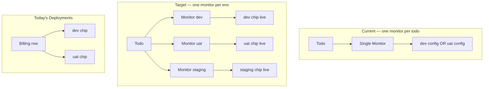

# feat: Multi-environment deployment monitoring

## Goal Capsule

- **Objective:** Allow a todo or subtask to run Jenkins deployment monitors for multiple environments concurrently (e.g. dev and uat at the same time), and show all of today's deployments per service in the Today's Deployments sidebar.
- **Authority:** Product Contract; user confirmed env-keyed upsert on the existing singular `monitor` write field and grouped multi-env chips per service row in the sidebar.
- **Stop conditions:** Block only if the schema migration cannot enforce at-most-one deployment monitor per owner per environment without breaking existing single-monitor data.
- **Execution profile:** Schema and shared types first, backend upsert/enrichment, release-integration fixes, frontend aggregation and panel layout, tests.
- **Tail ownership:** Implementer runs verification contract before marking done.

---

## Product Contract

### Summary

Operators frequently deploy the same service to dev and uat on the same day. Today, attaching a second deployment monitor replaces the first — dev polling stops and its env chip loses live status. The Today's Deployments sidebar also collapses to one row per service, hiding the earlier environment. This feature makes multi-env monitoring first-class: one Jenkins poll loop per environment per todo/subtask, and the sidebar shows every qualifying deployment for each service.

### Problem Frame

The monitor model enforces one monitor per todo and one per subtask (`Monitor.todoId` / `Monitor.subtaskId` are `@unique`). When MCP or the API attaches a uat deployment monitor after dev, `todos.service.ts` finds the existing monitor and **updates** it in place — dev config and poll state are overwritten. Release discovery attach follows the same pattern.

The enrichment layer already maps multiple monitors to different env chips (`enrichDeployedEnvironments` keys by `config.env`), but only one todo-level monitor is ever passed in.

Separately, `collectTodayServiceDeployments` deduplicates by service key alone (`upsertLatestByService`), keeping the row with the highest sort key. A test explicitly locks in this behavior: when dev and uat both deployed today, only uat appears.

### Requirements

#### Backend — multi-env monitors

- R1. A todo may own **multiple** monitors; at most **one deployment monitor per environment** (`dev`, `uat`, `uat-main`, `staging`) per todo.
- R2. A subtask follows the same rule: multiple monitors allowed, at most one deployment monitor per environment per subtask.
- R3. Non-deployment monitor types on subtasks (e.g. `http`, `github_pr`) remain at most one per subtask per monitor type (preserve today's behavior for non-deployment monitors).
- R4. `CreateTodoDto.monitor` / `UpdateTodoDto.monitor` and subtask equivalents perform **env-keyed upsert**: match an existing deployment monitor by `config.env`; update if found, create if not. Attaching uat must not replace dev.
- R5. `TodoDto` and `SubtaskDto` expose `monitors: MonitorDto[]` listing all owned monitors. Singular `monitor` remains for backward compatibility — populated with the deployment monitor that has the latest `lastRunAt` (or `null` when none).
- R6. `enrichDeployedEnvironments` receives **all** todo-level deployment monitors plus subtask monitors; each env chip gets status from its matching monitor.
- R7. Scheduler, WebSocket events, and todo status sync continue to work per monitor; UAT/uat-main success transitions remain env-specific (`todo-deployment-status-sync.ts`).
- R8. Release staging attach and backfill locate the **staging** deployment monitor by env, not "the only monitor on the todo". Attaching staging must not overwrite an in-progress dev or uat monitor.

#### Frontend — Today's Deployments panel

- R9. `collectTodayServiceDeployments` returns **all** deployments from today per service, not just the latest one.
- R10. Each service row in `ActiveDeploymentsPanel` displays **multiple env chips** when that service has multiple today deployments (any status included — panel already shows success/fail/in-progress for today).
- R11. Deduplication across todos for the same service **and environment** still applies when two todos share the same service and env build (keep latest sort key for that service+env pair).
- R12. Todo-card `DeployedEnvironmentList` behavior is unchanged — it already renders multiple env chips when enrichment supplies them.

### Acceptance Examples

- AE1. **Concurrent dev and uat monitors**
  - **Given:** Todo with `deployedEnvironments: [dev, uat]` and an active dev deployment monitor.
  - **When:** Agent attaches a uat deployment monitor via `update_todo`.
  - **Then:** Two monitors exist; dev continues polling; both env chips show live status after polls.

- AE2. **Today's Deployments shows both envs**
  - **Given:** Service `Billing` has dev (success, this morning) and uat (in progress, this afternoon) on today's todos.
  - **When:** Todo screen renders.
  - **Then:** Today's Deployments shows one Billing row with dev and uat chips.

- AE3. **Release staging attach preserves dev/uat**
  - **Given:** Member todo with in-progress dev monitor during a staging release discovery attach.
  - **When:** Staging build is discovered and attached.
  - **Then:** Staging monitor is created/updated; dev monitor remains enabled with its last result.

- AE4. **Env-keyed upsert is idempotent**
  - **Given:** Todo already has uat deployment monitor for build #100.
  - **When:** `update_todo` sends another uat monitor for build #101.
  - **Then:** Same monitor row is updated (not a second uat monitor).

### Scope Boundaries

**In scope:** Monitor schema migration, shared types, `MonitorsService` upsert helpers, todos/subtasks/releases services, mappers/enrichment, backend integration tests, `activeDeployments` aggregation, `ActiveDeploymentsPanel` layout/CSS, web unit tests.

**Deferred to Follow-Up Work:** `monitors[]` on create/update DTOs (batch attach in one call); aggregate backend endpoint for deployments; extending release-level multi-env beyond existing per-`ReleaseDeployment` monitors; subtask non-deployment multi-monitor expansion beyond current type-key rule.

**Outside this product's identity:** Service catalog Jenkins URL editing; prod release monitor model; changing Releases panel behavior.

---

## Planning Contract

### Key Technical Decisions

- KTD1. **Schema: `envKey` discriminator column (session-settled: user-approved — chosen over JSON-only uniqueness: Postgres cannot enforce unique on JSON config fields; envKey enables Prisma-native compound uniques).** Add nullable `envKey String?` on `Monitor`. For `deployment` monitors, set to prisma enum name (`dev`, `uat`, …). For other types on subtasks, set to monitor type (`http`, `github_pr`). Replace `@unique` on `todoId` and `subtaskId` with `@@unique([todoId, envKey])` and `@@unique([subtaskId, envKey])`. Change `Todo.monitor` / `Subtask.monitor` relations to `monitors Monitor[]`.
- KTD2. **Write API: env-keyed upsert on singular `monitor` (session-settled: user-approved — chosen over new `monitors[]` write field in v1: backward compatible for MCP agents).** `MonitorsService.upsertDeploymentMonitorForTodo(todoId, dto)` finds by `todoId + envKey`; create or update. Same for subtasks. Direct `POST /todos/:id/monitors` uses the same upsert path for deployment type; non-deployment POST keeps conflict-if-exists behavior.
- KTD3. **Read API: add `monitors[]`, keep singular `monitor` as compat shim.** Singular field = deployment monitor with max `lastRunAt` among todo-owned monitors (null if none). Clients that only read `monitor` still get the most recently polled deployment; new UI reads `monitors` where needed.
- KTD4. **Release integration targets env explicitly.** Staging attach/backfill queries `findFirst({ where: { todoId, envKey: 'staging' } })` instead of `findUnique({ where: { todoId } })`.
- KTD5. **Today's Deployments dedupe key becomes `serviceKey + environment`.** Map key `${serviceKey}:${environment}`; within each key keep latest sort key (handles duplicate todos for same service/env). Group rows by `serviceKey` for panel rendering.
- KTD6. **Panel layout: one service row, multiple chips (session-settled: user-approved — chosen over separate rows per env: user requested per-service multi-env display).** Extend `DeploymentRow` or add `ServiceDeploymentGroup` component rendering service label once and a flex row of env chips.

### High-Level Technical Design

### Assumptions

- Existing production data has at most one monitor per todo/subtask; migration backfill sets `envKey` from `config.env` for deployment monitors and from `type` otherwise.
- MCP agents continue sending one `monitor` object per call; multi-env attach is sequential calls (acceptable for v1).
- Scheduler's existing `findMany({ enabled: true })` loop scales to a small N of monitors per todo (typical ≤4 envs).

### Risks and Dependencies

- **Migration risk:** Backfill must run before dropping `@unique` on `todoId`/`subtaskId`; verify no duplicate todo monitors exist pre-migration (should be zero by constraint).
- **Compat risk:** Any client assuming `todo.monitor` is the only monitor must tolerate `monitors[]`; singular field remains populated for transition.
- **Release backfill:** Must not copy release poll results onto non-staging todo monitors (fix is part of env-targeted lookup).

---

## Implementation Units

### U1. Schema migration and monitor ownership model

**Goal:** Allow multiple monitors per todo/subtask with per-env uniqueness for deployment monitors.

**Requirements:** R1, R2, R3

**Dependencies:** None

**Files:**
- `apps/backend/prisma/schema.prisma`
- `apps/backend/prisma/migrations/<timestamp>_multi_env_monitors/migration.sql` (generated)

**Approach:** Add `envKey String? @map("env_key")` to `Monitor`. Add `@@unique([todoId, envKey])` and `@@unique([subtaskId, envKey])`. Remove `@unique` from bare `todoId` and `subtaskId`. Change `Todo` and `Subtask` relations from `monitor Monitor?` to `monitors Monitor[]`. Migration SQL: add column, backfill `env_key` from `(config->>'env')` for deployment type else `type`, then drop old unique indexes and add compound uniques. Add `@@index([todoId])` and `@@index([subtaskId])` if not already present via FK.

**Patterns to follow:** Existing `DeployedEnvironment` `@@unique([todoId, name])` per-env pattern.

**Test scenarios:**
- Migration backfill: existing deployment monitor with `config.env = uat` receives `envKey = uat`.
- Migration backfill: http subtask monitor receives `envKey = http`.
- Compound unique prevents two deployment monitors with same env on one todo.

**Verification:** `npx prisma migrate dev` succeeds; `npx prisma validate` passes.

---

### U2. Shared types and monitor envKey helper

**Goal:** Expose multi-monitor DTOs and a shared helper to derive envKey from monitor type/config.

**Requirements:** R4, R5

**Dependencies:** U1

**Files:**
- `packages/shared-types/src/index.ts`
- `apps/backend/src/common/monitor-env-key.ts` (create)
- `apps/backend/src/common/monitor-env-key.spec.ts` (create)

**Approach:** Add `monitors?: MonitorDto[]` to `TodoDto` and `SubtaskDto`. Document singular `monitor` as backward-compat (latest-polled deployment monitor). Export `resolveMonitorEnvKey(type, config): string | null` — returns config.env for deployment, monitor type string for other types, null when undetermined (reject at upsert). No change to create/update DTO shapes (singular `monitor` retained).

**Patterns to follow:** `packages/shared-types/src/index.ts` existing DTO conventions.

**Test scenarios:**
- Deployment config `{ env: 'dev' }` → `envKey = 'dev'`.
- Deployment config `{ env: 'uat-main' }` → prisma-aligned key (match existing enum mapping).
- Type `http` → `envKey = 'http'`.
- Deployment missing env → null (caller throws BadRequest).

**Verification:** Shared types build; unit tests pass.

---

### U3. MonitorsService env-keyed upsert

**Goal:** Central upsert/create paths that respect per-env uniqueness instead of one-monitor-per-owner conflict.

**Requirements:** R1, R2, R3, R4

**Dependencies:** U1, U2

**Files:**
- `apps/backend/src/monitors/monitors.service.ts`
- `apps/backend/src/monitors/monitors.service.spec.ts` (create or extend)

**Approach:** Add `upsertForTodo(todoId, dto)` and `upsertForSubtask(subtaskId, dto)`: compute envKey, `findFirst({ where: { todoId, envKey } })`, update or create. Replace conflict throws in `createForTodo`/`create` with upsert for deployment type; keep conflict for non-deployment when envKey slot taken by different type. Refactor `createForTodo`/`create` to delegate to upsert for deployment monitors. `POST` controller endpoints call upsert paths. Add `findDeploymentMonitorForTodo(todoId, env)` helper for release code.

**Patterns to follow:** `createForReleaseDeployment` replace-on-create pattern, but scoped to env slot not whole owner.

**Test scenarios:**
- Upsert dev then upsert uat on same todo → two rows, distinct ids.
- Second upsert uat with new buildNumber → updates same row, does not create duplicate.
- Non-deployment monitor on subtask with existing http monitor → conflict if second http; allowed if different type.

**Verification:** Unit tests pass.

---

### U4. Todo and subtask services — env-keyed monitor attach

**Goal:** Create/update todo and subtask flows use upsert instead of findUnique-by-owner update.

**Requirements:** R4

**Dependencies:** U3

**Files:**
- `apps/backend/src/todos/todos.service.ts`
- `apps/backend/src/todos/todos.service.spec.ts`
- `apps/backend/src/subtasks/subtasks.service.ts`
- `apps/backend/src/subtasks/subtasks.service.spec.ts` (create if missing)
- `apps/backend/src/scheduler/scheduler.service.ts` (todo reload includes)
- `apps/backend/src/releases/releases.service.ts` (`broadcastTodosUpdated` includes)

**Approach:** Change all todo/subtask Prisma includes from `monitor: true` to `monitors: true` (todos service, subtasks service, scheduler broadcast reload, release broadcast reload). In update/create monitor blocks, call `upsertForTodo` / `upsertForSubtask` instead of findUnique on todoId/subtaskId.

**Patterns to follow:** Existing silent monitor attach on todo update.

**Test scenarios:**
- Update todo with uat monitor when dev monitor exists → both persist after update.
- Create todo with dev monitor → single monitor with correct envKey.

**Verification:** Unit tests pass.

---

### U5. Mappers and deployment enrichment

**Goal:** DTO mapping passes all monitors into enrichment; compat singular field populated.

**Requirements:** R5, R6

**Dependencies:** U4

**Files:**
- `apps/backend/src/common/mappers.ts`
- `apps/backend/src/common/deployment-enrichment.spec.ts`

**Approach:** Update `toTodoDto` / `toSubtaskDto`: map `monitors` array; set singular `monitor` to latest-polled deployment monitor among owned monitors. Update `enrichTodoDeployedEnvironments` to pass all todo `monitors` (not one) into `collectDeploymentMonitors`. Update `enrichSubtaskDeployedEnvironments` similarly. Extend enrichment spec with two todo monitors (dev + uat) enriching two chips independently.

**Patterns to follow:** `enrichDeployedEnvironments` existing per-env Map logic (no change needed there).

**Test scenarios:**
- Todo with dev and uat monitors → both env chips have deployment info.
- Singular `monitor` field equals monitor with latest `lastRunAt`.
- Subtask + todo monitors for same env on different owners → each enriches its own chip set (no cross-leak).

**Verification:** `deployment-enrichment.spec.ts` passes.

---

### U6. Release service staging attach and backfill

**Goal:** Release-driven staging monitor attach targets staging env slot only.

**Requirements:** R8

**Dependencies:** U3

**Files:**
- `apps/backend/src/releases/releases.service.ts`
- `apps/backend/src/releases/releases.service.spec.ts`

**Approach:** In `attachTodoDeploymentMonitorsForService` and `backfillMemberTodoStagingMonitorFromRelease`, replace `findUnique({ where: { todoId } })` with `findFirst({ where: { todoId, envKey: 'staging' } })` (or helper). Upsert staging monitor without touching dev/uat monitors. Backfill copies `lastResult` only onto staging monitor.

**Patterns to follow:** Existing staging monitor payload with `suppressTodoStatusSync: true`.

**Test scenarios:**
- Attach staging when dev monitor exists → dev monitor unchanged, staging monitor created.
- Backfill updates staging monitor only when dev also present.

**Verification:** `releases.service.spec.ts` passes.

---

### U7. Backend integration tests

**Goal:** End-to-end proof that API accepts concurrent env monitors and enrichment returns both.

**Requirements:** R1, R4, R6, AE1

**Dependencies:** U4, U5, U6

**Files:**
- `apps/backend/test/todos.integration-spec.ts`

**Approach:** Add integration test: create todo with dev monitor + deployedEnvironments dev; PATCH with uat monitor; assert response `monitors.length === 2`, both envs enriched, singular `monitor` populated. Assert DB has two monitor rows with distinct envKeys.

**Execution note:** Extend existing monitor integration tests rather than new file.

**Test scenarios:**
- Covers AE1 at HTTP layer.
- Replacing uat build number updates one row only.

**Verification:** Backend integration test suite passes.

---

### U8. Today's Deployments aggregation — multi-env per service

**Goal:** Aggregation returns all today deployments grouped by service, deduped per service+env.

**Requirements:** R9, R11

**Dependencies:** None (frontend; benefits from U5 enrichment at runtime)

**Files:**
- `apps/web/src/utils/activeDeployments.ts`
- `apps/web/src/utils/activeDeployments.test.ts`

**Approach:** Replace `rowsByService: Map<string, ActiveDeploymentRow>` with `rowsByServiceEnv: Map<string, ActiveDeploymentRow>` keyed by `` `${serviceKey}:${environment}` ``. Change return type or add optional `groupedByService` helper. Export `groupTodayDeploymentsByService(rows): Map<string, ActiveDeploymentRow[]>` for the panel. Update row `id` to `` `${serviceKey}:${environment}` `` for stable React keys. Remove/replace test "keeps only the latest deployment per service for today" with "keeps both dev and uat for same service" and "dedupes same service+env across todos".

**Patterns to follow:** Existing `getDeploymentSortKey` sort order.

**Test scenarios:**
- Same service, dev + uat today → two rows returned (or grouped map with two entries).
- Same service+env on two todos → one row (latest sort key wins).
- Yesterday dev + today uat → one row (uat only).

**Verification:** Web unit tests pass.

---

### U9. ActiveDeploymentsPanel multi-chip layout

**Goal:** Render one row per service with multiple env chips.

**Requirements:** R10, AE2

**Dependencies:** U8

**Files:**
- `apps/web/src/components/ActiveDeploymentsPanel.tsx`
- `apps/web/src/index.css` (or deployments panel CSS section)

**Approach:** Group flat rows by `serviceKey` via `groupTodayDeploymentsByService`. Render service label once; map env chips in a horizontal flex container (`.deployment-active-chips`). Reuse existing chip styling from `DeploymentRow`. Update interval effect to tick when any grouped chip is in progress. Empty state unchanged.

**Patterns to follow:** `DeployedEnvironmentList` chip markup; `ReleasesView` service grouping.

**Test scenarios:**
- Test expectation: none — layout covered by aggregation tests and manual smoke.

**Verification:** Manual smoke on todo screen with billing dev success + uat in-progress shows both chips on one row.

---

### U10. MCP server documentation touch-up

**Goal:** Agent docs reflect multi-env sequential attach semantics.

**Requirements:** R4

**Dependencies:** U3

**Files:**
- `apps/mcp-server/src/index.ts` (tool description strings only)

**Approach:** Update `update_todo` / `update_subtask` monitor parameter descriptions: attaching a monitor upserts by environment; prior env monitors remain active. No schema change to MCP tool shapes.

**Test scenarios:**
- Test expectation: none — description-only change.

**Verification:** MCP tool descriptions mention per-env upsert behavior.

---

## Verification Contract

| Gate | Command |
|------|---------|
| Shared types build | `npm run build --workspace=@todo-platform/shared-types` |
| Backend unit tests | `npm test --workspace=@todo-platform/backend` |
| Backend integration (todos) | `npm run test:integration --workspace=@todo-platform/backend -- todos.integration-spec` |
| Web unit tests | `npm run test --workspace=@todo-platform/web` |
| Prisma | `npx prisma validate` in `apps/backend` |

---

## Definition of Done

- [ ] Todos and subtasks can hold concurrent deployment monitors for different environments; attaching uat no longer replaces dev.
- [ ] `TodoDto.monitors` lists all monitors; env chips for all attached envs show live deployment status.
- [ ] Release staging attach/backfill only affects the staging monitor slot.
- [ ] Today's Deployments shows multiple env chips per service when multiple envs deployed today.
- [ ] All verification contract commands pass.
- [ ] No regressions in scheduler polling, WebSocket invalidation, or UAT-driven todo status transitions.

---

## Sources and Research

- Root cause confirmed in `apps/backend/prisma/schema.prisma` (`todoId @unique`), `apps/backend/src/todos/todos.service.ts` (in-place update), `apps/web/src/utils/activeDeployments.ts` (`upsertLatestByService`).
- Enrichment already multi-env-capable: `apps/backend/src/common/deployment-enrichment.ts`.
- Prior art: `docs/plans/2026-07-20-002-feat-todo-deployment-monitor-plan.md` (single monitor constraint R2); `docs/plans/2026-07-24-001-feat-todo-deployments-sidebar-plan.md` (panel origin; later evolved to today's deployments).
