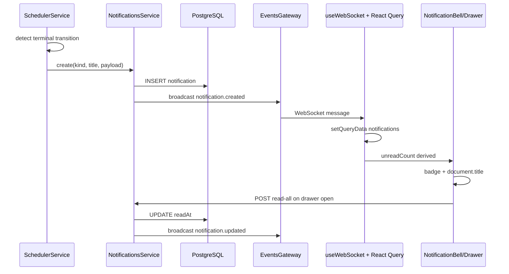
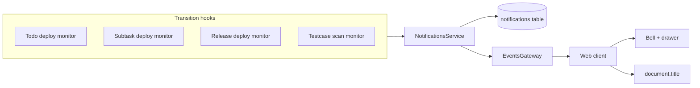

# feat: Real-time in-app notifications

## Goal Capsule

- **Objective:** Notify operators in real time when monitored deployments finish (success or failure) or testcase scans finish, with a bell UI, unread badge, notification drawer, 24-hour retention, and matching browser tab title.
- **Authority:** Product Contract; user confirmed todo/subtask/release deployment scopes, server-persisted notifications, and unread-only badge semantics.
- **Stop conditions:** Block only if WebSocket gateway or scheduler hooks cannot emit notification events without breaking existing entity broadcasts.
- **Execution profile:** Schema and shared types first, backend persistence and transition hooks, frontend data layer, then bell/drawer UI and tab title.
- **Tail ownership:** Implementer runs verification contract before marking done.

---

## Product Contract

### Summary

Operators watch Jenkins deployments and testcase scans across todos, subtasks, and releases. Today the dashboard updates live via WebSocket entity events, but there is no dedicated notification surface — users must notice status changes in panels or cards. This feature adds persisted notifications, pushes them over the existing WebSocket channel, and surfaces them through a header bell with unread badge and drawer. Items older than 24 hours disappear automatically; the browser tab title mirrors the unread count.

### Problem Frame

The platform already polls deployment and testcase-scan monitors on a schedule and broadcasts `monitor.updated`, `todo.updated`, and `release.updated` over WebSocket (`apps/backend/src/events/events.gateway.ts`, `apps/web/src/hooks/useWebSocket.ts`). Those events refresh React Query caches but do not record discrete “something finished” moments an operator can review later.

There is no `Notification` model, no REST list endpoint, no bell UI in `apps/web/src/App.tsx`, and no `document.title` integration. Overlay patterns exist for detail panels (`SubtaskPanel`, `ReleasePanel`) but not for a right-side notification drawer.

### Requirements

#### Event sources

- R1. Create a notification when a **todo-level deployment monitor** transitions to terminal success or failure (first edge into `MonitorResultStatus.SUCCESS` or `MonitorResultStatus.FAILED`, not on every repeat poll).
- R2. Create a notification when a **subtask deployment monitor** transitions subtask status to `COMPLETED` or `FAILED` (first edge only).
- R3. Create a notification when a **release deployment monitor** transitions to `successful` or `failed` (first edge only, using existing `previousStatus` / `nextStatus` in `onDeploymentMonitorResult`).
- R4. Create a notification when a **testcase scan** transitions to terminal `completed` or `failed` (first edge only).

#### Persistence and API

- R5. Notifications are **server-persisted** in PostgreSQL with `readAt` nullable timestamp and `createdAt` for ordering and TTL.
- R6. `GET /notifications` returns notifications from the last 24 hours, newest first.
- R7. `PATCH /notifications/:id/read` marks one notification read; `POST /notifications/read-all` marks all unread in the 24-hour window read.
- R8. Expired notifications (older than 24 hours) are excluded from list responses and deleted opportunistically on list fetch.

#### Real-time delivery

- R9. After persisting, broadcast `notification.created` over the existing WebSocket gateway with the full `NotificationDto` payload.
- R10. After bulk read, broadcast `notification.updated` with `{ readAll: true }` or per-item updates so all connected tabs sync badge state.

#### UI

- R11. A **bell button** in the app header (right cluster, alongside connection status) shows an unread badge when `unreadCount > 0`.
- R12. Clicking the bell opens a **drawer** listing notifications from the last 24 hours (title, body/summary, relative timestamp, success/failure styling).
- R13. Opening the drawer marks displayed unread notifications as read (via read-all or visible-item read — implementer picks the simpler path that satisfies unread badge clearing on open).
- R14. The **browser tab title** reflects unread count: `(N) Todo Platform` when `N > 0`, otherwise `Todo Platform`.

#### Non-goals

- R15. No per-user inbox — the app has no auth; notifications are global for all viewers (consistent with existing todos/releases API).
- R16. No email, push, or mobile notifications in v1.
- R17. No notification preferences or mute controls in v1.

### Acceptance Examples

- AE1. **Todo deployment success**
  - **Given:** A todo with an active dev deployment monitor polling in `RUNNING`.
  - **When:** Jenkins reports build success on the next poll.
  - **Then:** A notification appears in the drawer within one WebSocket round-trip; bell badge increments; tab title shows `(1) Todo Platform`.

- AE2. **Release deployment failure**
  - **Given:** A staging release with a service deployment monitor in progress.
  - **When:** Jenkins reports failure.
  - **Then:** A release-scoped notification is created with service and release context; existing `release.updated` broadcast still fires unchanged.

- AE3. **Testcase scan completed**
  - **Given:** A todo with a testcase scan in `scanning`.
  - **When:** Monitor poll maps to terminal `completed`.
  - **Then:** Notification created once; repeat polls do not duplicate.

- AE4. **24-hour expiry**
  - **Given:** A notification created 25 hours ago.
  - **When:** Client fetches `GET /notifications`.
  - **Then:** That notification is not returned and is deleted from the database.

- AE5. **Drawer clears badge**
  - **Given:** Three unread notifications.
  - **When:** User opens the notification drawer.
  - **Then:** Badge drops to zero and tab title reverts to `Todo Platform`; notifications remain visible in the list as read items until they expire.

### Scope Boundaries

#### In scope

Todo, subtask, and release deployment terminal transitions; testcase scan terminal transitions; Prisma model and REST API; WebSocket event types; header bell, drawer, badge, tab title; unit and integration tests for backend transition helpers and notification service.

#### Deferred to Follow-Up Work

- Release-level aggregate notifications (entire release `successful` / `failed`) — per-service release deployment notifications cover the primary operator need.
- Click-through navigation from a notification row to the relevant todo/release detail.
- Notification sound or desktop Notification API.

#### Outside this product's identity

- User accounts, authentication, or per-operator notification routing.
- External alerting (Slack, PagerDuty, email).

---

## Planning Contract

### Key Technical Decisions

- KTD1. **Server-persisted global inbox (session-settled: user-approved — chosen over client-only WebSocket ephemeral list: survives refresh and syncs across tabs).** `Notification` Prisma model + REST list; WebSocket pushes new rows. Filter and purge at 24 hours.

- KTD2. **Unread badge semantics (session-settled: user-approved — chosen over total-recent count: badge reflects `readAt IS NULL`; opening drawer marks read).** Tab title uses the same unread count.

- KTD3. **Transition-gated creation, not poll-gated.** Reuse `previousResult` / `previousStatus` already available in scheduler and releases service. Extract pure helpers in `apps/backend/src/common/notification-transitions.ts` mirroring `isFirstDeploySuccess` in `todo-deployment-status-sync.ts`.

- KTD4. **Separate WebSocket event types.** Add `notification.created` and `notification.updated` to `WebSocketEventType`; do not overload `monitor.updated` payloads. Frontend prepends new notifications to React Query cache on create.

- KTD5. **Right-side drawer, not centered modal.** New CSS pattern (`notification-drawer`) at `z-index` above sidebar panels; reuse overlay backdrop and Escape-to-close from `SubtaskPanel` / `ReleasePanel`.

- KTD6. **Deployment scope (session-settled: user-approved — chosen over todo/subtask-only: todo, subtask, and release deployment monitors all emit notifications).** Testcase scans included per user request.

### High-Level Technical Design

### Assumptions

- Opening the drawer triggers `POST /notifications/read-all` for simplicity (satisfies AE5); per-row read remains available for future partial-read UX.
- Notification copy is assembled server-side from todo/subtask/release/scan context at creation time (stable title/body even if source entity is later deleted — payload JSON holds IDs for optional future deep links).

### System-Wide Impact

- **Scheduler:** `SchedulerModule` imports `NotificationsModule`; inject `NotificationsService` into `SchedulerService` and `ReleasesService` (release deployment path).
- **WebSocket contract:** `packages/shared-types` gains new event types — MCP server and any WS consumers must tolerate unknown event types (already ignores malformed messages).
- **Frontend header:** `App.tsx` layout gains bell without displacing service filter or connection indicator.
- **Database:** New table; no FK to todos/releases (notifications outlive deleted entities via copied title/body).

### Risks and Dependencies

- **Duplicate notifications on scheduler retries:** Mitigate with transition-edge checks; optional unique constraint on `(kind, sourceId, outcome)` deferred unless duplicates appear in testing.
- **Subtask status sync fires every poll today:** U3 must compare previous subtask status before notifying — otherwise duplicate notifications on every poll cycle.
- **Depends on:** Existing WebSocket gateway, scheduler poll loop, and React Query setup — no new infrastructure.

---

## Implementation Units

### U1. Schema, shared types, and DTOs

**Goal:** Define the notification domain model and wire it through shared packages.

**Requirements:** R5, R6, R9

**Dependencies:** None

**Files:**
- `apps/backend/prisma/schema.prisma`
- `apps/backend/prisma/migrations/<timestamp>_notifications/migration.sql`
- `packages/shared-types/src/index.ts`
- `apps/backend/src/common/notification.dto.ts`

**Approach:** Add `NotificationKind` enum (`todo_deployment`, `subtask_deployment`, `release_deployment`, `testcase_scan`) and `Notification` model with `id`, `kind`, `title`, `body`, `payload` (Json), `readAt`, `createdAt`. Index `createdAt` for TTL queries. Export `NotificationDto`, `NotificationKind`, and extend `WebSocketEventType` with `notification.created` | `notification.updated`.

**Patterns to follow:** `TestcaseScan` model and enum style in `schema.prisma`; DTO validation in `apps/backend/src/common/testcase-scan.dto.ts`.

**Test scenarios:**
- Test expectation: none — schema and type exports; validated by migration apply and TypeScript build.

**Verification:** `npx prisma validate` and `npx prisma migrate dev` succeed; monorepo build compiles with new types.

---

### U2. Notifications module (service, controller, TTL)

**Goal:** Persist, list, mark-read, purge, and broadcast notifications.

**Requirements:** R5, R6, R7, R8, R9, R10

**Dependencies:** U1

**Files:**
- `apps/backend/src/notifications/notifications.module.ts`
- `apps/backend/src/notifications/notifications.service.ts`
- `apps/backend/src/notifications/notifications.controller.ts`
- `apps/backend/src/app.module.ts`
- `apps/backend/src/notifications/notifications.service.spec.ts`
- `apps/backend/test/notifications.integration-spec.ts`
- `README.md`

**Approach:** `NotificationsService.create(dto)` inserts row, maps to `NotificationDto`, calls `events.broadcast('notification.created', dto)`. `findRecent()` deletes rows with `createdAt < now - 24h`, returns remainder newest-first. `markRead(id)` and `markAllRead()` set `readAt`, broadcast `notification.updated`. Register `NotificationsModule` in `AppModule`. Controller: `GET /notifications`, `PATCH /notifications/:id/read`, `POST /notifications/read-all`. Extend README WebSocket event list with the two notification event types.

**Patterns to follow:** `ReleasesController` / `ReleasesService` thin-controller pattern; `EventsGateway` injection as in `todos.service.ts`.

**Test scenarios:**
- Happy path: create notification → `GET /notifications` returns it with `readAt: null`.
- Edge case: notification exactly 24h old is excluded after list fetch purge.
- Happy path: `markAllRead` sets `readAt` on all unread in window.
- Error path: `PATCH` unknown id returns 404.
- Integration: create via service directly, assert REST list and JSON shape match `NotificationDto`.

**Verification:** `npm run test --workspace=@todo-platform/backend` passes new unit and integration specs.

---

### U3. Transition helpers and scheduler hooks

**Goal:** Emit notifications only on first terminal transition for each monitored event.

**Requirements:** R1, R2, R3, R4

**Dependencies:** U2

**Files:**
- `apps/backend/src/common/notification-transitions.ts`
- `apps/backend/src/common/notification-transitions.spec.ts`
- `apps/backend/src/scheduler/scheduler.service.ts`
- `apps/backend/src/releases/releases.service.ts`
- `apps/backend/src/scheduler/scheduler.module.ts`
- `apps/backend/src/releases/releases.module.ts`

**Approach:** Pure helpers:
- `isFirstMonitorTerminalTransition(previous, next)` for todo deployment monitors.
- `isSubtaskTerminalTransition(previousStatus, nextStatus)` for subtask deploy path.
- `isReleaseDeploymentTerminalTransition(previous, next)` wrapping existing release status enum.
- `isTestcaseScanTerminalTransition(previous, next)` using `isTerminalTestcaseScanStatus`.

In `executeMonitor` todo/subtask branch: after result known, if deployment monitor and terminal edge, call `notificationsService.createForTodoDeployment(...)` with env, todo title, build URL from monitor config/result metadata.

In `syncSubtaskStatus`: load current status before update; notify only on edge to `COMPLETED`/`FAILED`.

In `syncTestcaseScanMonitor`: compare `scan.status` before update; notify on terminal edge with scan name and todo context.

In `onDeploymentMonitorResult`: when `previousStatus !== nextStatus` and next is `successful`/`failed`, call `notificationsService.createForReleaseDeployment(...)`.

Import `NotificationsModule` into `SchedulerModule` and `ReleasesModule`.

**Execution note:** Add characterization-style unit tests for helpers before modifying scheduler — legacy subtask sync updates every poll.

**Patterns to follow:** `isFirstDeploySuccess` in `todo-deployment-status-sync.ts`; terminal scan check in `testcase-scan-status-sync.ts`.

**Test scenarios:**
- Happy path: `RUNNING → SUCCESS` returns true; `SUCCESS → SUCCESS` returns false.
- Happy path: `scanning → completed` returns true; `completed → completed` returns false.
- Edge case: poll error leaving status unchanged does not notify.
- Integration (mock NotificationsService in scheduler unit test or integration): single terminal poll creates exactly one notification row.

**Verification:** `notification-transitions.spec.ts` passes; backend test suite green.

---

### U4. Frontend data layer

**Goal:** Fetch notifications, handle WebSocket events, derive unread count, sync tab title.

**Requirements:** R9, R10, R14

**Dependencies:** U2

**Files:**
- `apps/web/src/api.ts`
- `apps/web/src/hooks/useWebSocket.ts`
- `apps/web/src/hooks/useNotifications.ts`
- `apps/web/src/hooks/useNotificationTitle.ts`
- `apps/web/src/hooks/useNotificationTitle.test.ts`

**Approach:** Add `fetchNotifications`, `markNotificationRead`, `markAllNotificationsRead` to `api.ts`. `useNotifications` wraps React Query `['notifications']` with `select` for `unreadCount`. Extend `useWebSocket` cases: `notification.created` prepends to cache; `notification.updated` refetches or patches read state. `useNotificationTitle(unreadCount)` sets `document.title` and restores on unmount.

**Patterns to follow:** Existing `useWebSocket` invalidate vs `setQueryData` split; React Query in `App.tsx`.

**Test scenarios:**
- Happy path: unread count 3 → title `(3) Todo Platform`.
- Edge case: unread count 0 → title `Todo Platform`.
- Happy path: `notification.created` handler prepends to existing cache array.

**Verification:** `npm run test --workspace=@todo-platform/web` passes `useNotificationTitle.test.ts`.

---

### U5. Bell button and notification drawer UI

**Goal:** Header bell with badge, drawer list, open-to-mark-read behavior.

**Requirements:** R11, R12, R13, R14

**Dependencies:** U4

**Files:**
- `apps/web/src/components/NotificationBell.tsx`
- `apps/web/src/components/NotificationDrawer.tsx`
- `apps/web/src/App.tsx`
- `apps/web/src/index.css`

**Approach:** `NotificationBell` renders icon button + numeric badge (`aria-label` includes count). Click toggles drawer open state. `NotificationDrawer` fixed right panel with backdrop; lists notifications with kind icon/color (reuse `badge-green` / `badge-red`); shows empty state; on mount/open calls `markAllNotificationsRead`. Mount bell in `App.tsx` header `.connection-status` cluster (bell left of live dot). CSS: `.notification-bell`, `.notification-badge`, `.notification-drawer`, `.notification-drawer-overlay`.

**Patterns to follow:** Escape and backdrop close from `ReleasePanel`; header layout in `App.tsx`; badge styling from existing `.badge-*` classes.

**Test scenarios:**
- Test expectation: none — presentational components; behavior covered by U4 hook tests and manual AE1/AE5 verification.

**Verification:** Manual smoke — trigger a deployment terminal event in dev, confirm bell, drawer, and tab title update; drawer open clears badge.

---

## Verification Contract

| Gate | Command | Applies to |
|------|---------|------------|
| Backend unit tests | `npm run test --workspace=@todo-platform/backend` | U2, U3 |
| Backend integration | `npm run test:integration --workspace=@todo-platform/backend` | U2 |
| Web unit tests | `npm run test --workspace=@todo-platform/web` | U4 |
| Prisma | `npx prisma validate` (from `apps/backend`) | U1 |
| Build | `npm run build` (repo root) | all |

Behavioral smoke (dev environment): attach a deployment monitor, wait for or simulate terminal poll, confirm notification row, WebSocket delivery, badge, drawer, and tab title per AE1 and AE5.

---

## Definition of Done

- [ ] All R1–R14 requirements traced to at least one U-ID.
- [ ] Notification created only on terminal transition edges (no duplicate on repeat polls).
- [ ] Notifications older than 24 hours absent from API and removed from DB.
- [ ] Bell badge and `document.title` show unread count; opening drawer clears both.
- [ ] Existing WebSocket entity events (`todo.updated`, `monitor.updated`, etc.) unchanged.
- [ ] README WebSocket section documents `notification.created` and `notification.updated`.
- [ ] Verification contract commands pass.
- [ ] No abandoned experimental code from implementation attempts.

---

## Appendix

### Sources and research

- WebSocket gateway: `apps/backend/src/events/events.gateway.ts`
- Scheduler transition context: `apps/backend/src/scheduler/scheduler.service.ts` (`previousResult` at line 142)
- Frontend WS handler: `apps/web/src/hooks/useWebSocket.ts`
- Overlay panel pattern: `apps/web/src/components/ReleasesView.tsx` (`ReleasePanel`)
- Prior plan noting WS invalidation: `docs/plans/2026-07-24-001-feat-todo-deployments-sidebar-plan.md`
- README WebSocket section: `README.md`
