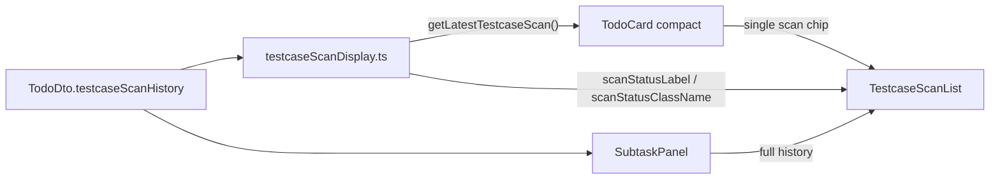

# feat: Display scan record status on todo items

## Goal Capsule

- **Objective:** Show each todo item's latest testcase scan with its persisted record status (`scanning`, `completed`, `failed`) instead of the current binary card behavior where only in-progress scans appear and terminal scans vanish.
- **Authority:** Product Contract below; user confirmed scope during planning (latest scan on cards, panel alignment only, notifications out of scope).
- **Stop conditions:** Block only if compact card layout cannot fit name + status without breaking Kanban/List density.
- **Execution profile:** Frontend-only in `apps/web`; extract display helpers mirroring deployment chip utilities, then wire TodoCard and shared scan list.
- **Tail ownership:** Implementer runs verification contract before marking done.

---

## Product Contract

### Summary

Kanban and List todo cards currently filter testcase scans to `scanning` only, so operators lose scan outcome visibility once a job finishes. This change shows the **latest scan record** on each card with its `TestcaseScanStatus` label and existing chip styling. The todo detail popup keeps full history but shares the same status labeling utilities for consistency.

### Problem Frame

Testcase scan history stores durable status on each record (`TestcaseScanStatus`), synced from Jenkins monitors via the backend. Todo cards today use `getActiveTestcaseScans`, which hides `completed` and `failed` records — operators only see an implicit "something is running" state and get no card-level signal after completion. Notification titles ("Test scan completed") and monitor poll metadata (`DeploymentStatus.in_progress`) use different vocabulary; todo items should reflect the **scan record** status the API already exposes on `TodoDto.testcaseScanHistory`.

### Requirements

- R1. Kanban and List compact todo cards show the **latest** testcase scan (by `createdAt`, matching backend sort order) when `testcaseScanHistory` is non-empty — regardless of whether status is `scanning`, `completed`, or `failed`.
- R2. Each visible scan chip displays the scan **name** and its **record status** label derived from `TestcaseScanStatus` (`scanning`, `completed`, `failed`).
- R3. Status styling reuses existing scan chip CSS classes (`.testcase-scan-chip-scanning`, `-completed`, `-failed`); spinner appears only when status is `scanning`.
- R4. When a todo has no scan history, cards show no scan chip (unchanged empty state).
- R5. When multiple scans exist, cards show **only the newest** scan; older records remain visible in the detail popup full history.
- R6. SubtaskPanel testcase scan section continues to list full history; status labels and chip classes come from the same shared display helper as cards.
- R7. No backend, schema, API, MCP, WebSocket, or notification changes — consume existing `testcaseScanHistory[].status` on `TodoDto`.
- R8. Live updates continue via existing `todo.updated` WebSocket patches (payload already includes full `testcaseScanHistory`).

### Acceptance Examples

- AE1. **Scanning scan on card**
  - **Given:** A todo whose newest scan has `status: scanning` and `name: "Regression"`.
  - **When:** Kanban or List renders the compact card.
  - **Then:** One chip shows spinner, name, and label `scanning`; chip uses scanning styling.

- AE2. **Completed scan stays visible on card**
  - **Given:** A todo whose newest scan has `status: completed` (no newer scan).
  - **When:** The card renders.
  - **Then:** Chip shows name and label `completed` with completed styling; no spinner.

- AE3. **Failed scan on card**
  - **Given:** Newest scan has `status: failed`.
  - **When:** The card renders.
  - **Then:** Chip shows name and label `failed` with failed styling.

- AE4. **Newer scan supersedes older terminal scan**
  - **Given:** Todo has an older `completed` scan and a newer `scanning` scan.
  - **When:** The card renders.
  - **Then:** Only the newer scanning scan appears on the card.

- AE5. **Popup full history unchanged in breadth**
  - **Given:** A todo with three scans in mixed statuses.
  - **When:** User opens SubtaskPanel.
  - **Then:** All three scans render with record status labels; card still shows only the newest.

- AE6. **WebSocket transition**
  - **Given:** A card showing a scanning scan.
  - **When:** Backend broadcasts `todo.updated` with that scan now `completed`.
  - **Then:** Card chip updates to completed styling and label without full page reload.

### Scope Boundaries

**In scope:** Scan display utilities, `TestcaseScanList` / `TodoCard` wiring, SubtaskPanel import alignment, unit tests, minor compact-card CSS if needed.

**Deferred to Follow-Up Work:**

- Showing all scans (not just latest) on compact cards.
- Notification title alignment to record status wording.
- Time-windowed terminal scan visibility (e.g., hide completed after 24h).
- Subtask-level scan history.

**Out of scope:** Backend monitor mapping, `DeploymentStatus` in monitor metadata, notification drawer changes.

---

## Planning Contract

### Assumptions

User confirmed during scoping synthesis:

- Cards show **latest scan only** (not all scans).
- SubtaskPanel: align labeling via shared helper; no behavior change to full-history list.
- Notifications remain out of scope.

Product Contract preservation: N/A (bootstrap plan).

### Key Technical Decisions

| ID | Decision | Rationale |
|---|---|---|
| KTD-1 | Replace `getActiveTestcaseScans` on cards with `getLatestTestcaseScan` returning at most one record | Matches confirmed "latest scan regardless of status" policy; avoids card clutter from full history. |
| KTD-2 | Extract `testcaseScanDisplay.ts` mirroring `deploymentDisplay.ts` | Centralizes label/class mapping and latest-scan selection; enables unit tests without component harness. |
| KTD-3 | Keep `TestcaseScanList` as the sole scan renderer | Avoids new component; pass `[latestScan]` or full array depending on surface. |
| KTD-4 | No API or WebSocket changes | `toTodoDto` already includes ordered `testcaseScanHistory`; `todo.updated` patches cards correctly. |

### High-Level Technical Design

Data already flows from scheduler → `testcaseScan.status` → `toTodoDto` → WebSocket `todo.updated`. This feature only changes **which records** compact cards render and ensures labels always reflect `TestcaseScanStatus`.

---

## Implementation Units

### U1. Extract testcase scan display utilities

**Goal:** Shared pure functions for status labels, CSS classes, and latest-scan selection.

**Requirements:** R2, R5

**Dependencies:** None

**Files:**
- `apps/web/src/utils/testcaseScanDisplay.ts` (create)
- `apps/web/src/utils/testcaseScanDisplay.test.ts` (create)
- `apps/web/package.json` (modify — register test file)

**Approach:** Move `scanStatusLabel` and `scanStatusClassName` logic from `TestcaseScanList.tsx` into the new util. Add `getLatestTestcaseScan(scans)` — when input is empty or undefined, return `[]`; otherwise return a one-element array containing the scan with the greatest `createdAt` (history from the API is already newest-first, but do not rely on that without a test). Export `formatTestcaseScanStatus(status: TestcaseScanStatus): string` as the canonical label function. Do not import React.

**Patterns to follow:** `apps/web/src/utils/deploymentDisplay.ts` and `deploymentDisplay.test.ts`.

**Test scenarios:**
- Happy path: `getLatestTestcaseScan` with three scans returns the newest by `createdAt`.
- Edge case: empty/undefined input returns `[]`.
- Edge case: single completed scan is returned (not filtered out).
- Happy path: `scanStatusLabel(SCANNING)` → `scanning`, `COMPLETED` → `completed`, `FAILED` → `failed`.
- Happy path: `scanStatusClassName` maps each enum to existing CSS class suffixes.

**Verification:** `npm run test --workspace=@todo-platform/web` passes with new test file.

---

### U2. Wire TodoCard to latest scan with record status

**Goal:** Compact cards show the newest scan chip with persisted status visible.

**Requirements:** R1, R2, R3, R4, R5, R8

**Dependencies:** U1

**Files:**
- `apps/web/src/components/TodoCard.tsx` (modify)
- `apps/web/src/components/TestcaseScanList.tsx` (modify)

**Approach:** In `TodoCard`, replace `getActiveTestcaseScans(todo.testcaseScanHistory)` with `getLatestTestcaseScan` wrapped as a one-element array for `TestcaseScanList` (or extend list to accept optional single-scan prop — prefer minimal diff). Update `TestcaseScanList` to import label/class helpers from `testcaseScanDisplay.ts` instead of local duplicates. Remove or deprecate `getActiveTestcaseScans` export if nothing else uses it; keep `hasActiveTestcaseScan` only if still needed elsewhere (currently unused — safe to remove both if grep confirms).

**Execution note:** Prefer characterization-style unit tests in U1 over component tests; manual smoke on Kanban confirms layout.

**Test scenarios:**
- Integration (manual): todo with completed newest scan shows green completed chip on card.
- Integration (manual): todo with scanning newest scan shows spinner + scanning label.
- Regression: todo with no scans shows no scan section.

**Verification:** Kanban and List views show latest scan status; terminal scans no longer disappear from cards.

---

### U3. Align SubtaskPanel with shared display helpers

**Goal:** Full history list uses the same status label and CSS class mapping as cards.

**Requirements:** R6

**Dependencies:** U1, U2

**Files:**
- `apps/web/src/components/TestcaseScanList.tsx` (modify — if not fully done in U2)
- `apps/web/src/components/SubtaskPanel.tsx` (modify only if imports/helpers need wiring)

**Approach:** Ensure `TestcaseScanList` exclusively uses `testcaseScanDisplay.ts` for status text and chip classes. SubtaskPanel should require no logic change beyond benefiting from the shared list component. Confirm `layout="lines"` still renders status column for all history rows.

**Test expectation:** none — covered by U1 unit tests and manual popup smoke.

**Verification:** Popup scan rows show `scanning` / `completed` / `failed` labels identical to card chips.

---

### U4. Compact card CSS polish (conditional)

**Goal:** Terminal status chips read clearly at compact card density.

**Requirements:** R3

**Dependencies:** U2

**Files:**
- `apps/web/src/index.css` (modify only if needed)

**Approach:** After U2 manual smoke, adjust `.todo-card-compact .testcase-scan-list-compact` spacing or status font size if completed/failed chips feel cramped. Reuse existing color tokens; no new status enum values.

**Test expectation:** none — visual smoke only.

**Verification:** Completed/failed chips are legible on compact Kanban cards without wrapping layout breaks.

---

## Verification Contract

| Gate | Command / action |
|---|---|
| Unit tests | `npm run test --workspace=@todo-platform/web` |
| Typecheck + build | `npm run build --workspace=@todo-platform/web` |
| Lint | `npm run lint --workspace=@todo-platform/web` |
| Manual — Kanban card | Todo with newest scan `completed` shows completed chip; with `scanning` shows spinner |
| Manual — List card | Same compact scan chip behavior as Kanban |
| Manual — Popup | Full history with mixed statuses; labels match card |
| Manual — Live update | Trigger or wait for scan terminal transition; card updates via WebSocket |

---

## Definition of Done

- [ ] Latest testcase scan appears on Kanban/List cards for todos with scan history, including terminal statuses (R1, R5).
- [ ] Card and popup chips display `TestcaseScanStatus` labels and existing status styling (R2, R3, R6).
- [ ] Empty scan history produces no card chip (R4).
- [ ] No backend/API/notification changes shipped (R7).
- [ ] `testcaseScanDisplay.test.ts` covers latest-scan selection and label/class mapping (U1).
- [ ] Verification contract gates pass.

---

## Appendix

### Research notes

- Original testcase scan plan (`docs/plans/2026-07-21-001-feat-testcase-scan-history-plan.md`) R18–R20 scoped cards to scanning-only; this plan intentionally supersedes R20 for card visibility.
- `TestcaseScanStatus` (record) vs `DeploymentStatus` (monitor poll metadata) — UI must read `TestcaseScanDto.status`, not monitor `metadata.scan.status`.
- WebSocket `todo.updated` in `apps/web/src/hooks/useWebSocket.ts` already patches `testcaseScanHistory` on todos cache.

### Sources

- `apps/web/src/components/TestcaseScanList.tsx` — current filter and label logic
- `apps/web/src/components/TodoCard.tsx` — card wiring
- `apps/backend/src/common/mappers.ts` — `toTestcaseScanDto` / `testcaseScanHistory` ordering
- `docs/plans/2026-07-22-001-feat-compact-todo-views-plan.md` — compact card field set
