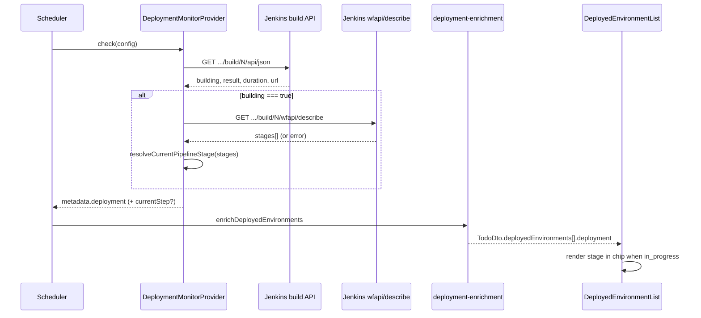

# feat: Show current pipeline stage on todo deployment chips

## Goal Capsule

- **Objective:** When a todo deployment monitor is in progress, show the Jenkins pipeline **stage name** alongside build number and status on deployment chips — not just `#2790` and duration.
- **Authority:** This plan.
- **Stop conditions:** Block only if Jenkins wfapi is unavailable for all deployment jobs in production (unlikely; degrade gracefully instead).
- **Execution profile:** Shared types → backend Jenkins helper → monitor provider → web display utilities → chip UI.
- **Tail ownership:** Implementer runs verification contract before marking done.

---

## Product Contract

### Summary

Todo deployment monitors poll Jenkins and enrich `deployedEnvironments[].deployment` with build number, status, and duration. Operators cannot see which pipeline stage is running without opening Jenkins. This feature adds an optional **current stage name** to `DeploymentInfo` when the build is in progress and wfapi returns stage data. Non-pipeline (freestyle) jobs continue to show build number and status only.

**Scope confirmed:** Stage name granularity; todo/subtask env chips and Today's Deployments sidebar; testcase scans and release-only chips unchanged.

### Problem Frame

Deployment jobs are multi-stage Jenkins pipelines (build, test, deploy, etc.). The dashboard shows a spinner, build number, and elapsed time but no indication of *where* in the pipeline the job is. Operators must context-switch to Jenkins to answer "is it still deploying or still running tests?"

### Requirements

- R1. `DeploymentInfo` carries an optional `currentStep: string | null` representing the **currently running pipeline stage name** while status is `in_progress`.
- R2. When the build is not in progress, `currentStep` is omitted or `null` (terminal builds do not show a stale stage).
- R3. The deployment monitor poll enriches `metadata.deployment` with `currentStep` when Jenkins wfapi returns stage data.
- R4. If wfapi is unavailable (404, non-pipeline job, plugin missing, timeout), the poll still succeeds with existing build/status fields; `currentStep` is omitted.
- R5. Todo and subtask deployment chips (`DeployedEnvironmentList`) show the stage name when present and status is in progress.
- R6. Today's Deployments sidebar (`ActiveDeploymentsPanel`) shows the same stage name for in-progress rows.
- R7. Chip tooltips include the stage name when present.
- R8. Existing monitor scheduling, enrichment, notifications, and todo status sync behavior are unchanged.

### Scope Boundaries

**In scope**

- Jenkins `DeploymentMonitorProvider` only (todo/subtask deployment monitors).
- Shared `DeploymentInfo` type and downstream enrichment/display.

**Deferred for later**

- Innermost flow-node detail within a stage (e.g. "Shell Script").
- Release deployment chips in `ReleasesView` (separate DTO/status model).
- Testcase scan monitor step display.
- Historical stage timeline or step progress bar.

**Outside this product's identity**

- Jenkins Blue Ocean UI parity.
- Writing stage data to the database beyond existing monitor `lastResult` JSON.

### Acceptance Examples

- AE1. **In-progress pipeline build shows stage**
  - **Given:** A todo with a dev deployment monitor polling a Jenkins pipeline build that is running in stage "Deploy to UAT".
  - **When:** The dashboard renders the todo card.
  - **Then:** The dev env chip shows env name, `#<build>`, stage label "Deploy to UAT", and elapsed duration.

- AE2. **Freestyle job unchanged**
  - **Given:** A deployment monitor on a non-pipeline Jenkins job (wfapi returns 404).
  - **When:** The build is in progress.
  - **Then:** The chip shows build number and duration only (no stage label, no poll failure).

- AE3. **Terminal build hides stage**
  - **Given:** A deployment that has finished (success or fail).
  - **When:** The chip renders.
  - **Then:** No stage label is shown; build number and status coloring behave as today.

---

## Planning Contract

### Key Technical Decisions

- **KTD1. Source stage from Jenkins Workflow API.** After the existing build JSON poll (`/api/json?tree=building,result,...`), when `building === true`, call `${jobUrl}/${buildNumber}/wfapi/describe` with the same Basic auth. Parse the flat `stages[]` array (Pipeline REST API plugin). *(session-settled: user-approved — chosen over innermost flow node: readable on compact chips.)*

- **KTD2. Stage selection algorithm.** From `stages[]`, pick the **current running stage** as the first stage (in array order) whose `status` is not terminal (`SUCCESS`, `FAILED`, `ABORTED`, `NOT_EXECUTED`). Prefer explicit non-terminal statuses (`IN_PROGRESS`, `PAUSED_PENDING_INPUT`) when present. If all stages are terminal but `building` is still true, omit `currentStep` rather than guessing.

- **KTD3. Graceful degradation.** wfapi fetch failures (404, 403, 5xx, timeout, malformed JSON) must not fail the deployment monitor poll. Log at debug/warn and omit `currentStep`. The primary build status poll remains authoritative.

- **KTD4. Field naming.** Use `currentStep` on `DeploymentInfo` for API stability and minimal diff surface, even though the value is a pipeline **stage** name. Document in shared-types JSDoc that it holds the stage name.

- **KTD5. Display placement.** Show stage between build number and duration inside `env-chip-meta`, only when `status === IN_PROGRESS` and `currentStep` is non-empty. Truncate long names with CSS (`max-width`, `text-overflow: ellipsis`) and expose full name in `title` tooltip.

- **KTD6. Propagation path.** Stage flows through existing monitor metadata → `extractDeploymentInfo` → `enrichDeployedEnvironments` → todo DTO → `ActiveDeploymentRow`. No schema migration; data lives in monitor `lastResult` JSON as today.

### Assumptions

- Deployment Jenkins jobs in this org use Pipeline REST API (`/wfapi/describe`) or Pipeline Stage View REST API — standard on Jenkins 2.x with pipeline plugins.
- Stage names are human-readable (declared `stage('...')` names), suitable for compact chips.
- Poll interval (existing scheduler) is sufficient; no extra wfapi call when build is not `building`.

### High-Level Technical Design



### Risks and Dependencies

- **Risk:** wfapi adds latency to in-progress polls. *Mitigation:* Only call wfapi when `building`; share 15s timeout budget; wfapi failure is non-fatal.
- **Risk:** Parallel pipeline branches produce multiple non-terminal stages in flat `stages[]`. *Mitigation:* Show first non-terminal stage in array order; document limitation in Open Questions if operators need multi-branch labels.
- **Dependency:** Existing `JENKINS_AUTH` and deployment monitor cron path (`apps/backend/src/scheduler/scheduler.service.ts`).

---

## Implementation Units

### U1. Extend DeploymentInfo with currentStep

**Goal:** Add the optional stage field to the shared contract.

**Requirements:** R1, R2, R4

**Dependencies:** None

**Files:**
- `packages/shared-types/src/index.ts`

**Approach:** Add `currentStep?: string | null` to `DeploymentInfo` with JSDoc: "Current Jenkins pipeline stage name while in progress; null/omitted when unknown or terminal."

**Patterns to follow:** Existing optional fields on `DeploymentInfo` (`buildUrl`, `timestamp`).

**Test scenarios:**
- Test expectation: none — type-only change; behavior covered in backend/UI tests.

**Verification:** TypeScript consumers compile after rebuild of shared-types.

---

### U2. Jenkins wfapi helper and stage resolver

**Goal:** Pure functions to fetch wfapi describe and resolve the running stage name.

**Requirements:** R3, R4

**Dependencies:** U1

**Files:**
- `apps/backend/src/jenkins/jenkins-pipeline-stage.ts` (new)
- `apps/backend/src/jenkins/jenkins-pipeline-stage.spec.ts` (new)

**Approach:**
- Define minimal wfapi types: `{ stages?: Array<{ name: string; status: string }> }`.
- Export `resolveCurrentPipelineStage(stages): string | null` implementing KTD2 with unit tests for: single running stage, all complete while building (returns null), paused input stage, empty/missing stages, parallel non-terminal stages (first wins).
- Export `fetchJenkinsPipelineStages(jobUrl, buildNumber, auth): Promise<string | null>` that GETs wfapi/describe, parses stages, returns resolved name or null on any failure (no throw to caller).

**Patterns to follow:** `apps/backend/src/jenkins/jenkins-last-build.ts` for fetch + auth header shape.

**Test scenarios:**
- Happy path: three stages, middle `IN_PROGRESS` → returns middle name.
- Terminal-only stages while building → null.
- `PAUSED_PENDING_INPUT` stage → returns that stage name.
- Empty stages array → null.
- Parallel: two non-terminal stages → returns first in array order.

**Verification:** Unit tests pass in isolation.

---

### U3. Integrate wfapi into DeploymentMonitorProvider

**Goal:** Attach `currentStep` to deployment metadata during in-progress polls.

**Requirements:** R3, R4, R8

**Dependencies:** U1, U2

**Files:**
- `apps/backend/src/monitors/providers/monitor-providers.ts`
- `apps/backend/src/monitors/providers/monitor-providers.spec.ts`
- `apps/backend/src/common/deployment-enrichment.ts`
- `apps/backend/src/common/deployment-enrichment.spec.ts`

**Approach:**
- After successful build JSON parse, if `build.building`, call `fetchJenkinsPipelineStages` and set `deployment.currentStep` when non-null.
- Extend `mapJenkinsBuildToDeployment` to accept optional `currentStep` parameter OR merge step after mapping in `check()`.
- Update `extractDeploymentInfo` to pass through optional string `currentStep` when present (no strict validation failure if missing).
- Extend provider specs with mocked fetch: building + wfapi success sets `currentStep`; wfapi 404 leaves field undefined; finished build skips wfapi call.

**Execution note:** Extend existing `DeploymentMonitorProvider` tests with fetch mocks rather than live Jenkins.

**Patterns to follow:** Existing `mapJenkinsBuildToDeployment` tests in `monitor-providers.spec.ts`; mock `global.fetch` patterns already used in provider tests.

**Test scenarios:**
- Covers AE2. Building + wfapi 404 → monitor SUCCESS/RUNNING, deployment without `currentStep`.
- Building + wfapi returns running "Deploy" stage → `metadata.deployment.currentStep === 'Deploy'`.
- Finished SUCCESS build → no wfapi fetch invoked (assert fetch call count).
- `extractDeploymentInfo` returns `currentStep` when embedded in lastResult metadata.
- Enrichment attaches deployment with `currentStep` to matching env chip.

**Verification:** Backend unit tests pass; enrichment spec covers new field passthrough.

---

### U4. Web display utilities and sidebar row shape

**Goal:** Thread `currentStep` from DTO to sidebar aggregation.

**Requirements:** R5, R6

**Dependencies:** U1, U3

**Files:**
- `apps/web/src/utils/activeDeployments.ts`
- `apps/web/src/utils/activeDeployments.test.ts`
- `apps/web/src/utils/deploymentDisplay.ts` (optional helper for formatting step label)
- `apps/web/src/utils/deploymentDisplay.test.ts`

**Approach:**
- Add `currentStep?: string | null` to `ActiveDeploymentRow`; map from `env.deployment.currentStep` in `rowFromEnv`.
- Optional: `formatDeploymentCurrentStep(step)` returning trimmed string or null for reuse in chip components.

**Patterns to follow:** Existing `buildNumber` / `durationMs` mapping in `activeDeployments.ts`.

**Test scenarios:**
- Row mapping includes `currentStep` when deployment has it.
- Row omits or nulls `currentStep` when deployment lacks it.

**Verification:** Web unit tests pass.

---

### U5. Chip UI — DeployedEnvironmentList and ActiveDeploymentsPanel

**Goal:** Render stage name on in-progress deployment chips and tooltips.

**Requirements:** R5, R6, R7

**Dependencies:** U4

**Files:**
- `apps/web/src/components/DeployedEnvironmentList.tsx`
- `apps/web/src/components/ActiveDeploymentsPanel.tsx`
- `apps/web/src/index.css`

**Approach:**
- In `EnvChipContent` and `DeploymentChip`, when `status === IN_PROGRESS` and `currentStep` is non-empty, render `<span className="env-chip-step">{currentStep}</span>` between build number and duration.
- Append stage to `buildChipTitle` / chip `title` parts.
- CSS: `.env-chip-step` matches meta font size; `max-width` + ellipsis for compact/kanban cards; full text in `title`.

**Patterns to follow:** Existing `env-chip-build`, `env-chip-duration` meta layout in `DeployedEnvironmentList.tsx`.

**Test scenarios:**
- Test expectation: none for pure JSX — cover via `deploymentDisplay` / component snapshot optional; prioritize utility tests from U4.
- Manual: Covers AE1 — in-progress chip shows stage between `#build` and duration.

**Verification:** Visual check on todo card and Today's Deployments panel with mocked in-progress deployment data.

---

## Verification Contract

From repo root:

```bash
# Shared types build (if monorepo script exists)
npm run build --workspace=@todo-platform/shared-types

# Backend unit tests
npm run test --workspace=apps/backend -- --testPathPattern="jenkins-pipeline-stage|monitor-providers|deployment-enrichment"

# Web unit tests (apps/web lists test files explicitly in package.json — add new specs there if created)
npm run test --workspace=apps/web
```

Quality gates:
- No regression in deployment monitor poll success rate for non-pipeline jobs (wfapi failure is swallowed).
- Typecheck passes across backend and web workspaces.

---

## Definition of Done

- [ ] `DeploymentInfo.currentStep` defined in shared-types with JSDoc.
- [ ] wfapi helper tested; stage resolver handles in-progress, paused, and empty cases.
- [ ] `DeploymentMonitorProvider` sets `currentStep` only while building; wfapi errors do not fail polls.
- [ ] Todo/subtask chips and Today's Deployments sidebar show stage for in-progress deployments (AE1).
- [ ] Freestyle/non-pipeline jobs unchanged (AE2); terminal builds hide stage (AE3).
- [ ] Verification contract commands pass.

---

## Open Questions

- **Deferred:** When parallel branches have multiple simultaneous non-terminal stages, is "first in wfapi array" acceptable for operators, or should we concatenate names (e.g. `Unit | Integration`)?

---

## Sources and Research

- Codebase: `apps/backend/src/monitors/providers/monitor-providers.ts` (build poll today uses `tree=building,result,duration,timestamp,url` only).
- Codebase: `apps/web/src/components/DeployedEnvironmentList.tsx`, `apps/web/src/components/ActiveDeploymentsPanel.tsx` (chip meta shows `#build` + duration).
- External: Jenkins Pipeline REST API `GET /job/:job/:run/wfapi/describe` returns flat `stages[]` with `name` and `status` ([Pipeline REST API plugin](https://plugins.jenkins.io/pipeline-rest-api)).
