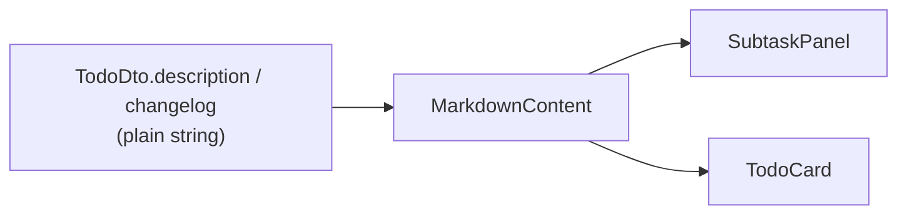

# Todo Description & Changelog Markdown Display - Plan

## Goal Capsule

- **Objective:** Render todo `description` and `changelog` as safe Markdown in the web app instead of plain text, using a shared display component.
- **Authority:** This plan; user confirmed during scoping that changelog is in scope alongside description.
- **Stop conditions:** Block only if a safe markdown renderer cannot be integrated without expanding scope to backend validation or shared-types changes.
- **Execution profile:** Frontend-only in `apps/web`; descriptions remain opaque strings in API/DB.
- **Tail ownership:** Implementer runs verification contract before marking done.

---

## Product Contract

### Summary

Todo descriptions and changelogs stored as plain strings will render as formatted Markdown in the web UI. Operators and agents can use headings, emphasis, lists, links, and code in those fields without backend changes.

### Problem Frame

`SubtaskPanel` and `TodoCard` render `todo.description` (and changelog in the panel) as raw text with `white-space: pre-wrap`. Markdown syntax appears literally — `**bold**`, bullet lists, and links are not formatted. Release-note and changelog content is already assembled as markdown on the backend, but the UI never renders it.

### Requirements

- R1. Todo **description** in `SubtaskPanel` renders as Markdown (headings, bold/italic, lists, links, inline/code blocks, blockquotes).
- R2. Todo **changelog** in `SubtaskPanel` uses the same Markdown renderer as description.
- R3. Todo **description** in `TodoCard` (when `showDescription` is true) uses the same shared renderer.
- R4. Plain text without markdown markers continues to display readably (no visible regression for existing todos).
- R5. Raw HTML embedded in description/changelog is not executed — content must be safe against XSS.
- R6. External links open in a new tab with `rel="noopener noreferrer"`.
- R7. `javascript:` and other dangerous URL schemes in links are blocked.
- R8. No backend, MCP, shared-types, or database migration changes.

### Acceptance Examples

- AE1. **Panel description with markdown**
  - **Given:** A todo whose description is `## Summary\n\n- item one\n- item two`.
  - **When:** User opens the todo in `SubtaskPanel`.
  - **Then:** A heading and bullet list render; raw `#` and `-` syntax is not shown.

- AE2. **Panel changelog with markdown**
  - **Given:** A todo whose changelog contains `**Fixed** login redirect`.
  - **When:** User opens `SubtaskPanel`.
  - **Then:** Changelog shows bold "Fixed" and plain "login redirect".

- AE3. **Plain text unchanged in appearance**
  - **Given:** A todo whose description is `Deploy to staging after QA sign-off.` (no markdown).
  - **When:** User opens `SubtaskPanel`.
  - **Then:** Description reads as a normal sentence; no stray formatting artifacts.

- AE4. **XSS attempt neutralized**
  - **Given:** A description containing `<script>alert(1)</script>` or `[click](javascript:alert(1))`.
  - **When:** Panel renders the description.
  - **Then:** No script executes; dangerous link is not clickable as JavaScript.

### Scope Boundaries

**In scope:** Shared markdown display component, CSS for markdown elements inside existing description containers, wiring in `SubtaskPanel` and `TodoCard`, unit tests for URL/security helpers.

**Out of scope:** Backend markdown validation, MCP tool description updates, release content in `ReleasesView`, markdown editor/preview for authoring, images/tables/task-list checkboxes in v1, changelog generation changes.

#### Deferred to Follow-Up Work

- Markdown rendering for `ReleasesView` release content (currently `<pre>`).
- Rich authoring UI (split editor + preview).
- GFM tables, images, and task-list checkboxes if operators need them later.

---

## Planning Contract

### Key Technical Decisions

- **KTD1 — Library:** Use `react-markdown` with default HTML-skipping behavior (no `rehype-raw`). Matches project need: render markdown as React elements, not `dangerouslySetInnerHTML`. Add `remark-gfm` for autolinks and strikethrough; disable tables via `disallowedElements` since v1 excludes tables.

- **KTD2 — Shared component:** Introduce `MarkdownContent` in `apps/web/src/components/` consumed by `SubtaskPanel` and `TodoCard`. Keeps security config and link behavior in one place.

- **KTD3 — URL safety:** Custom `urlTransform` blocks `javascript:`, `data:`, and `vbscript:` schemes. Custom `a` component sets `target="_blank"` and `rel="noopener noreferrer"` for `http`/`https` links.

- **KTD4 — Styling:** Add `.markdown-content` element styles under existing containers (`.subtask-panel-description-content`, `.todo-description`). Remove `white-space: pre-wrap` from markdown-backed fields; preserve compact card line-clamp on `.todo-description` (description hidden on list/kanban cards today via `COMPACT_TODO_CARD_PROPS`).

- **KTD5 — Testing strategy:** Follow existing web pattern — pure helpers tested with `tsx --test`; no new component test harness. Extract link-scheme guard to `apps/web/src/utils/markdownSecurity.ts` for unit tests.

### Assumptions

- Descriptions and changelogs authored via API/MCP are trusted enough for standard GFM subset; security hardening focuses on XSS vectors, not content moderation.
- Compact card line-clamp with multi-block markdown is acceptable edge behavior because cards currently set `showDescription: false`.

### High-Level Technical Design



Rendering pipeline:

1. String passed as `children` to `MarkdownContent`.
2. `remark-gfm` extends parser (autolinks, strikethrough; tables disallowed).
3. `react-markdown` builds React elements (HTML in source ignored).
4. Custom components override `a` for external link behavior.
5. `urlTransform` rejects dangerous schemes before render.

---

## Implementation Units

### U1. Add markdown dependencies and security helper

**Goal:** Install renderer packages and provide a tested URL-scheme guard.

**Requirements:** R5, R7

**Dependencies:** None

**Files:**
- `apps/web/package.json`
- `apps/web/src/utils/markdownSecurity.ts` (create)
- `apps/web/src/utils/markdownSecurity.test.ts` (create)

**Approach:** Add `react-markdown` and `remark-gfm` to web dependencies. Implement `isAllowedMarkdownUrl(url: string): boolean` and `transformMarkdownUrl(url: string): string` that pass through `http`/`https`/relative paths and reject dangerous schemes (return empty string or `#` for blocked URLs per react-markdown `urlTransform` contract).

**Patterns to follow:** Existing util tests in `apps/web/src/utils/deploymentDisplay.test.ts` — `node:test` + `node:assert/strict`.

**Test scenarios:**
- Happy path: `https://example.com/path` allowed and unchanged.
- Happy path: relative `/docs/page` allowed.
- Edge case: empty string rejected.
- Error path: `javascript:alert(1)` rejected.
- Error path: `data:text/html,...` rejected.
- Error path: `vbscript:...` rejected.

**Verification:** `npm run test -w @todo-platform/web` includes new test file and passes.

---

### U2. Create MarkdownContent component and styles

**Goal:** Shared, safe markdown renderer with project-appropriate styling.

**Requirements:** R1, R2, R3, R4, R5, R6, R7

**Dependencies:** U1

**Files:**
- `apps/web/src/components/MarkdownContent.tsx` (create)
- `apps/web/src/index.css`

**Approach:** Component accepts `children: string` and optional `className`. Configure `ReactMarkdown` with `remarkPlugins={[remarkGfm]}`, `disallowedElements={['table', 'thead', 'tbody', 'tr', 'th', 'td']}`, `urlTransform={transformMarkdownUrl}`, and custom `components.a` for external links. Wrap output in `<div className="markdown-content">`. Add CSS for `h1-h6`, `p`, `ul/ol`, `code/pre`, `blockquote`, `a` using existing CSS variables (`--text`, `--text-muted`, `--border`).

**Patterns to follow:** Presentational components like `CopyableUuid`; global CSS in `index.css` alongside `.subtask-panel-description` rules.

**Test scenarios:**
- Test expectation: none — behavioral proof via U3 integration and manual verification; security helper covered in U1.

**Verification:** Component compiles; markdown sample renders correctly when wired in U3.

---

### U3. Wire MarkdownContent into SubtaskPanel and TodoCard

**Goal:** Replace plain-text description/changelog rendering with shared markdown display.

**Requirements:** R1, R2, R3, R4; Covers AE1, AE2, AE3

**Dependencies:** U2

**Files:**
- `apps/web/src/components/SubtaskPanel.tsx`
- `apps/web/src/components/TodoCard.tsx`
- `apps/web/src/index.css` (adjust `.subtask-panel-description` if wrapper element changes)

**Approach:** In `SubtaskPanel`, replace `<p className="subtask-panel-description">{todo.description}</p>` and changelog equivalent with `<MarkdownContent className="subtask-panel-description">{text}</MarkdownContent>` inside existing `.subtask-panel-description-content` wrappers. In `TodoCard`, replace plain `{todo.description}` with `<MarkdownContent className="todo-description">`. Remove `white-space: pre-wrap` from `.subtask-panel-description` when applied to markdown output.

**Patterns to follow:** Existing conditional rendering for empty description/changelog; `COMPACT_TODO_CARD_PROPS` unchanged (`showDescription: false` on list/kanban).

**Test scenarios:**
- Covers AE1. Description with heading and list renders formatted structure in panel.
- Covers AE2. Changelog with bold renders emphasized text.
- Covers AE3. Plain sentence description renders without markdown artifacts.
- Integration: Kanban/list cards still omit description (no regression from compact props).
- Edge case: null/empty description still shows "No description" empty state.

**Verification:** Manual check in dev — open todo popup with markdown description and changelog; confirm list/kanban cards unchanged.

---

### U4. Security verification for XSS vectors

**Goal:** Confirm dangerous markdown payloads are neutralized in the rendered UI.

**Requirements:** R5, R7; Covers AE4

**Dependencies:** U3

**Files:** (no new files — verification against U1–U3)

**Approach:** Manually or via devtools, render todo with XSS payloads. Confirm U1 tests cover URL schemes; confirm raw HTML in markdown appears escaped/not executed (react-markdown default).

**Test scenarios:**
- Covers AE4. `<script>alert(1)</script>` does not execute.
- Covers AE4. `[x](javascript:alert(1))` link does not invoke JavaScript.
- Edge case: `` in markdown not rendered as live HTML.

**Verification:** AE4 scenarios pass in browser; no console errors from blocked content.

---

## Verification Contract

From repo root:

```bash
npm run build -w @todo-platform/web
npm run lint -w @todo-platform/web
npm run test -w @todo-platform/web
```

Manual: run web dev server, open a todo in `SubtaskPanel` with markdown in description and changelog; spot-check Kanban card does not show description.

---

## Definition of Done

- [ ] U1–U4 complete with cited requirements satisfied
- [ ] All verification contract commands pass
- [ ] AE1–AE4 scenarios verified
- [ ] No backend, shared-types, or MCP changes
- [ ] Product Contract unchanged

---

## System-Wide Impact

**End users / operators:** Richer readable todo detail in popup; no workflow change.

**Developers:** One new dependency pair in web app; reuse `MarkdownContent` for future release-content rendering.

**Operations:** None — display-only change.

---

## Risks & Dependencies

| Risk | Mitigation |
|------|------------|
| XSS via markdown | Default react-markdown HTML skip + URL scheme guard (KTD1, KTD3) |
| Line-clamp breaks with block markdown on cards | Cards hide description today; document edge case in KTD4 |
| remark-gfm enables unwanted tables | `disallowedElements` blocks table tags (KTD1) |
| Bundle size increase | Acceptable for single feature; ~30kb gzipped for react-markdown + remark-gfm |

**Dependencies:** None external to repo. npm install required after U1.

---

## Sources & Research

- `apps/web/src/components/SubtaskPanel.tsx`, `TodoCard.tsx` — current plain-text rendering
- `apps/web/src/components/compactTodoCardProps.ts` — description hidden on list/kanban
- `docs/plans/2026-07-22-001-feat-compact-todo-views-plan.md` — card density decisions
- `docs/plans/2026-07-23-001-feat-todo-changelog-release-plan.md` — changelog as markdown strings, rendering deferred
- [react-markdown security docs](https://github.com/remarkjs/react-markdown) — safe by default without rehype-raw
