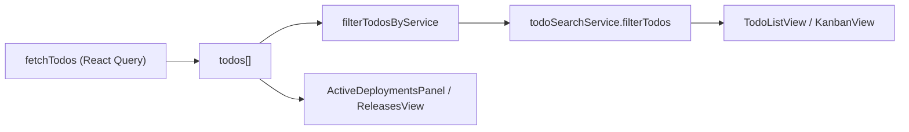

# Todo Search - Plan

## Goal Capsule

- **Objective:** Add immediate, frontend-only search on the todos page that filters list/kanban views by todo title, associated ticket title, or ticket ID, composed with the existing service filter.
- **Authority:** This plan; user confirmed scoping on 2026-07-30 (ticket IDs included, no URL persistence, list/kanban only, case-insensitive substring).
- **Stop conditions:** Block only if introducing a swappable search service conflicts with existing app architecture in a way that requires backend work.
- **Execution profile:** Frontend-only in `apps/web`; no API, MCP, or shared-types changes.
- **Tail ownership:** Implementer runs verification contract before marking done.

---

## Product Contract

### Summary

Operators can type in a search box beside the service filter and see todos narrow instantly. Matching covers todo titles, associated ticket titles, and Jira-style ticket IDs (e.g. `FB-1234`). Search composes with the service filter and does not affect deployments or releases sidebars.

### Problem Frame

The todos header has a service filter but no text search. With many todos, finding one by title or linked ticket requires manual scanning. Search should be client-side for now, with a service boundary so a future backend search can drop in without rewriting the UI.

### Requirements

- R1. A search textbox appears to the **right** of the service filter in the todos header toolbar.
- R2. Filtering runs **on every keystroke** — no submit button, no debounce gate, no "search" action.
- R3. A todo matches when the query is a **case-insensitive substring** of:
  - its **title**, or
  - any **associated ticket title**, or
  - any associated ticket's **ID** extracted from its link (e.g. `FB-1234` from a Jira URL).
- R4. An **empty or whitespace-only** query shows all todos (within the active service filter).
- R5. Search and service filter **compose with AND** — a todo must pass both.
- R6. Search applies only to **list and kanban** todo views; **deployments** and **releases** sidebars continue receiving the full unfiltered todo list.
- R7. Search state is **not** persisted to the URL.
- R8. Filtering is **frontend-only**; no backend search endpoint.
- R9. A **dedicated search service** exposes a simple interface the UI calls; the initial implementation filters in-memory todos locally.

### Acceptance Examples

- AE1. **Title match**
  - **Given:** Todos include one titled `OAuth login flow` and others unrelated.
  - **When:** User types `oauth` in the search box.
  - **Then:** Only `OAuth login flow` (and any other title matches) appear in list/kanban.

- AE2. **Ticket title match**
  - **Given:** A todo titled `Deploy billing` has an associated ticket titled `Payment retry bug`.
  - **When:** User types `retry`.
  - **Then:** That todo remains visible.

- AE3. **Ticket ID match**
  - **Given:** A todo has an associated ticket linked to `https://jira.example.com/browse/FB-1234`.
  - **When:** User types `fb-123`.
  - **Then:** That todo remains visible.

- AE4. **Combined with service filter**
  - **Given:** Service filter is `billing-api`; search query is `auth`.
  - **When:** User types in search.
  - **Then:** Only todos assigned to `billing-api` **and** matching `auth` are shown.

- AE5. **Sidebars unaffected**
  - **Given:** Search hides all todos in list/kanban.
  - **When:** User views the deployments sidebar.
  - **Then:** Deployments still reflect the full fetched todo set, not search-filtered results.

- AE6. **Clear search restores results**
  - **Given:** Search has narrowed the list.
  - **When:** User clears the search input.
  - **Then:** All todos matching the service filter reappear immediately.

### Scope Boundaries

**In scope:** Search input UI, local search service + interface, matching logic (title, ticket title, ticket ID), App.tsx filter pipeline, empty-state copy when search yields no results, unit tests.

**Out of scope:** Backend search API, URL/query-param persistence, search on description/subtasks/PRs/services, debouncing, fuzzy ranking, highlighting matched text, search on non-todos sections.

#### Deferred to Follow-Up Work

- Backend `TodoSearchService` implementation calling a search API with the same interface.
- Search query URL persistence (if shareable filtered views become a product need).
- Match highlighting in todo cards.

---

## Planning Contract

### Key Technical Decisions

- KTD1. **Service interface shape** — `TodoSearchService` exposes `filterTodos(todos: TodoDto[], query: string): TodoDto[]`. The UI holds a module-level default instance (`todoSearchService`) so a future backend adapter swaps one import, not every callsite. *(session-settled: user-directed — chosen over inline `filterTodosBySearch` util only: user explicitly requested a dedicated service boundary for BE replacement.)*
- KTD2. **Ticket ID extraction** — Reuse `extractJiraTicketId` from `apps/web/src/utils/ticketUtils.ts` rather than duplicating Jira URL parsing. Match runs case-insensitive substring against the normalized uppercase ID.
- KTD3. **Filter composition** — Service filter runs first, then search, mirroring how `App.tsx` already uses `useMemo` for `filterTodosByService`. Search receives the service-filtered array.
- KTD4. **No debounce** — User asked for immediate filtering on each keystroke; controlled input + `useMemo` is sufficient at current scale.
- KTD5. **State location** — `searchQuery` lives as React state in `App.tsx` (not URL), consistent with `todoViewMode` local storage pattern but without persistence.

### High-Level Technical Design



Search is a second stage on the service-filtered list. Sidebars read `todos` before either filter stage.

### Assumptions

- In-memory filtering over the full fetched todo list is acceptable until todo counts grow large enough to need server-side search.
- Associated tickets without a parseable Jira ID in `link` are still searchable by **title** only.

---

## Implementation Units

### U1. Search matching primitives

**Goal:** Pure, testable functions that decide whether a single todo matches a query.

**Requirements:** R3, R4

**Dependencies:** None

**Files:**
- `apps/web/src/services/todo-search/matchTodo.ts` (create)
- `apps/web/src/services/todo-search/matchTodo.test.ts` (create)

**Approach:**
- Export `normalizeSearchQuery(query: string): string` — trim + lowercase; empty string means "no filter".
- Export `todoMatchesSearchQuery(todo: TodoDto, normalizedQuery: string): boolean` — return `true` when normalized query is empty; otherwise check title substring, each `associatedTickets[].title` substring, and each ticket's `extractJiraTicketId(link)` substring (case-insensitive).
- Guard `associatedTickets` when undefined/empty.

**Patterns to follow:** `apps/web/src/utils/serviceFilter.ts` (pure filter helpers + colocated tests); `apps/web/src/utils/ticketUtils.ts` for ID extraction.

**Test scenarios:**
- Empty/whitespace query matches every todo.
- Todo title match is case-insensitive (`Auth` matches `oauth auth flow`).
- Ticket title match when todo title does not match.
- Ticket ID match via link (`FB-1234` URL; query `fb-123` matches).
- Ticket with no parseable ID: title still matches; ID-only query does not match.
- Todo with no associated tickets: only title is considered.
- No false positive when query appears in unrelated fields (description is not searched — use a todo with matching description but non-matching title to confirm exclusion is N/A at match layer; integration in U4 covers description not being a search field).

**Verification:** All `matchTodo` tests pass.

---

### U2. Todo search service interface and local implementation

**Goal:** Swappable service boundary the UI will call.

**Requirements:** R8, R9

**Dependencies:** U1

**Files:**
- `apps/web/src/services/todo-search/todoSearchService.ts` (create)
- `apps/web/src/services/todo-search/localTodoSearchService.ts` (create)
- `apps/web/src/services/todo-search/index.ts` (create)
- `apps/web/src/services/todo-search/localTodoSearchService.test.ts` (create)

**Approach:**
- Define `TodoSearchService` interface with `filterTodos(todos: TodoDto[], query: string): TodoDto[]`.
- `localTodoSearchService` implements it by normalizing the query once, returning all todos when empty, otherwise filtering with `todoMatchesSearchQuery`.
- `index.ts` exports the interface, local implementation, and `todoSearchService` default bound to `localTodoSearchService` (future: swap export to a remote adapter).

**Patterns to follow:** Keep the module small — no React imports in the service layer.

**Test scenarios:**
- `filterTodos` with empty query returns the same array contents (order preserved).
- `filterTodos` with query returns only matching todos.
- `filterTodos` with query matching nothing returns `[]`.

**Verification:** Service tests pass; interface is importable from a single `services/todo-search` entry point.

---

### U3. Search input component and toolbar styles

**Goal:** Accessible search textbox placed to the right of the service filter.

**Requirements:** R1, R2

**Dependencies:** None (UI only; wiring in U4)

**Files:**
- `apps/web/src/components/TodoSearchInput.tsx` (create)
- `apps/web/src/index.css` (modify)

**Approach:**
- Controlled component: `value: string`, `onChange: (value: string) => void`, optional `disabled`.
- `type="search"`, `aria-label="Search todos"`, placeholder e.g. `Search todos or tickets…`.
- Style `.todo-search-input` to align height/spacing with `.service-filter-input`; place in `.header-toolbar` flex row after the service filter via parent markup in U4.

**Patterns to follow:** `apps/web/src/components/ServiceFilterCombobox.tsx` input styling in `index.css`.

**Test scenarios:**
- Test expectation: none — presentational component; behavior covered by U1/U2 tests and manual smoke in U4.

**Verification:** Input renders beside service filter with consistent toolbar alignment.

---

### U4. App integration and empty states

**Goal:** Wire search into the todos page filter pipeline without affecting sidebars.

**Requirements:** R2, R4, R5, R6, R7; Covers AE1–AE6.

**Dependencies:** U2, U3

**Files:**
- `apps/web/src/App.tsx` (modify)
- `apps/web/package.json` (modify — register new test files in `test` script)

**Approach:**
- Add `searchQuery` state (`useState('')`).
- Chain filters:
  1. `serviceFilteredTodos = filterTodosByService(todos ?? [], serviceFilter)`
  2. `filteredTodos = todoSearchService.filterTodos(serviceFilteredTodos, searchQuery)`
- Render `<TodoSearchInput>` immediately after `<ServiceFilterCombobox>` in `.header-toolbar`.
- Keep `<ActiveDeploymentsPanel todos={todos ?? []} />` on the unfiltered list.
- Update empty state when `todos.length > 0` but `filteredTodos.length === 0`:
  - If `searchQuery.trim()` is non-empty, message references search (and service filter if not `all`).
  - Else keep existing service-filter empty copy.

**Patterns to follow:** Existing `useMemo` + `serviceFilter` pattern in `App.tsx`.

**Test scenarios:**
- Test expectation: none at component level — filter pipeline logic is proven in U1/U2; manual smoke covers layout and sidebar behavior.

**Verification:**
- Typing in search filters list/kanban immediately.
- Clearing search restores service-filtered set.
- Deployments sidebar unchanged when search hides all list items.
- No `?search=` or similar URL param added.

---

## Verification Contract

From repo root:

```bash
cd apps/web && npm test
cd apps/web && npm run lint
cd apps/web && npm run build
```

All must pass. New test files from U1 and U2 must be listed in `apps/web/package.json` `test` script.

Manual smoke (todos section):

1. Open app with multiple todos across services, some with associated tickets.
2. Confirm search box is right of service filter.
3. Type a todo title fragment — list/kanban narrows on each keystroke.
4. Type a ticket title fragment — parent todo appears.
5. Type a ticket ID fragment (e.g. `FB-123`) — linked todo appears.
6. Set a service filter + search — only todos passing both show.
7. Clear search — results restore.
8. Confirm deployments panel still shows deployments for todos hidden by search.

---

## Definition of Done

- [ ] `TodoSearchInput` visible to the right of the service filter on the todos page.
- [ ] Search filters list/kanban on every keystroke with case-insensitive substring matching on todo title, ticket title, and ticket ID.
- [ ] Search AND-composes with service filter; empty search shows all service-filtered todos.
- [ ] Deployments and releases sidebars use unfiltered todos.
- [ ] `TodoSearchService` interface exists with `localTodoSearchService` as default; no backend changes.
- [ ] Unit tests cover matching and service filtering; `npm test`, `npm run lint`, and `npm run build` pass in `apps/web`.
- [ ] Appropriate empty-state message when search (with or without service filter) yields no todos.

---

## System-Wide Impact

**End users:** Faster todo discovery on the todos page.

**Developers:** `apps/web/src/services/todo-search/` becomes the extension point for backend search; UI imports `todoSearchService` only.

**Operations:** None — no deploy or config changes beyond the web app bundle.

---

## Risks & Dependencies

| Risk | Mitigation |
|------|------------|
| Large todo lists may feel sluggish with per-keystroke filter | Acceptable for v1; service boundary allows moving work server-side later. |
| Tickets without Jira-style links are not searchable by ID | Documented assumption; title search still applies. |
| Duplicate filter logic if search is added elsewhere | Single service module; UI does not reimplement matching. |

**Dependencies:** None — builds on existing `TodoDto.associatedTickets` data already returned by `fetchTodos`.

---

## Sources & Research

- `apps/web/src/App.tsx` — current filter pipeline and toolbar layout.
- `apps/web/src/utils/serviceFilter.ts` — pure filter helper pattern.
- `apps/web/src/utils/ticketUtils.ts` — `extractJiraTicketId` for ID matching.
- `apps/web/src/components/ServiceFilterCombobox.tsx` — toolbar control conventions.
- User scoping confirmation (2026-07-30): ticket IDs in scope, no URL persistence, list/kanban only, case-insensitive substring.

External research: not required — local patterns are sufficient.
