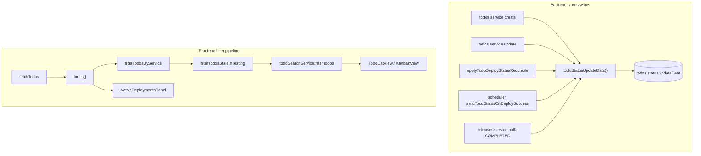

# Stale Testing Filter - Plan

## Goal Capsule

- **Objective:** Add a header switch that filters list/kanban todos to those currently in Testing status for at least 72 rolling hours, using a persisted `statusUpdateDate` field updated on every todo status change.
- **Authority:** This plan; user confirmed scoping on 2026-07-30 (`statusUpdateDate`, rolling 72h, session-only state, switch UI).
- **Stop conditions:** Block only if a status mutation path cannot be found or wired without bypassing `statusUpdateDate` updates.
- **Execution profile:** Backend schema + status-write paths, shared types, frontend filter + switch in `apps/web`.
- **Tail ownership:** Implementer runs verification contract before marking done.

---

## Product Contract

### Summary

Operators can flip a switch in the todos header to surface todos stuck in Testing for three or more days. The filter AND-composes with the service filter and search; sidebars keep the full todo set. Age is computed client-side from `statusUpdateDate`, which the backend maintains whenever todo status changes.

### Problem Frame

Todos can linger in Testing while operators work through other items. The todos page has service and text search filters but no way to highlight aging Testing work. Without a dedicated timestamp, `updatedAt` is a poor proxy because any field edit resets it. A status-scoped date field plus a toolbar switch gives a reliable, low-friction view of stale Testing todos.

### Requirements

- R1. A **switch control** appears in the todos header toolbar (alongside view mode, service filter, and search).
- R2. When the switch is **off** (default), todo list/kanban behavior is unchanged.
- R3. When the switch is **on**, only todos with **`status === TESTING`** and **`now − statusUpdateDate ≥ 72 hours`** (rolling, wall-clock milliseconds) are shown in list/kanban.
- R4. The stale-testing filter **AND-composes** with the service filter and search filter — a todo must pass all three.
- R5. Switch state is **session-only** React state in `App.tsx`; not persisted to URL, localStorage, or backend.
- R6. Deployments sidebar and releases views continue receiving the **full unfiltered** todo list (same as search).
- R7. Backend adds **`statusUpdateDate`** on todos, set to **now** whenever todo **status** changes (create, manual update, deploy-driven sync, release completion).
- R8. `statusUpdateDate` is exposed on **`TodoDto`** as an ISO string.
- R9. Existing todos receive a migration backfill (`statusUpdateDate = updatedAt`) so the filter works immediately after deploy.

### Acceptance Examples

- AE1. **Stale testing todo visible**
  - **Given:** A todo in Testing with `statusUpdateDate` 73 hours ago.
  - **When:** User turns the switch on.
  - **Then:** That todo appears in list/kanban.

- AE2. **Fresh testing todo hidden**
  - **Given:** A todo in Testing with `statusUpdateDate` 24 hours ago.
  - **When:** User turns the switch on.
  - **Then:** That todo is hidden.

- AE3. **Non-testing todo hidden**
  - **Given:** A todo in Wait for Staging with `statusUpdateDate` 5 days ago.
  - **When:** User turns the switch on.
  - **Then:** That todo is hidden.

- AE4. **Composed with service filter and search**
  - **Given:** Switch on; service filter `billing-api`; search query `auth`; one matching todo is stale Testing, another is stale Testing but wrong service.
  - **When:** User views list/kanban.
  - **Then:** Only the todo passing all three filters is shown.

- AE5. **Sidebars unaffected**
  - **Given:** Switch on hides all todos in list/kanban.
  - **When:** User views the deployments sidebar.
  - **Then:** Deployments still reflect the full fetched todo set.

- AE6. **Status change resets age clock**
  - **Given:** A todo re-enters Testing via status update (manual or deploy sync).
  - **When:** Backend persists the change.
  - **Then:** `statusUpdateDate` is refreshed to now; the todo no longer matches until another 72 hours elapse.

- AE7. **Switch off restores full view**
  - **Given:** Switch has narrowed the list.
  - **When:** User turns the switch off.
  - **Then:** All todos matching service filter and search reappear.

### Scope Boundaries

**In scope:** Prisma migration, `statusUpdateDate` write paths, `TodoDto` + mapper, pure frontend filter function + unit tests, switch component + CSS, `App.tsx` filter pipeline and empty-state copy.

**Out of scope:** Subtask status tracking, backend list API filter param, URL persistence, notifications/alerts for stale todos, configurable threshold (hard-coded 72h), MCP tool changes beyond automatic DTO shape.

#### Deferred to Follow-Up Work

- Configurable stale threshold (env or UI setting).
- URL/query-param persistence for shareable filtered views.
- Visual badge on cards showing days in Testing without enabling the filter.

**Outside this product's identity:** Auto-escalation, SLA enforcement, or changing todo status based on age.

---

## Planning Contract

### Key Technical Decisions

- KTD1. **`statusUpdateDate` on every status change, not a Testing-only timestamp.** Updated whenever todo status is written, including create, manual PATCH, deploy reconcile, scheduler sync, and release bulk completion. `(session-settled: user-directed — chosen over testingSince: user wants a general status-change date usable for future filters.)`
- KTD2. **Rolling 72-hour threshold.** `Date.now() − new Date(statusUpdateDate).getTime() >= 72 * 60 * 60 * 1000`. No calendar-day normalization. `(session-settled: user-directed — chosen over calendar days: user specified rolling 72 hours.)`
- KTD3. **Central backend helper for status writes.** Introduce `todoStatusUpdateData(nextStatus)` returning `{ status, statusUpdateDate: new Date() }` in `apps/backend/src/common/todo-status-update.ts`; all todo status mutation paths import it so no path forgets the date. `(session-settled: user-directed — chosen over ad-hoc field sets at each callsite: four distinct mutation paths exist today.)`
- KTD4. **Client-side filter stage.** Pure function `filterTodosStaleInTesting(todos, enabled, nowMs?)` in `apps/web/src/utils/staleTestingFilter.ts`, chained in `App.tsx` after service filter and before search (order among AND-filters is immaterial; match existing pipeline style).
- KTD5. **Switch UI, session-only.** Native `<button role="switch">` with `aria-checked`; no URL sync. `(session-settled: user-directed — chosen over checkbox or URL persistence: user asked for switch button and no persistence.)`
- KTD6. **Migration backfill from `updatedAt`.** Best available proxy for historical todos; acknowledged imprecision for todos whose status and `updatedAt` diverged before this field existed.

### High-Level Technical Design



Filter requires `status === TESTING` **and** age threshold; a todo that left Testing is excluded by status even if `statusUpdateDate` is old.

### Assumptions

- Backfilling `statusUpdateDate` from `updatedAt` is acceptable for pre-migration todos (may misclassify a few edge cases).
- Hard-coded 72h threshold and switch label text are sufficient for v1.
- Todo count stays small enough for client-side age filtering.

---

## Implementation Units

### U1. Schema, shared types, and mapper

**Goal:** Persist and expose `statusUpdateDate` on every todo.

**Requirements:** R7, R8, R9

**Dependencies:** None

**Files:**
- `apps/backend/prisma/schema.prisma`
- `apps/backend/prisma/migrations/<timestamp>_todo_status_update_date/migration.sql`
- `packages/shared-types/src/index.ts`
- `apps/backend/src/common/mappers.ts`
- `apps/web/src/utils/serviceFilter.test.ts` (update `baseTodo` factory if shared pattern)

**Approach:**
- Add `statusUpdateDate DateTime @default(now()) @map("status_update_date")` to `Todo` model.
- Migration: `ADD COLUMN`, then `UPDATE todos SET status_update_date = updated_at`.
- Extend `TodoDto` with `statusUpdateDate: string`.
- Map in `toTodoDto`: `statusUpdateDate: todo.statusUpdateDate.toISOString()`.

**Patterns to follow:** Column add migrations like `apps/backend/prisma/migrations/20260723100000_todo_changelog/migration.sql`; DTO date fields like `createdAt` / `updatedAt` in `TodoDto`.

**Test scenarios:**
- Test expectation: none — schema/mapper covered by integration tests in U2 and frontend tests in U3.

**Verification:**
- `prisma migrate` applies cleanly.
- `toTodoDto` output includes `statusUpdateDate` for list/get responses.

---

### U2. Status mutation paths and backend tests

**Goal:** Every todo status write refreshes `statusUpdateDate`.

**Requirements:** R7, AE6

**Dependencies:** U1

**Files:**
- `apps/backend/src/common/todo-status-update.ts` (new)
- `apps/backend/src/common/todo-status-update.spec.ts` (new)
- `apps/backend/src/todos/todos.service.ts`
- `apps/backend/src/common/apply-todo-deploy-status-reconcile.ts`
- `apps/backend/src/scheduler/scheduler.service.ts`
- `apps/backend/src/releases/releases.service.ts`
- `apps/backend/test/todos.integration-spec.ts` (extend if needed)
- `apps/backend/src/releases/releases.service.spec.ts` (update `updateMany` expectations)
- Test factories/mocks referencing `TodoDto` or Prisma `Todo` shape

**Approach:**
- Export `todoStatusUpdateData(status: TodoStatus): { status: TodoStatus; statusUpdateDate: Date }`.
- **create:** Include `statusUpdateDate: new Date()` in create data (alongside status default or explicit value).
- **update:** When `dto.status` is defined and differs from `previous.status`, merge `todoStatusUpdateData(dto.status)` into the update payload. Non-status field updates must not touch `statusUpdateDate`.
- **apply-todo-deploy-status-reconcile:** Replace `{ status: nextStatus }` with spread of `todoStatusUpdateData(nextStatus)`.
- **scheduler `syncTodoStatusOnDeploySuccess`:** Same replacement before `prisma.todo.update`.
- **releases bulk COMPLETED:** Replace `{ status: 'COMPLETED' }` in `updateMany` with `{ status: 'COMPLETED', statusUpdateDate: new Date() }` (or helper).

**Patterns to follow:** Existing status transition guards in `shouldApplyTodoStatusTransition`; unit spec style in `apps/backend/src/common/todo-deployment-status-sync.spec.ts`.

**Test scenarios:**
- **Happy path:** Helper returns both `status` and `statusUpdateDate`.
- **Integration/manual update:** PATCH todo status from `IN_PROGRESS` to `TESTING` → response `statusUpdateDate` is newer than before.
- **Non-status update:** PATCH title only → `statusUpdateDate` unchanged.
- **Deploy reconcile:** When reconcile advances status, `statusUpdateDate` updates (unit or service-level test if feasible).

**Verification:**
- `npm test` in `apps/backend` passes.
- No remaining raw `{ status: ... }` todo writes outside the helper (grep audit).

---

### U3. Stale-testing filter logic

**Goal:** Pure, testable client filter for the 72h Testing rule.

**Requirements:** R3, R4

**Dependencies:** U1 (DTO field available at runtime)

**Files:**
- `apps/web/src/utils/staleTestingFilter.ts` (new)
- `apps/web/src/utils/staleTestingFilter.test.ts` (new)
- `apps/web/package.json` (add test file to `test` script)

**Approach:**
- Export constants: `STALE_TESTING_THRESHOLD_MS = 72 * 60 * 60 * 1000`.
- Export `isTodoStaleInTesting(todo: TodoDto, nowMs: number): boolean` — true when `todo.status === TodoStatus.TESTING` and age ≥ threshold.
- Export `filterTodosStaleInTesting(todos, enabled, nowMs = Date.now())` — returns input unchanged when `enabled` is false; otherwise filters with `isTodoStaleInTesting`.
- Inject `nowMs` in tests for deterministic boundaries.

**Patterns to follow:** `apps/web/src/utils/serviceFilter.ts` and `serviceFilter.test.ts` (factory `baseTodo`, node:test + assert).

**Test scenarios:**
- **Happy path:** Testing todo with `statusUpdateDate` 73h ago → included when enabled.
- **Edge — exactly 72h:** `statusUpdateDate` exactly 72h ago → included (`>=` threshold).
- **Edge — just under 72h:** 71h 59m ago → excluded.
- **Edge — disabled switch:** enabled false → all todos returned regardless of age/status.
- **Edge — wrong status:** `WAIT_FOR_STAGING` with old `statusUpdateDate` → excluded.
- **Edge — missing statusUpdateDate:** Treat as non-match (defensive; should not occur post-migration).

**Verification:**
- `npm test` in `apps/web` includes new test file and passes.

---

### U4. Switch UI and App integration

**Goal:** Wire switch into header toolbar and filter pipeline; update empty states.

**Requirements:** R1, R2, R5, R6, AE4, AE5, AE7

**Dependencies:** U3

**Files:**
- `apps/web/src/components/StaleTestingSwitch.tsx` (new)
- `apps/web/src/App.tsx`
- `apps/web/src/index.css`

**Approach:**
- **Component:** Controlled switch — props `checked`, `onChange`, `disabled`. Use `<button type="button" role="switch" aria-checked={checked}>` with label e.g. "Testing 3d+". Match dark-theme toolbar styling (surface/border tokens from `:root`).
- **App state:** `const [staleTestingOnly, setStaleTestingOnly] = useState(false)`.
- **Pipeline:** Insert `filterTodosStaleInTesting(serviceFilteredTodos, staleTestingOnly)` before `todoSearchService.filterTodos`.
- **Toolbar:** Render `<StaleTestingSwitch>` after `<TodoSearchInput>`.
- **Empty state:** When `filteredTodos.length === 0` but upstream todos exist, mention stale-testing switch when active (alongside existing search/service messages).
- **Sidebars:** Keep `ActiveDeploymentsPanel todos={todos ?? []}` on unfiltered data.

**Patterns to follow:** Controlled inputs like `TodoSearchInput`; `useMemo` chain in `App.tsx`; sidebar isolation per todo search plan.

**Test scenarios:**
- Test expectation: none at component level — filter logic proven in U3; manual smoke covers switch interaction and sidebar behavior.

**Verification:**
- Switch toggles list/kanban immediately.
- Switch off restores prior view.
- Deployments sidebar unchanged when switch hides all list items.
- No URL param added for this filter.

---

## Verification Contract

From repo root:

```bash
cd apps/backend && npx prisma migrate dev
cd apps/backend && npm test
cd apps/web && npm test
cd apps/web && npm run lint
cd apps/web && npm run build
```

All must pass. New web test file must be listed in `apps/web/package.json` `test` script.

Manual smoke (todos section):

1. Seed or pick a todo in Testing; note `statusUpdateDate` via API or DB.
2. Confirm switch appears in header toolbar after search input.
3. With switch off, all todos (per service/search) visible as before.
4. With switch on, only Testing todos ≥ 72h old appear.
5. Change a visible todo's status away from Testing — it disappears from filtered view on next fetch/ws update.
6. Set service filter + search + switch — only todos passing all three show.
7. Turn switch off — full service/search view restores.
8. Confirm deployments panel still shows deployments for todos hidden by the switch.

---

## Definition of Done

- [ ] `statusUpdateDate` column exists; migration backfills existing rows.
- [ ] All todo status mutation paths update `statusUpdateDate` via shared helper.
- [ ] `TodoDto.statusUpdateDate` returned from list/get APIs.
- [ ] Switch control visible in todos header; default off.
- [ ] Switch on filters to Testing todos with age ≥ 72 rolling hours.
- [ ] Filter AND-composes with service filter and search; switch state is session-only.
- [ ] Deployments sidebar uses unfiltered todos.
- [ ] Unit tests cover filter boundaries and backend helper; verification contract commands pass.

---

## System-Wide Impact

**End users:** Quick visibility into Testing todos that have been idle for three+ days.

**Developers:** `statusUpdateDate` is reusable for future status-age filters; mutation paths centralized in one helper.

**Operations:** Requires running the Prisma migration before/at deploy; no new env vars.

---

## Risks & Dependencies

| Risk | Mitigation |
|------|------------|
| Missed status write path leaves stale `statusUpdateDate` | Grep audit for todo status writes; helper used everywhere; integration test on manual status PATCH. |
| Backfill from `updatedAt` misclassifies old todos | Documented assumption; acceptable for v1; operators can manually bump status to refresh date if needed. |
| `updateMany` on release completion bypasses helper | Explicitly include `statusUpdateDate` in bulk update data. |
| Switch discoverability | Clear label "Testing 3d+"; empty-state copy when filter active. |

**Dependencies:** U2 depends on U1 migration; U3/U4 depend on API returning `statusUpdateDate` (U1).

---

## Sources & Research

- Existing filter pipeline: `apps/web/src/App.tsx`, `apps/web/src/utils/serviceFilter.ts`, `docs/plans/2026-07-30-002-feat-todo-search-plan.md`
- Status mutation paths: `apps/backend/src/todos/todos.service.ts`, `apps/backend/src/common/apply-todo-deploy-status-reconcile.ts`, `apps/backend/src/scheduler/scheduler.service.ts`, `apps/backend/src/releases/releases.service.ts`
- User scoping decisions captured 2026-07-30: `statusUpdateDate`, rolling 72h, no URL persistence, switch UI
