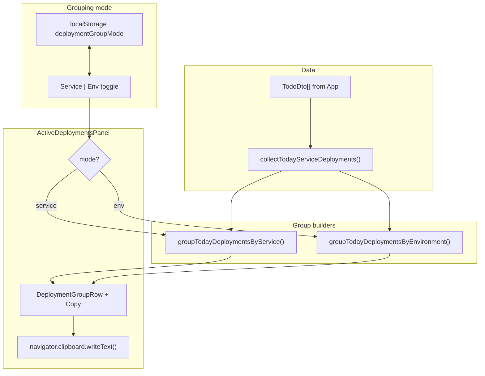

# feat: Deployment sidebar env grouping and group copy

## Goal Capsule

- **Objective:** Extend Today's Deployments sidebar with a Service/Env grouping toggle and a per-group Copy button that copies that group's deployment lines to the clipboard.
- **Authority:** Product Contract; user confirmed one-line-per-deployment copy format and default multiline shape.
- **Stop conditions:** Block only if clipboard APIs are unavailable in target browsers — plan treats graceful no-op as acceptable (same as Releases panel).
- **Execution profile:** Frontend-only change in `apps/web`; no API, schema, or backend work.
- **Tail ownership:** Implementer runs verification contract before marking done.

---

## Product Contract

### Summary

Today's Deployments sidebar currently groups today's deployment activity by service, with environment shown on each chip. Operators also want to see the same data grouped by environment (all services deploying to `uat` together). A segmented toggle switches between the two grouping modes. Each group row gets a Copy control that copies that group's deployment details as plain text — one line per deployment — for pasting into chat or notes.

### Problem Frame

When several services deploy to the same environment, service-centric grouping scatters env context across rows. Env-centric grouping makes it easier to answer "what landed in uat today?" Copying deployment status for a standup or incident thread currently requires manual transcription from multiple chips.

### Requirements

#### Grouping toggle

- R1. Today's Deployments panel exposes a two-option toggle: **Service** (current default) and **Env**.
- R2. **Service mode** preserves current behavior: group header is service name; chips show environment, status, build, duration, and stage.
- R3. **Env mode** inverts the row/chip labels: group header is environment name; chips show service name with the same status/build/duration/stage metadata.
- R4. Env groups sort by canonical environment order (`dev` → `uat` → `uat-main` → `staging` per `DEPLOYED_ENVIRONMENT_ORDER`); within each group, deployments sort newest-first (same `sortKey` rule as today).
- R5. Service groups keep current sort: groups by most recent activity; deployments within a group newest-first.
- R6. The selected grouping mode persists in `localStorage` across visits (same durability expectations as todo list/kanban view mode).
- R7. Toggle uses the existing segmented control visual pattern (`.view-toggle` / `.view-toggle-btn`) for consistency with the todo view switcher.

#### Group copy

- R8. Each deployment group row (service group or env group) shows a **Copy** control in the group header area.
- R9. Clicking Copy writes that group's deployments to the clipboard as plain text, **one line per deployment**, using this field order separated by ` · ` (middle dot):
  `Service · Env · Status · #Build · Duration · Stage · Build URL`
- R10. Omit empty optional segments rather than leaving blank placeholders — e.g. skip Duration when unknown, skip Stage when not in progress, skip Build URL when absent.
- R11. Status labels are human-readable: `in progress`, `success`, `fail` (derived from `DeploymentStatus`).
- R12. After a successful copy, the button briefly shows **Copied!** (same ~1.5s feedback pattern as release content copy).
- R13. Clipboard failures are swallowed silently (no error toast); the button stays on **Copy**.

#### Unchanged behavior

- R14. Panel still reads unfiltered todos from `App.tsx`, shows all statuses from today (not in-progress-only), and keeps live duration ticks for in-progress deployments.
- R15. Empty state, chip link behavior, and responsive sidebar layout remain unchanged.

### Acceptance Examples

- AE1. **Service mode default**
  - **Given:** User opens todo screen with today's deployments.
  - **When:** Panel renders.
  - **Then:** Grouping toggle shows Service selected; rows match current service-grouped layout.

- AE2. **Env mode grouping**
  - **Given:** Billing and Auth both have uat deployments today; Auth has a dev deployment.
  - **When:** User selects Env on the toggle.
  - **Then:** A `uat` group lists Billing and Auth chips; a `dev` group lists Auth chip; group order follows env catalog order.

- AE3. **Copy a service group**
  - **Given:** Service mode; Billing group has uat success #42 with duration and build URL.
  - **When:** User clicks Copy on the Billing group.
  - **Then:** Clipboard contains one line: `Billing · uat · success · #42 · 2m 0s · https://...`.

- AE4. **Copy an env group**
  - **Given:** Env mode; `uat` group contains Billing and Auth deployments.
  - **When:** User clicks Copy on the uat group.
  - **Then:** Clipboard contains two lines (one per deployment), each including service and env.

- AE5. **Persistence**
  - **Given:** User selects Env mode, reloads the page.
  - **When:** Panel renders.
  - **Then:** Env mode is still selected.

### Scope Boundaries

**In scope:** Grouping toggle, env grouping utility, copy text formatter, panel UI/CSS, unit tests for utilities.

**Deferred to Follow-Up Work:** Copy-all button for the entire panel; markdown or Slack-specific copy formats; copying from individual chips; backend changes.

**Outside this product's identity:** Releases panel copy behavior; todo-card deployment chips; service catalog configuration.

---

## Planning Contract

### Key Technical Decisions

- KTD1. **Grouping mode state (session-settled: user-approved — chosen over session-only reset: matches list/kanban persistence pattern):** Store `DeploymentGroupMode` (`'service' | 'env'`) in `localStorage` under `todox.deploymentGroupMode`, with parse/sync helpers mirroring `todoViewMode.ts`.
- KTD2. **Env grouping location:** Add `groupTodayDeploymentsByEnvironment()` alongside existing `groupTodayDeploymentsByService()` in `activeDeployments.ts` — keeps aggregation testable and colocated.
- KTD3. **Shared group row component:** Refactor panel to a generic group row accepting `groupLabel`, `chipLabelField` (`environment` | `serviceLabel`), and `deployments[]` rather than duplicating Service/Env row components.
- KTD4. **Copy formatting location:** Pure `formatDeploymentGroupCopyText(deployments, nowMs)` in `activeDeployments.ts` (or adjacent `deploymentCopy.ts` if the formatter grows) — unit-testable without DOM.
- KTD5. **Copy UI pattern:** Reuse `.release-copy-btn` styling and the ReleasesView copied-state timeout pattern; add a compact header row wrapper (`.deployment-active-row-header`) for label + copy button.
- KTD6. **Toggle placement:** Render toggle inline below the panel title (`Today's Deployments`) so the narrow sidebar column stays readable.

### High-Level Technical Design

### Assumptions

- User confirmed one-line-per-deployment copy format with ` · ` separators (R9).
- Toggle persistence defaults to localStorage (R6); user did not opt out.
- Env group ordering uses `DEPLOYED_ENVIRONMENT_ORDER`; envs with no deployments today are omitted.

---

## Implementation Units

### U1. Env grouping and copy text utilities

**Goal:** Pure helpers for env-centric groups and clipboard-ready plain text.

**Requirements:** R3, R4, R9, R10, R11

**Dependencies:** None

**Files:**
- `apps/web/src/utils/activeDeployments.ts` (modify)
- `apps/web/src/utils/activeDeployments.test.ts` (modify)

**Approach:**
1. Export `EnvDeploymentGroup` type (`environment`, `deployments`, `maxSortKey`).
2. Add `groupTodayDeploymentsByEnvironment(rows)` — bucket by `row.environment`, sort deployments newest-first inside each group, sort groups by `DEPLOYED_ENVIRONMENT_ORDER` index (unknown envs last).
3. Add `formatDeploymentGroupCopyText(deployments, nowMs)` — map each row through status/duration/stage formatters from `deploymentDisplay.ts`; join segments with ` · `; join rows with `\n`.
4. Export a small `deploymentStatusLabel(status)` helper local to the formatter or inline switch for readable status strings.

**Patterns to follow:** Existing `groupTodayDeploymentsByService()` and `deploymentDisplay.ts` duration/step helpers.

**Test scenarios:**
- Env grouping places two services under the same env in one group.
- Env groups sort `dev` before `uat` before `staging` regardless of activity timestamps.
- Deployments within an env group sort newest-first by `sortKey`.
- Copy text for one deployment includes service, env, status, build number, duration, and URL when present.
- Copy text omits duration/stage/URL segments when absent.
- In-progress deployment with `currentStep` includes stage segment.
- Multiple deployments produce multiple newline-separated lines.

**Verification:** `npm run test --workspace=@todo-platform/web` passes including updated tests.

---

### U2. Grouping mode persistence

**Goal:** Read/write Service vs Env toggle preference from localStorage.

**Requirements:** R1, R6, AE5

**Dependencies:** None

**Files:**
- `apps/web/src/utils/deploymentGroupMode.ts` (create)
- `apps/web/src/utils/deploymentGroupMode.test.ts` (create)
- `apps/web/package.json` (modify — add new test file to the `test` script)

**Approach:**
1. Define `DeploymentGroupMode = 'service' | 'env'`.
2. Implement `parseDeploymentGroupMode`, `readDeploymentGroupModeFromStorage`, `syncDeploymentGroupModeToStorage` mirroring `todoViewMode.ts` error handling.
3. Default to `'service'` when storage missing or invalid.
4. Register `deploymentGroupMode.test.ts` in the web workspace `test` script (same explicit list pattern as `todoViewMode.test.ts`).

**Patterns to follow:** `apps/web/src/utils/todoViewMode.ts`, `apps/web/src/utils/todoViewMode.test.ts`.

**Test scenarios:**
- Invalid storage value defaults to `service`.
- `env` round-trips through parse/sync helpers.
- Storage errors return default without throwing.

**Verification:** New test file passes under web workspace test script.

---

### U3. Panel toggle, generic group rows, and copy buttons

**Goal:** Wire grouping mode UI, env/service rendering, and per-group clipboard copy.

**Requirements:** R2, R3, R5, R7, R8, R12, R13, R14, AE1, AE2, AE3, AE4

**Dependencies:** U1, U2

**Files:**
- `apps/web/src/components/ActiveDeploymentsPanel.tsx` (modify)

**Approach:**
1. Initialize grouping mode from `readDeploymentGroupModeFromStorage()`; on toggle change, update state and call `syncDeploymentGroupModeToStorage`.
2. Render segmented toggle below panel title with `role="group"` and `aria-label="Deployment grouping"`.
3. `useMemo` collects rows once, then branches to service or env group builder based on mode.
4. Replace `ServiceDeploymentRow` with `DeploymentGroupRow` accepting `groupLabel`, `getChipPrimaryLabel(deployment)`, `deployments`, `nowMs`.
   - Service mode: `groupLabel = serviceLabel`, chip primary = `environment`.
   - Env mode: `groupLabel = environment`, chip primary = `serviceLabel`.
5. Add Copy button in group header; on click call `formatDeploymentGroupCopyText` and `navigator.clipboard.writeText`; track per-row copied state with timeout (key copy state by group id — `serviceKey` or `environment`).
6. Keep `DeploymentChip` but parameterize the primary label field (today hard-coded to `environment`).

**Patterns to follow:** `App.tsx` view toggle, `ReleasesView.tsx` copy handler, existing chip rendering in `ActiveDeploymentsPanel.tsx`.

**Test scenarios:**
- Test expectation: none — component behavior covered by utility tests plus manual smoke; no component test runner today.

**Verification:** Manual smoke — toggle switches grouping; copy produces expected clipboard text; Copied! feedback appears.

---

### U4. Panel header and copy button styling

**Goal:** Layout toggle and group-header copy control in the narrow sidebar column.

**Requirements:** R7, R8

**Dependencies:** U3

**Files:**
- `apps/web/src/index.css` (modify)

**Approach:**
1. Add `.deployments-panel-header` flex row for title + optional spacing; stack title and toggle vertically if width is tight.
2. Add `.deployments-panel-toggle` wrapper reusing `.view-toggle` with smaller font/padding if needed for sidebar width.
3. Add `.deployment-active-row-header` — flex row with group label and copy button aligned (`space-between`).
4. Reuse `.release-copy-btn` for copy control; optionally alias as `.deployment-group-copy-btn` if shared selectors become awkward.

**Execution note:** Prefer runtime smoke verification over unit coverage for CSS.

**Patterns to follow:** `.view-toggle`, `.release-copy-btn`, `.deployment-active-row`.

**Test scenarios:**
- Test expectation: none — visual/responsive smoke only.

**Verification:** Toggle and copy buttons fit within `.app-deployments` without horizontal overflow at desktop and stacked mobile widths.

---

## Verification Contract

| Gate | Command / action | Applies to |
|------|------------------|------------|
| Unit tests | `npm run test --workspace=@todo-platform/web` | U1, U2 |
| Typecheck + build | `npm run build --workspace=@todo-platform/web` | All units |
| Lint | `npm run lint --workspace=@todo-platform/web` | All units |
| Manual — service default | Panel opens in Service mode with unchanged row layout | U3 |
| Manual — env toggle | Env mode groups by environment; chips show service names | U3, AE2 |
| Manual — copy service group | Copy on service group produces one line per deployment with confirmed format | U3, AE3 |
| Manual — copy env group | Copy on env group includes service on each line | U3, AE4 |
| Manual — persistence | Reload preserves Env selection | U2, U3, AE5 |
| Manual — regression | Chip links, empty state, live duration tick unchanged | U3 |

---

## Definition of Done

- Today's Deployments panel has a Service/Env toggle defaulting to Service.
- Env mode groups deployments by environment with service names on chips.
- Each group row has a Copy button that writes one line per deployment in the confirmed format.
- Grouping preference persists across page reloads via localStorage.
- Utility tests cover env grouping and copy formatting; web test/build/lint pass.
- No backend or shared-types changes.

---

## Appendix

### Sources & Research

- Current panel and service grouping: `apps/web/src/components/ActiveDeploymentsPanel.tsx`
- Aggregation utilities: `apps/web/src/utils/activeDeployments.ts`
- Env catalog order: `packages/shared-types/src/index.ts` (`DEPLOYED_ENVIRONMENT_ORDER`)
- Toggle persistence pattern: `apps/web/src/utils/todoViewMode.ts`
- Segmented toggle UI: `apps/web/src/App.tsx`, `apps/web/src/index.css` (`.view-toggle`)
- Copy button pattern: `apps/web/src/components/ReleasesView.tsx`, `.release-copy-btn` in `index.css`
- Duration/step formatting: `apps/web/src/utils/deploymentDisplay.ts`
- Original sidebar plan: `docs/plans/2026-07-24-001-feat-todo-deployments-sidebar-plan.md`
- User scoping confirmation: one-line-per-deployment copy format; localStorage persistence; env order by catalog
