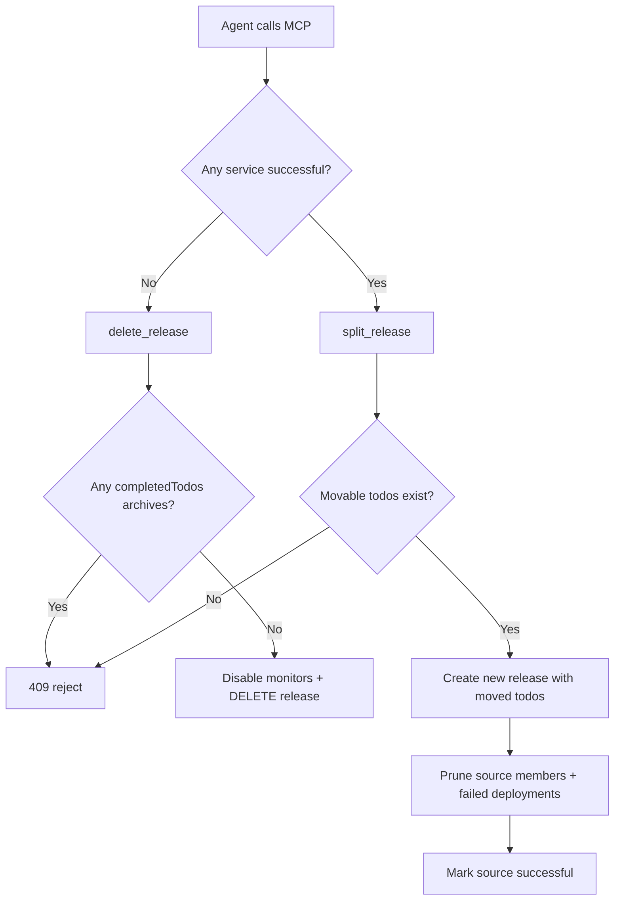

# feat: Delete and split in-progress releases

## Goal Capsule

- **Objective:** Give coding agents MCP tools to abandon a non-successful in-progress release (`delete_release`) or peel remaining work off a partially successful release (`split_release`) so they can recreate a release with an updated todo set.
- **Authority:** Product Contract overrides defaults; existing release membership, deployment monitoring, and success side-effect rules from `docs/plans/2026-07-20-006-feat-release-generation-plan.md` remain the baseline unless this plan explicitly changes them.
- **Stop conditions:** Block on ambiguous service-outcome classification, prod archived members, or failing backend verification gates — not on web UI parity.
- **Execution profile:** Standard backend + shared packages + MCP surface; no schema migration expected.

---

## Product Contract

### Summary

Agents sometimes create a release before every eligible todo is ready. Today, once deployments are attached, membership cannot change and `cancel_release` only works when no deployments exist. This plan adds two complementary escape hatches: hard delete when no service has succeeded yet, and split when some services already succeeded but others have not.

### Problem Frame

After `create_release`, agents cannot append todos once Jenkins deployments are attached. The existing `cancel_release` MCP tool maps to `DELETE /releases/:id`, but the backend rejects cancellation when `deployments.length > 0`. That leaves agents stuck: they must either finish the release as-is or manually repair state outside the platform. The desired workflow is delete-and-recreate when nothing succeeded, or split remaining todos into a fresh release when some services already shipped.

### Requirements

- R1. **`delete_release` eligibility:** A non-terminal release may be deleted only when **no member service** has a successful outcome (per service-outcome resolution below) and the release has **no `completedTodos` archives**. Terminal whole-release status `successful` is always rejected.
- R2. **`delete_release` effects:** Unschedule/disable all release-scoped monitors (deployment monitors + discovery), delete the release row (cascade members/deployments), and broadcast updates so freed todos become eligible for a new release via `availableForRelease`.
- R3. **`split_release` eligibility:** Allowed when at least one member service has a successful outcome **and** at least one member todo belongs to a non-successful service. Rejected when no service succeeded yet (use delete) or when no movable todos remain.
- R4. **`split_release` effects:** Create a new release of the same `type` with selected movable todos; remove those todos from the source release; drop non-successful deployment rows (and disable their monitors) from the source; refresh assembled content on both releases; mark the source release `successful` via the existing manual-success path so completed/archived successful-service todos stay final.
- R5. **Service-outcome source of truth:** Classify each distinct member service using the same merged logic as release aggregation (`resolveServiceOutcomes` in `apps/backend/src/common/release-deployment-status-sync.ts`) — Jenkins deployment status plus staging todo `COMPLETED` / prod archive signals — not deployment row count alone.
- R6. **MCP surface:** Expose `delete_release` and `split_release` as primitive MCP tools. Keep `cancel_release` as a backward-compatible alias for `delete_release` with an updated description.
- R7. **REST parity:** `DELETE /releases/:id` implements delete rules; add `POST /releases/:id/split` for split. Shared API client mirrors both.
- R8. **Prod safety:** `delete_release` rejects when any `completedTodos` archive exists on the release. `split_release` may run when archives represent already-successful services only; it must not delete or restore archived rows (no restore API in scope).

### Actors

- A1. Coding agent — primary caller via MCP.
- A2. Human operator — may call REST directly; web UI buttons remain out of scope.

### Key Flows

- F1. **Delete-and-recreate:** Agent creates staging release with deployments attached; all services still pending/failed → `delete_release` → todos free → `create_release` with expanded `todoIds`.
- F2. **Split remaining work:** Agent creates release; service A succeeds, service B still pending → `split_release` moves B's todos to a new release → source marked `successful` with A's completed todos → agent adds more todos to the new release and deploys B separately.

### Acceptance Examples

- AE1. Staging release with two services, deployments attached, none successful → `delete_release` succeeds; both todos appear in `list_todos?availableForRelease=true`.
- AE2. Same release after service A succeeds → `delete_release` returns conflict; `split_release` creates a new release containing service B todos only; source release status becomes `successful`.
- AE3. Prod release with any archived member → `delete_release` rejected; `split_release` still allowed when active movable todos remain on non-successful services.
- AE4. `cancel_release` MCP call behaves identically to `delete_release` for eligible releases.

### Scope Boundaries

**In scope:** Backend delete/split service methods, REST routes, shared-types/shared-api DTOs, MCP tool registration, unit + integration tests, README MCP table updates.

**Deferred for later:** Web UI delete/split buttons; restoring prod-archived todos; allowing membership edits on an existing release without split; auto-attaching deployments on the split-created release.

**Outside this product's identity:** Force-unarchive prod todos; deleting terminal successful releases.

### Success Criteria

- Agents can abandon a zero-success release even after deployments were attached.
- Agents can move undeployed-service todos to a new release after partial success without manual DB repair.
- Eligibility rules prevent deleting or splitting releases that would orphan prod archives or undo successful service outcomes.

---

## Planning Contract

### Key Technical Decisions

- KTD1. **Two tools, one delete endpoint.** `delete_release` is the primary MCP name; `cancel_release` remains an alias calling the same backend delete. Avoid a second HTTP verb.
- KTD2. **Delete gate = zero successful services.** (session-settled: user-directed — chosen over status rollback on delete: user confirmed successful deployments make delete illegal; split handles that case instead.)
- KTD3. **Split uses manual success on source.** Reuse `applyManualStatus(SUCCESSFUL)` after membership surgery so successful-service todos retain COMPLETED/archive side effects and monitors disable consistently.
- KTD4. **Movable todo default.** When `todoIds` omitted on split, move all member todos whose `serviceId` maps to a non-successful service outcome. Explicit `todoIds` must be a subset of that movable set.
- KTD5. **No todo status rollback on delete.** Because delete is only allowed before any service succeeds, member todos should still satisfy create eligibility (`WAIT_FOR_STAGING` / `COMPLETED`) without reversal logic.
- KTD6. **Extract shared eligibility helper.** Add a package-local helper (e.g. `classifyReleaseServiceOutcomes(release)`) in the releases module or `common/` to keep delete/split/aggregation aligned.

### High-Level Technical Design



### Assumptions

- Release records created by agents follow the current pattern: members stored in `ReleaseMember`, deployments optional at create or via `update_release`.
- Agents will call `list_releases` / `get_release` to inspect per-service deployment status before choosing delete vs split.

### Risks and Dependencies

- **Risk:** Split removes deployment rows for non-successful services while Jenkins jobs may still be running. *Mitigation:* disable/unschedule monitors before deleting deployment rows; document that agents should not split while unsure of in-flight builds.
- **Risk:** Manual success after split could re-trigger completion for todos already COMPLETED. *Mitigation:* rely on existing idempotent completion/archive helpers; add unit coverage.
- **Dependency:** Existing `disableMonitorsForRelease`, `applyManualStatus`, `mergeReleaseContent` / `assembleTodoChangelogSection`, and `loadAndValidateTodos`.

---

## Implementation Units

### U1. Service outcome classification helper

**Goal:** Centralize per-service success classification for delete/split gates.

**Requirements:** R5

**Dependencies:** None

**Files:**
- `apps/backend/src/common/release-service-outcomes.ts` (create)
- `apps/backend/src/common/release-service-outcomes.spec.ts` (create)

**Approach:**
1. Export a function that accepts a release-shaped payload (members with todos + service, deployments, completedTodos, type) and returns `{ successfulServiceIds, nonSuccessfulServiceIds, movableTodoIds }` using `resolveServiceOutcomes`.
2. Treat a service as successful when its resolved outcome is `successful`.
3. Movable todos = active members whose `todo.serviceId` is in `nonSuccessfulServiceIds`.

**Patterns to follow:** `apps/backend/src/common/release-deployment-status-sync.ts` (`resolveServiceOutcomes`, `aggregateReleaseStatus`).

**Test scenarios:**
- Staging release: service A deployment successful, service B pending → A successful, B movable.
- Staging release: service A todos all COMPLETED but deployment still running → A successful via todo signal.
- Prod release: service A archived in `completedTodos`, service B active → A successful, B movable.
- No deployments anywhere, all todos still WAIT_FOR_STAGING → all services non-successful, all todos movable.
- All services successful → movable set empty.

**Verification:** Unit tests pass; helper imported by service layer without circular deps.

---

### U2. Extend release deletion in ReleasesService

**Goal:** Allow deleting in-progress releases that have deployments but zero successful services.

**Requirements:** R1, R2, R5, R8

**Dependencies:** U1

**Files:**
- `apps/backend/src/releases/releases.service.ts` (modify)
- `apps/backend/src/releases/releases.service.spec.ts` (modify)

**Approach:**
1. Replace the `existing.deployments.length > 0` guard in `cancel()` with U1 outcome check: reject if any successful service or any `completedTodos` row.
2. Reject terminal `successful` / unchanged rules for `failed`? — allow delete on `failed` when no service succeeded (edge case: all failed); reject `successful`.
3. Before delete: call `disableMonitorsForRelease(id)`.
4. Keep cascade delete + `broadcastTodosUpdated` for member todo IDs.

**Execution note:** Add characterization tests around current cancel behavior first, then widen eligibility.

**Patterns to follow:** Existing `cancel()` at `apps/backend/src/releases/releases.service.ts`; `disableMonitorsForRelease`.

**Test scenarios:**
- Happy path: in_progress release, deployments present, none successful → deletes release and broadcasts member todo updates.
- Conflict: any successful service → `ConflictException` with message directing agent to `split_release`.
- Conflict: prod `completedTodos` present → rejected even if no deployment success.
- Conflict: release status `successful` → rejected.
- Regression: release with no deployments still deletes (current behavior).

**Verification:** `ReleasesService` unit tests green.

---

### U3. Implement split release in ReleasesService

**Goal:** Move non-successful-service todos to a new release and finalize the source release.

**Requirements:** R3, R4, R5, R8

**Dependencies:** U1, U2

**Files:**
- `apps/backend/src/releases/releases.service.ts` (modify)
- `apps/backend/src/releases/releases.service.spec.ts` (modify)

**Approach:**
1. Add `split(id, dto)` method.
2. Load release; run U1 classifier; reject if zero successful services or zero movable todos. Reject delete (not split) when `completedTodos.length > 0`.
3. Resolve `todoIds` = dto.todoIds ?? movableTodoIds; validate subset.
4. Transaction: create new release (`in_progress`, same `type`, dto.releaseDate/content merged with changelog section for moved todos only); remove split members from source; delete source deployment rows for non-successful services; refresh both release contents.
5. After transaction: disable monitors for removed deployments; call `applyManualStatus(sourceId, SUCCESSFUL)`; broadcast create/update events.

**Technical design:** Split is not atomic with optional deploy on the new release — new release starts without deployments so agents can append more todos via a follow-up create pattern (still blocked today post-deploy — new release has no deploys yet, so `update_release` append works until deployments attach).

**Patterns to follow:** `create()`, `update()` membership/content merge, `applyManualStatus`.

**Test scenarios:**
- Happy path partial_success staging: moves only non-successful-service todos; source becomes `successful`; new release has moved members only.
- Explicit `todoIds` subset of movable set succeeds; superset rejected.
- No successful services → rejected (use delete).
- All services successful → rejected (nothing to split).
- Source manual success disables discovery/deployment monitors (mock `disableMonitorsForRelease` / monitor service calls).
- Prod: successful service archived, remaining active todo on failed service → split allowed; archived rows untouched.

**Verification:** Unit tests cover split branching and error messages.

---

### U4. REST, DTOs, and shared API client

**Goal:** Expose delete and split through HTTP and `TodoApiClient`.

**Requirements:** R7

**Dependencies:** U2, U3

**Files:**
- `apps/backend/src/common/release.dto.ts` (modify — add `SplitReleaseBody`)
- `apps/backend/src/releases/releases.controller.ts` (modify — add split route, update delete swagger text)
- `packages/shared-types/src/index.ts` (modify — add `SplitReleaseDto`)
- `packages/shared-api/src/index.ts` (modify — add `splitRelease`, optionally alias method name)

**Approach:**
1. `SplitReleaseBody`: required `releaseDate`, `content`; optional `todoIds` array.
2. `POST /releases/:id/split` → `releasesService.split`.
3. Update DELETE swagger summary to describe widened delete eligibility.
4. `splitRelease(id, data)` POST helper in shared API.

**Test scenarios:**
- Test expectation: none — wiring-only unit; behavior covered in service/integration tests.

**Verification:** Typecheck across workspaces; controller compiles.

---

### U5. MCP tools and documentation

**Goal:** Register agent-facing tools with accurate schemas and descriptions.

**Requirements:** R6

**Dependencies:** U4

**Files:**
- `apps/mcp-server/src/releases.ts` (modify — add `splitReleaseSchema`)
- `apps/mcp-server/src/index.ts` (modify — register tools + handlers)
- `README.md` (modify — MCP tools table)

**Approach:**
1. Add `delete_release` tool (same schema as `releaseIdParamSchema`) calling `api.cancelRelease`.
2. Update `cancel_release` description to note it is an alias for `delete_release` and document eligibility (no successful services).
3. Add `split_release` tool with `{ id, releaseDate, content, todoIds? }` calling `api.splitRelease`.
4. Document decision guide in descriptions: "If any service deployed successfully, use split_release; otherwise delete_release."

**Patterns to follow:** Existing release tools in `apps/mcp-server/src/index.ts`.

**Test scenarios:**
- Test expectation: none — MCP server has no automated tests today; manual smoke via MCP host optional.

**Verification:** MCP server builds; tool list includes new entries.

---

### U6. Integration tests

**Goal:** Prove delete and split eligibility end-to-end against real Prisma.

**Requirements:** R1–R4, AE1–AE3

**Dependencies:** U2, U3, U4

**Files:**
- `apps/backend/test/releases.integration-spec.ts` (modify)

**Approach:**
1. Seed eligible todos across two services; create release with deployments; assert delete succeeds before any success.
2. Simulate service A success (update deployment status + todo COMPLETED); assert delete fails and split succeeds creating second release.
3. Assert `availableForRelease` filter frees todos after delete.

**Patterns to follow:** Existing integration spec setup with scheduler mocked.

**Test scenarios:**
- Covers AE1 and AE2 at HTTP level.
- Prod archive rejection (AE3) if feasible without heavy setup — otherwise defer to unit tests with mocked `completedTodos`.

**Verification:** `npm run test:integration --workspace=@todo-platform/backend` passes for releases spec.

---

## Verification Contract

```bash
# Unit tests (releases service + new helper)
npm run test --workspace=@todo-platform/backend -- releases.service.spec.ts release-service-outcomes.spec.ts

# Integration tests
npm run test:integration --workspace=@todo-platform/backend -- releases.integration-spec.ts

# Monorepo build / typecheck
npm run build
```

Quality gates: no new lint errors in touched files; error messages mention split vs delete when rejecting illegal delete.

---

## Definition of Done

- [ ] Delete allowed for in-progress releases with deployments when no service succeeded; rejected once any service succeeds or any prod archive exists.
- [ ] Split moves non-successful-service todos to a new release and marks source `successful`.
- [ ] MCP exposes `delete_release`, `split_release`, and backward-compatible `cancel_release`.
- [ ] REST + shared-api parity implemented.
- [ ] Unit and integration tests listed above pass.
- [ ] README MCP table documents both tools and the delete-vs-split decision rule.

---

## Open Questions

- **Deferred:** Should split optionally accept `todoIdsToAdd` for brand-new todos in the same call? Default no — agent creates/updates the new release in a second step after split returns the new ID.
- **Deferred:** Web UI affordances for delete/split.
